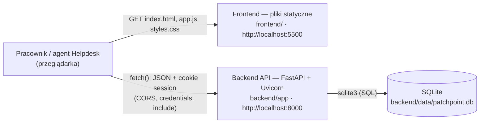
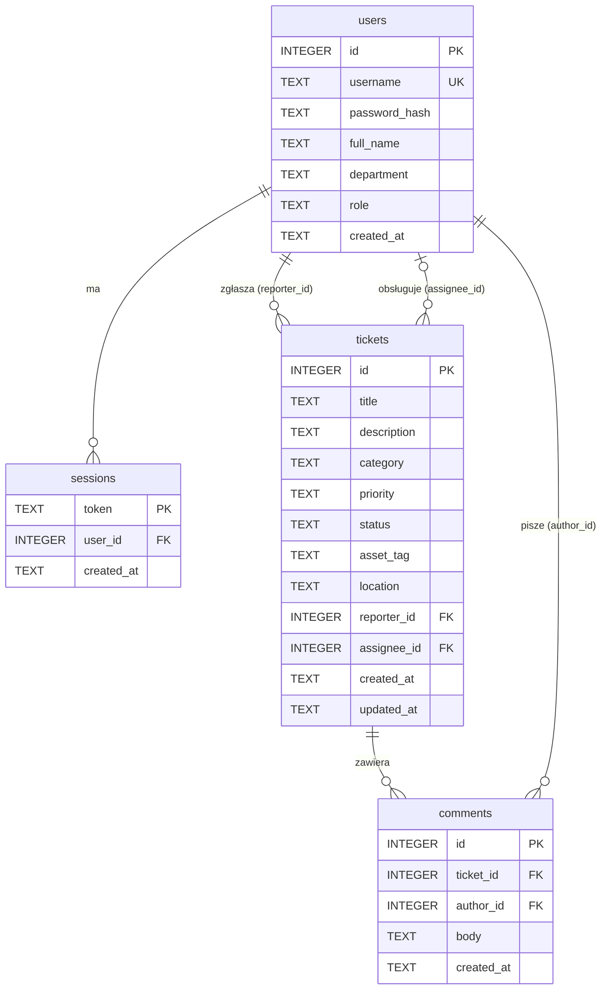
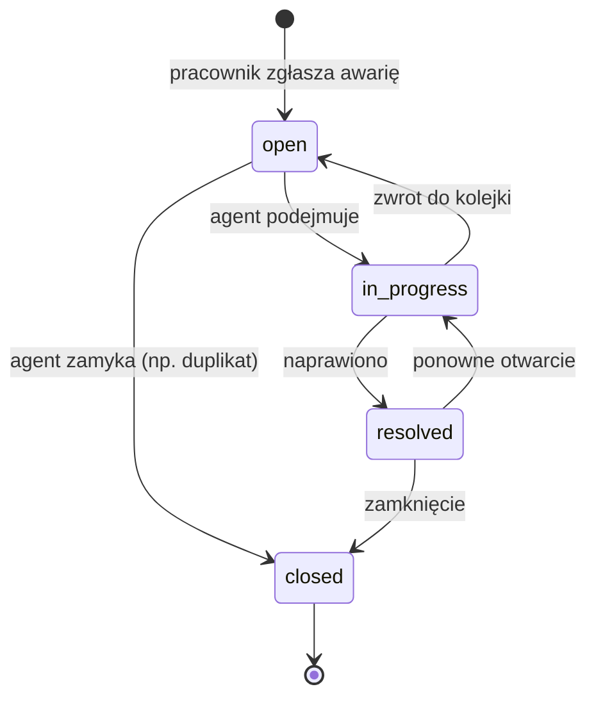
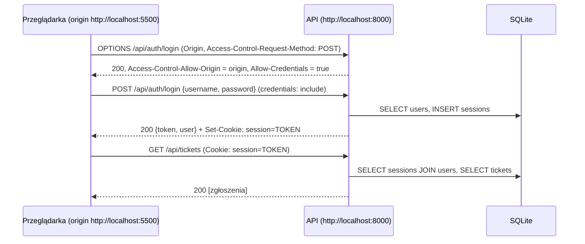

# Raport z Fazy 1 (DEV) — PatchPoint

Dokument opisuje wynik Fazy 1 projektu „AI-Driven DevSecOps” (Scenariusz 5: Menadżer Zadań IT): działający, celowo uproszczony system zgłaszania awarii sprzętu do działu Helpdesk, wygenerowany z pomocą AI. Powiązane dokumenty: [dziennik promptów](prompty.md), [rejestr słabości](rejestr-slabosci.md), [dowody uruchomienia](dowody/README.md).

## 1. Cel fazy

Punkty „Faza 1: DEV” z instrukcji kursu:

> - Wykorzystajcie wybrane narzędzie AI (np. ChatGPT, Gemini, Claude), aby wygenerować działający kod backendu (np. w Python/FastAPI, Node.js/Express lub PHP) dla Waszego scenariusza.
> - Zadbajcie o to, aby aplikacja realizowała podstawową logikę biznesową i posiadała komunikację z bazą danych (np. SQLite dla uproszczenia testów).
> - Celowo poproście AI o szybki kod (Draft/MVP), aby pozostawić przestrzeń na luki bezpieczeństwa. Udowodnijcie, że kod się uruchamia i realizuje swoje funkcje.

| Wymaganie | Realizacja | Dowód |
|---|---|---|
| Generowanie kodu z AI | Plan i kod powstały z udziałem Claude (Anthropic) w harnessie omp; zadania realizowali agenci wtyczki delivery | [`prompty.md`](prompty.md) |
| Logika biznesowa i komunikacja z SQLite | Zgłoszenia, przepływ statusów, komentarze, role, sesje; surowy `sqlite3`, baza w pliku `backend/data/patchpoint.db` | [`dowody/testy.txt`](dowody/testy.txt), [`dowody/demo.txt`](dowody/demo.txt) |
| Celowy Draft/MVP | 18 świadomie pozostawionych słabości W-01…W-18 | [`rejestr-slabosci.md`](rejestr-slabosci.md) |
| Dowód uruchomienia | Wyniki `make lint`, `make typecheck`, `make test`, `make demo` oraz kontrakt OpenAPI | [`dowody/`](dowody/README.md) |

## 2. Scenariusz 5 i wektory ataku

Scenariusz: system wsparcia technicznego do zgłaszania awarii sprzętowych przez pracowników do działu Helpdesk. Wektory wskazane jako cel analizy w Fazie 2 i elementy MVP, których dotyczą:

| Wektor | Elementy MVP | Pozycje rejestru |
|---|---|---|
| Information Disclosure (nadmiernie gadatliwe błędy ujawniające architekturę bazy danych) | handler błędów bazy zwracający SQL, ścieżkę pliku i traceback; surowe komunikaty ograniczeń SQLite przy rejestracji; tryb `debug=True` i publiczna dokumentacja API; `/api/health` z ujawnioną ścieżką i wersjami; różne odpowiedzi dla nieistniejącego loginu i złego hasła; `password_hash` w odpowiedziach; SQL składany z danych wejściowych w wyszukiwaniu; brak sprawdzania właściciela zgłoszenia | W-01, W-02, W-03, W-04, W-05, W-06, W-14, W-16 |
| Broken Authentication (słabe zarządzanie sesją) | hasła MD5 bez soli; przewidywalny token sesji; sesje bez wygasania; wylogowanie tylko po stronie cookie; cookie bez `HttpOnly`/`Secure`; konta domyślne i brak polityki haseł; nadawanie sobie roli przy rejestracji; XSS pozwalający odczytać cookie | W-05, W-07, W-08, W-09, W-10, W-11, W-12, W-15, W-17 |
| Bezpieczna konfiguracja CORS przy rozdzieleniu frontend/backend | `allow_origins=["*"]` razem z `allow_credentials=True` | W-13 |

Dodatkowo W-18 (brak logowania zdarzeń bezpieczeństwa) utrudnia wykrywanie ataków na wszystkie wektory.

## 3. Metoda pracy z AI

Całość powstała w trybie „plan, potem realizacja”. W trybie planowania AI przeanalizowało repozytorium i środowisko, zweryfikowało wersje pakietów w PyPI oraz zachowanie CORS w Starlette, zadało pytania doprecyzowujące i przygotowało plan, który przejrzał model doradczy. Instrukcję „Draft/MVP” przełożono na jawne wymagania W-xx w planie oraz zakaz komentarzy zdradzających słabości w kodzie. Pięć zadań wykonali kolejno agenci wtyczki delivery, a wynik każdego przeglądał osobny agent-recenzent przed commitem. Pełny dziennik promptów, pytań i odpowiedzi oraz mapa zadanie → agent → commit znajdują się w [`prompty.md`](prompty.md).

## 4. Architektura logiczna



| Komponent | Katalog | Technologia | Adres / lokalizacja | Uruchomienie |
|---|---|---|---|---|
| Frontend | `frontend/` | statyczny HTML, CSS i JavaScript bez bundlera i frameworków; serwowany przez `python3 -m http.server` | `http://localhost:5500` (nasłuch na `127.0.0.1`) | `make frontend` |
| Backend API | `backend/app/` | Python, FastAPI, Uvicorn, surowy `sqlite3`, `pydantic-settings` | `http://localhost:8000` (nasłuch na `127.0.0.1`), dokumentacja Swagger pod `/docs` | `make run` |
| Baza danych | `backend/data/` (ignorowany przez git) | SQLite, plik `patchpoint.db` tworzony przy starcie z `backend/app/schema.sql` | ścieżka z `PATCHPOINT_DATABASE_PATH` | automatycznie przy starcie API |

Frontend i backend działają na różnych originach (różne porty), dlatego komunikacja wymaga CORS (sekcja 10). UI należy otwierać przez `localhost`, a nie `127.0.0.1`: wtedy cookie ustawione przez `localhost:8000` jest same-site i przy `SameSite=lax` trafia do żądań `fetch`.

## 5. Stos technologiczny

Wersje odczytane z `backend/uv.lock`.

| Pakiet | Wersja | Zastosowanie |
|---|---|---|
| fastapi | 0.163.1 | framework API |
| starlette | 1.10.0 | warstwa HTTP, CORS (zależność FastAPI) |
| pydantic | 2.14.3 | walidacja i schematy |
| pydantic-settings | 2.16.3 | konfiguracja ze zmiennych środowiskowych (`PATCHPOINT_*`) |
| uvicorn | 0.54.0 | serwer ASGI |
| pytest (dev) | 9.2.0 | testy |
| pytest-cov (dev) | 7.1.0 | pokrycie kodu (próg 80%) |
| httpx2 (dev) | 2.16.0 | klient HTTP dla `TestClient` |
| mypy (dev) | 2.4.1 | kontrola typów (`strict`) |
| ruff (dev) | 0.17.5 | lint i formatowanie |

Wersja Pythona: 3.14.9 (`python3 --version` oraz `uv run python --version`, zob. [`dowody/README.md`](dowody/README.md)); `backend/.python-version` przypina 3.14, a `requires-python` to `>=3.12`.

## 6. Model danych



Schemat jest zdefiniowany w `backend/app/schema.sql` (`CREATE TABLE IF NOT EXISTS`, wykonywane przy każdym starcie), a klucze obce są wymuszane przez `PRAGMA foreign_keys = ON`. Daty są przechowywane jako tekst ISO 8601 w UTC.

| Tabela | Opis |
|---|---|
| `users` | konta; `username` unikalny, `password_hash`, `full_name`, `department` (domyślnie pusty), `role` (`employee` domyślnie, albo `agent`) |
| `sessions` | aktywne sesje: `token` (klucz główny), `user_id`, `created_at`; brak kolumn wygasania |
| `tickets` | zgłoszenia: tytuł, opis, `category`, `priority`, `status` (domyślnie `open`), opcjonalnie `asset_tag` i `location`, `reporter_id`, opcjonalny `assignee_id`, `created_at`, `updated_at` |
| `comments` | komentarze do zgłoszeń: `ticket_id`, `author_id`, `body`, `created_at` |

Wartości enumów (`backend/app/schemas.py`): kategorie `laptop`, `desktop`, `monitor`, `printer`, `peripheral`, `network`, `other`; priorytety `low`, `medium`, `high`, `critical`; statusy `open`, `in_progress`, `resolved`, `closed`. Przy pustej bazie (i `PATCHPOINT_SEED_DEMO_DATA` ustawionym na wartość domyślną `true`) tworzone są 4 konta demo, 3 zgłoszenia i 1 komentarz.

## 7. Role i uprawnienia

| Funkcja | Pracownik (`employee`) | Agent Helpdesk (`agent`) |
|---|---|---|
| Rejestracja i logowanie | tak | tak |
| Utworzenie zgłoszenia | tak | tak |
| Lista zgłoszeń | tylko własne | wszystkie |
| Wyszukiwanie i filtr po statusie | w obrębie własnych zgłoszeń | we wszystkich zgłoszeniach |
| Szczegóły zgłoszenia z komentarzami | każde zgłoszenie po `id` (brak sprawdzenia właściciela) | każde zgłoszenie |
| Dodanie komentarza | do każdego istniejącego zgłoszenia (brak sprawdzenia właściciela) | do każdego istniejącego zgłoszenia |
| Zmiana statusu, priorytetu, przypisania (`PATCH`) | nie (403) | tak |

Przypisać zgłoszenie można wyłącznie użytkownikowi z rolą `agent`.

## 8. Cykl życia zgłoszenia



Dozwolone przejścia definiuje `ALLOWED_TRANSITIONS` w `backend/app/routers/tickets.py`: `open` → `in_progress`, `closed`; `in_progress` → `open`, `resolved`; `resolved` → `in_progress`, `closed`; `closed` → brak. Ustawienie bieżącego statusu jest dozwolone (brak zmiany). Niedozwolone przejście kończy się odpowiedzią 400 `Invalid status transition: <obecny> -> <nowy>`.

## 9. API

Pełny kontrakt: [`dowody/openapi.json`](dowody/openapi.json); na działającym API dokumentacja interaktywna jest pod `http://localhost:8000/docs`. Błędy `HTTPException` mają postać `{"detail": "<tekst>"}`, a błędy walidacji (422) — `{"detail": [...]}`.

| Metoda | Ścieżka | Uwierzytelnienie | Rola | Opis | Kody odpowiedzi |
|---|---|---|---|---|---|
| GET | `/api/health` | nie | — | stan API, wersje i ścieżka bazy | 200 |
| POST | `/api/auth/register` | nie | — | rejestracja konta (pola: `username`, `password`, `full_name`, `department`, `role`) | 201, 409, 422 |
| POST | `/api/auth/login` | nie | — | logowanie; zwraca `token` i `user`, ustawia cookie `session` | 200, 401, 404, 422 |
| POST | `/api/auth/logout` | nie | — | usuwa cookie `session` w odpowiedzi | 200 |
| GET | `/api/auth/me` | tak | dowolna | dane zalogowanego użytkownika | 200, 401 |
| POST | `/api/tickets` | tak | dowolna | utworzenie zgłoszenia (status `open`, zgłaszający = bieżący użytkownik) | 201, 401, 422 |
| GET | `/api/tickets` | tak | dowolna | lista zgłoszeń; parametry `status`, `search`; pracownik widzi własne, agent wszystkie | 200, 401, 422 |
| GET | `/api/tickets/{ticket_id}` | tak | dowolna | szczegóły zgłoszenia wraz z komentarzami | 200, 401, 404, 422 |
| PATCH | `/api/tickets/{ticket_id}` | tak | `agent` | zmiana `status`, `priority`, `assignee_id` | 200, 400, 401, 403, 404, 422 |
| POST | `/api/tickets/{ticket_id}/comments` | tak | dowolna | dodanie komentarza | 201, 401, 404, 422 |

Kody 401, 403, 404 i 400 wynikają z kodu routerów (w `openapi.json` figurują tylko 2xx i 422). Kod 409 w rejestracji oznacza zajęty login, a 400 w `PATCH`: brak pól do zmiany, niedozwolone przejście statusu albo przypisanie do użytkownika, który nie jest agentem. Błąd bazy danych daje odpowiedź 500 z własnego handlera.

## 10. Sesja i komunikacja frontend–backend



Sesja:

- po logowaniu API zapisuje token w tabeli `sessions` i ustawia cookie wywołaniem `response.set_cookie(key=SESSION_COOKIE_NAME, value=token)`; nazwa cookie to `session`, a odpowiedź ma nagłówek `Set-Cookie: session=<token>; Path=/; SameSite=lax` (bez `HttpOnly`, `Secure` i `Max-Age`);
- token jest też zwracany w JSON odpowiedzi logowania;
- serwer rozpoznaje użytkownika po nagłówku `Authorization: Bearer <token>` albo, gdy go nie ma, po cookie `session`;
- frontend wysyła każde żądanie z `credentials: "include"` i nie przechowuje tokenu w `localStorage`.

Konfiguracja CORS to literał w `create_app` (`backend/app/main.py`):

```python
app.add_middleware(
    CORSMiddleware,
    allow_origins=["*"],
    allow_credentials=True,
    allow_methods=["*"],
    allow_headers=["*"],
)
```

W efekcie preflight z dowolnego origin dostaje ten origin w `Access-Control-Allow-Origin` oraz `Access-Control-Allow-Credentials: true`. Szczegóły i ocena: W-13 w [rejestrze słabości](rejestr-slabosci.md).

## 11. Dowód działania

Pełne wyniki i opis środowiska: [`dowody/README.md`](dowody/README.md).

- Testy ([`dowody/testy.txt`](dowody/testy.txt)): 46 zaliczonych, 0 niezaliczonych (`46 passed in 1.02s`); pokrycie `TOTAL`: 330 instrukcji, 13 pominiętych, 96% (próg 80%).
- Jakość ([`dowody/jakosc.txt`](dowody/jakosc.txt)): `make lint` — `All checks passed!` i `17 files already formatted`; `make typecheck` — `Success: no issues found in 17 source files`.
- Demo ([`dowody/demo.txt`](dowody/demo.txt)), kroki 1–3 i ostatnia linia:

```text
==> Krok 1: Sprawdzenie stanu API
→ GET /api/health (200)
status: ok, wersja: 0.1.0

==> Krok 2: Logowanie pracownika jan.kowalski
→ POST /api/auth/login (200)
Zalogowano: Jan Kowalski (rola: employee)

==> Krok 3: Jan tworzy nowe zgłoszenie
→ POST /api/tickets (201)
Zgłoszenie #4, status: open

...

DEMO ZAKOŃCZONE POWODZENIEM
```

## 12. Świadome uproszczenia MVP

Zgodnie z instrukcją kursu wersja z Fazy 1 jest celowo szybkim Draftem i zawiera 18 znanych słabości (Information Disclosure, Broken Authentication, CORS i pokrewne), skatalogowanych wraz z lokalizacją, kategorią OWASP Top 10:2025, CWE i sposobem weryfikacji w [`rejestr-slabosci.md`](rejestr-slabosci.md). Kod nie zawiera komentarzy wskazujących słabości, bo audyt w Fazie 2 ma je znaleźć samodzielnie. Z tego powodu aplikację należy uruchamiać wyłącznie lokalnie.

## 13. Przekazanie do Fazy 2

- Zakres audytu AI: `backend/app/**` i `frontend/**`, bez `docs/`, żeby audyt był „ślepy”.
- [`rejestr-slabosci.md`](rejestr-slabosci.md) służy jako wzorzec do oceny wyników audytu: wykryte trafnie, fałszywie dodatnie i pominięte.
- `make test` i `make demo` stanowią regresję funkcjonalną po łataniu; testy celowo nie utrwalają W-xx, więc przetrwają poprawki.
