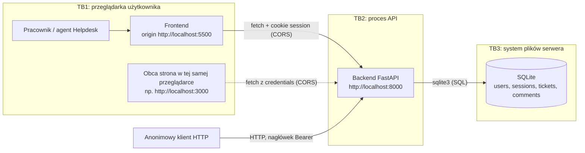
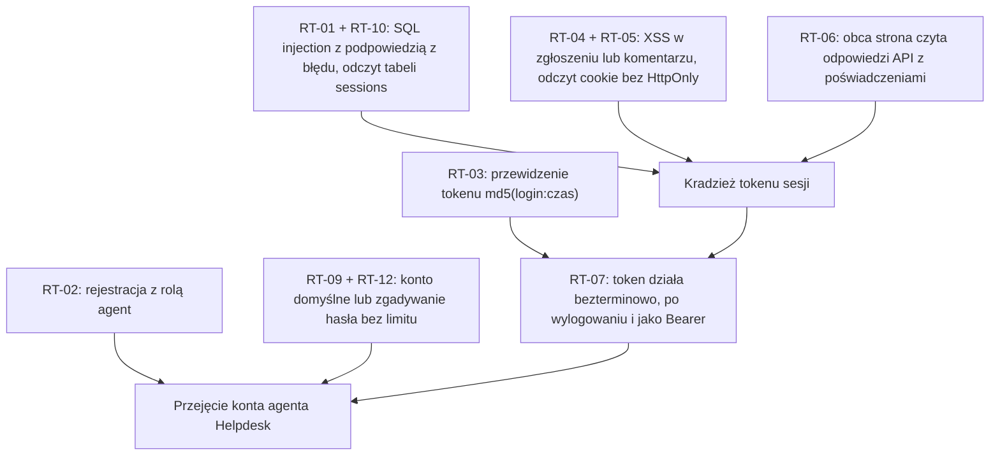

# Threat model PatchPoint (Faza 2)

Cel dokumentu to weryfikacja znalezisk audytu Red Team dla wektorów scenariusza: Information Disclosure (gadatliwe błędy bazy), Broken Authentication (słabe zarządzanie sesją) oraz bezpieczny CORS przy rozdzieleniu frontendu i backendu. Metoda: STRIDE na diagramie przepływu danych (DFD). Źródła: [`audyt-red-team-wynik.md`](audyt-red-team-wynik.md) (audyt AI), [`../faza-1-dev/rejestr-slabosci.md`](../faza-1-dev/rejestr-slabosci.md) (rejestr słabości W-01…W-18), [`../reviews/2026-11-16-delivery-faza-1-mvp.md`](../reviews/2026-11-16-delivery-faza-1-mvp.md) (code review Fazy 1, SEC-001…SEC-022) oraz [`dowody/ruff-s-faza-1.txt`](dowody/ruff-s-faza-1.txt) (klasyczny SAST: Ruff z regułami `S`).

## 1. Zakres i założenia

- Analizowany jest stan kodu Fazy 1 (drzewo commita `ab08633`).
- Uruchomienie lokalne: UI `http://localhost:5500`, API `http://localhost:8000`, plik SQLite.
- Poza zakresem: TLS, hosting i łańcuch dostaw zależności (A03). Te tematy należą do Fazy 3 (Dockerfile, CI z Semgrep i Trivy, architektura sieci).

## 2. Model systemu

### Aktywa

| ID | Aktywo |
|---|---|
| A1 | hasła i ich hashe (`users.password_hash`) |
| A2 | tokeny sesji (cookie `session`, tabela `sessions`) |
| A3 | dane zgłoszeń i komentarzy (opisy, lokalizacje, numery inwentarzowe) |
| A4 | integralność obsługi (status, przypisanie) |
| A5 | informacje o architekturze (schemat bazy, ścieżki, wersje) |
| A6 | dostępność API |

### Aktorzy

| ID | Aktor |
|---|---|
| T1 | anonimowy klient HTTP |
| T2 | zalogowany pracownik (konto z samodzielnej rejestracji) |
| T3 | obca strona otwarta w przeglądarce zalogowanego użytkownika (inny port `localhost` = ten sam site) |
| T4 | osoba z dostępem do pliku bazy lub kopii |
| T5 | podsłuch sieci (HTTP bez TLS, Faza 3) |

### Punkty wejścia

Stan Fazy 1, przepisany z routerów `health`, `auth` i `tickets`.

| Metoda | Ścieżka | Uwierzytelnienie | Rola |
|---|---|---|---|
| GET | `/api/health` | brak | dowolna |
| POST | `/api/auth/register` | brak | dowolna (pole `role` z żądania) |
| POST | `/api/auth/login` | brak | dowolna |
| POST | `/api/auth/logout` | brak (tylko usuwa cookie) | dowolna |
| GET | `/api/auth/me` | sesja (cookie lub `Authorization: Bearer`) | dowolna zalogowana |
| POST | `/api/tickets` | sesja | dowolna zalogowana |
| GET | `/api/tickets` | sesja | pracownik widzi własne zgłoszenia, agent wszystkie |
| GET | `/api/tickets/{ticket_id}` | sesja | dowolna zalogowana, bez sprawdzenia właściciela |
| PATCH | `/api/tickets/{ticket_id}` | sesja | `agent` |
| POST | `/api/tickets/{ticket_id}/comments` | sesja | dowolna zalogowana, bez sprawdzenia właściciela |

## 3. Analiza STRIDE

| Kategoria | Zagrożenie | Element DFD | Aktor | Luki (RT / W) |
|---|---|---|---|---|
| S | przewidywalny token → podszycie pod agenta | API (sesje) | T1 | RT-03 / W-08 |
| S | konto domyślne lub zgadywanie hasła bez limitu | API (logowanie) | T1 | RT-09, RT-12 / W-12, W-05 |
| S | kradzież sesji przez XSS lub SQLi i użycie bez wygaśnięcia | przeglądarka, API | T2 | RT-05, RT-01, RT-07 / W-17, W-14, W-09…W-11 |
| T | samodzielne nadanie roli agenta | API (rejestracja) | T1 | RT-02 / W-15 |
| T | komentarze do cudzych zgłoszeń | API (komentarze) | T2 | RT-04 / W-16 |
| T | akcje z obcego originu w imieniu zalogowanego | przeglądarka ↔ API | T3 | RT-06 / W-13 |
| R | brak śladu logowań, odmów i zmian zgłoszeń | API | T1, T2 | RT-15 / W-18 |
| I | gadatliwe błędy bazy (SQL, parametry, ścieżka, traceback) | API | T1, T2 | RT-10 / W-01, W-02 |
| I | tryb debug i publiczna dokumentacja API | API | T1 | RT-13 / W-03 |
| I | ścieżka bazy i wersje w `/api/health` | API | T1 | RT-14 / W-04 |
| I | hash hasła w odpowiedziach; MD5 bez soli | API, SQLite | T2, T3 | RT-11, RT-08 / W-06, W-07 |
| I | odczyt cudzych zgłoszeń i zrzut bazy | API, SQLite | T2 | RT-04, RT-01 / W-16, W-14 |
| I | enumeracja kont | API (logowanie) | T1 | RT-12 / W-05 |
| I | tokeny sesji jawnym tekstem w bazie | SQLite | T4 | SEC-020 (code review; rekomendacja w RT-03) |
| D | brak limitów długości pól i rozmiaru żądań, lista bez paginacji | API | T2 | SEC-017 (code review; w audycie odnotowane jako CWE-770) |
| D/I | nieobsłużony `OverflowError` dla identyfikatorów > 2⁶³−1 | API | T2 | RT-13 |
| E | pracownik → agent (rejestracja z rolą lub przejęcie sesji agenta) | API | T1, T2 | RT-02, RT-01, RT-03, RT-05 |
| (mitigacje) | brak CSP i nagłówków ochronnych; HTTP bez TLS | przeglądarka, API | T3, T5 | RT-16 / SEC-021 |

## 4. Weryfikacja znalezisk audytu

Kryterium: znalezisko jest „potwierdzone”, gdy kod we wskazanym miejscu ma opisane zachowanie. Dla RT-06 i RT-13 dochodzą fakty z uruchomienia bibliotek, opisane w tabeli. Numery linii sprawdzono w drzewie `ab08633`.

| RT | Tytuł (skrót) | Ważność (audyt) | Werdykt | Dowód w kodzie | Pozycja rejestru | Wektor scenariusza | Priorytet |
|---|---|---|---|---|---|---|---|
| RT-01 | SQL injection w `search` | krytyczna | potwierdzona | `backend/app/routers/tickets.py:86` (f-string z `search`), `:89` (`fetch_all` bez parametrów) | W-14 | Information Disclosure (łańcuch z W-01) | P1 |
| RT-02 | rejestracja z rolą `agent` | krytyczna | potwierdzona | `backend/app/schemas.py:17`, `backend/app/routers/auth.py:28` | W-15 | Broken Authentication | P1 |
| RT-03 | przewidywalny token | krytyczna | potwierdzona | `backend/app/security.py:17`, `backend/app/dependencies.py:33-37` (Bearer) | W-08 (i Bearer z W-11) | Broken Authentication | P1 |
| RT-04 | IDOR | wysoka | potwierdzona | `backend/app/routers/tickets.py:94-105`, `:158-164` | W-16 | Information Disclosure | P1 |
| RT-05 | stored XSS | wysoka | potwierdzona | `frontend/app.js:100`, `:110-122`, `:172-207` | W-17 | Broken Authentication (kradzież sesji) | P1 |
| RT-06 | CORS `*` z credentials | wysoka | potwierdzona; pewność audytu „średnia” podniesiona, bo Starlette 1.10 odbija `Origin` (`starlette/middleware/cors.py:163-164`), co potwierdziła też weryfikacja Fazy 1 (preflight z `Origin: http://evil.example`) | `backend/app/main.py:26-32` | W-13 | CORS | P1 |
| RT-07 | cykl życia sesji | wysoka | potwierdzona | `backend/app/routers/auth.py:58`, `:60`, `:64-66`; `backend/app/schema.sql:11-15`; `backend/app/dependencies.py:33-48` | W-09, W-10, W-11 | Broken Authentication | P1 |
| RT-08 | MD5 bez soli | wysoka | potwierdzona | `backend/app/security.py:8-13` | W-07 | Broken Authentication | P1 |
| RT-09 | konta domyślne, brak polityki haseł | wysoka | potwierdzona | `backend/app/database.py:13-18`, `backend/app/config.py:14`, `backend/app/schemas.py:14`, `frontend/index.html:52` | W-12 (konta i polityka haseł) | Broken Authentication | P1 |
| RT-10 | gadatliwe błędy bazy | średnia | potwierdzona | `backend/app/main.py:34-46`, `backend/app/database.py:21-27`, `backend/app/routers/auth.py:31-34`, `frontend/app.js:67` | W-01, W-02 | Information Disclosure | P2 |
| RT-11 | `password_hash` w API | średnia | potwierdzona | `backend/app/schemas.py:27` | W-06 | Information Disclosure | P2 |
| RT-12 | enumeracja i brak limitu prób | średnia | potwierdzona | `backend/app/routers/auth.py:46-50` | W-05, W-12 (limit prób) | Information Disclosure / Broken Authentication | P2 |
| RT-13 | `debug=True`, publiczne `/docs` | średnia | potwierdzona. Wyzwalacz `OverflowError` sprawdzono uruchomieniem: `sqlite3` rzuca `OverflowError` (nie `sqlite3.Error`), a Pydantic przyjmuje `99999999999999999999`. To nowe znalezisko spoza rejestru | `backend/app/main.py:23` | W-03 (+ nowe) | Information Disclosure | P2 |
| RT-14 | health | niska | potwierdzona | `backend/app/routers/health.py:13-23` | W-04 | Information Disclosure | P3 |
| RT-15 | brak logowania | niska | potwierdzona | brak użycia `logging` w `backend/app` | W-18 | wykrywalność ataków | P3 |
| RT-16 | brak CSP i nagłówków, HTTP | niska | potwierdzona dla CSP i nagłówków; część „HTTP bez TLS” poza zakresem Fazy 2 (Faza 3) | `frontend/index.html:3-9`, `backend/app/main.py:23-32` | spoza rejestru (SEC-021 w code review) | mitigacja XSS | P3 |

Priorytet P1 = ważność krytyczna lub wysoka, P2 = średnia, P3 = niska. Zespół nie zmienił żadnej oceny audytu.

## 5. Porównanie z rejestrem słabości

| W | Słabość (skrót) | Audyt AI (RT) | Code review Fazy 1 (SEC) | Ruff S |
|---|---|---|---|---|
| W-01 | gadatliwy handler błędów bazy | RT-10 | SEC-013 | — |
| W-02 | surowy komunikat UNIQUE przy zajętym loginie | RT-10 | SEC-018 | — |
| W-03 | `debug=True` i publiczne `/docs` | RT-13 | SEC-014 | — |
| W-04 | ścieżka bazy i wersje w `/api/health` | RT-14 | SEC-015 | — |
| W-05 | enumeracja kont przy logowaniu | RT-12 | SEC-012 | — |
| W-06 | `password_hash` w odpowiedziach API | RT-11 | SEC-016 | — |
| W-07 | hasła MD5 bez soli | RT-08 | SEC-006 | S324 (`security.py:9`) |
| W-08 | przewidywalny token sesji | RT-03 | SEC-005 | S324 (`security.py:17`) |
| W-09 | sesje bez wygasania | RT-07 | SEC-010 | — |
| W-10 | wylogowanie nie unieważnia sesji | RT-07 | SEC-011 | — |
| W-11 | cookie bez flag, token w JSON i Bearer | RT-07, RT-03 | SEC-009 | — |
| W-12 | konto domyślne, brak polityki haseł i limitu prób | RT-09, RT-12 | SEC-002 | — |
| W-13 | CORS `*` z credentials | RT-06 | SEC-008 | — |
| W-14 | SQL injection w `search` | RT-01 | SEC-003 | — (pominięta) |
| W-15 | nadanie roli przy rejestracji (mass assignment) | RT-02 | SEC-001 | — |
| W-16 | IDOR na zgłoszeniach i komentarzach | RT-04 | SEC-007 | — |
| W-17 | stored XSS przez `innerHTML` | RT-05 | SEC-004 | — (Ruff nie analizuje JS) |
| W-18 | brak logowania zdarzeń bezpieczeństwa | RT-15 | SEC-019 | — |

### Poza rejestrem

| Pozycja | Odniesienie w audycie |
|---|---|
| SEC-017 (limity, paginacja) | odnotowane jako CWE-770, bez osobnego RT |
| SEC-020 (jawne tokeny) | haszowanie tokenu w rekomendacji RT-03 |
| SEC-021 (nagłówki) | RT-16 |
| SEC-022 (`/tmp` w konfiguracji QA) | poza zakresem audytu (`.av/`) |
| `OverflowError` | RT-13, nowe |

### Metryki

| Źródło | Ślepe wobec rejestru | Trafione pozycje rejestru | Fałszywie dodatnie | Pominięte | Dodatkowe prawdziwe |
|---|---|---|---|---|---|
| Audyt AI (RT) | tak | 18/18 (16 znalezisk: RT-07 obejmuje W-09…W-11, RT-10 obejmuje W-01 i W-02, W-12 rozpada się na RT-09 i RT-12) | 0 | 0 | RT-16 i wyzwalacz `OverflowError` w RT-13; częściowo SEC-017 i SEC-020 |
| Ruff S (reguły Bandit) | tak | 2/18 (W-07, W-08 przez S324) | 1 (S608 w `update_ticket`: składane są tylko stałe fragmenty, wartości idą jako parametry) | 16 (w tym W-14: literał f-stringa z `search` nie zawiera słów kluczowych SQL) | 0 |
| Code review delivery Fazy 1 | nie (znał rejestr) | 18/18 | 0 | 0 | SEC-017, SEC-020, SEC-021, SEC-022 |

## 6. Scenariusze ataku dla wektorów scenariusza

### Information Disclosure

**ID-1 „Od błędu do zrzutu bazy”**

- Aktor: T2.
- Kroki: apostrof w `search` → RT-10 ujawnia pełne SQL z JOIN-ami i ścieżkę bazy → RT-01 `UNION SELECT` z `sessions` i `users` → tokeny ważne bezterminowo i przyjmowane jako Bearer (RT-07) oraz hashe MD5 (RT-08). Rekonesans przez RT-14 i `/docs` (RT-13).
- Skutek: odczyt całej bazy, w tym aktywnych tokenów agentów i hashy haseł.
- Faza 2 przerywa przez: parametryzację z `ESCAPE`, ogólny 500 z `error_id`, SHA-256 tokenów w bazie, Argon2id, minimalny health i wyłączone docs.

### Broken Authentication

**BA-1 „Konto domyślne i zgadywanie”**

- Aktor: T1.
- Kroki: RT-12 (404 kontra 401) → RT-09 (`admin`/`admin123`) lub zgadywanie bez limitu.
- Skutek: konto agenta bez żadnej podatności w kodzie aplikacji.
- Faza 2 przerywa przez: brak kont domyślnych, politykę haseł, jednolite 401 i limit 5 prób w 15 min (429).

**BA-2 „Przewidywalny token”**

- Aktor: T1.
- Kroki: login (z enumeracji lub danych demo) i przybliżony czas → kandydaci `md5(login:czas)` → Bearer. RT-07 usuwa limit czasu.
- Skutek: podszycie pod dowolnego użytkownika bez znajomości hasła.
- Faza 2 przerywa przez: `secrets.token_urlsafe(32)`, tylko cookie oraz wygasanie po 30 min bezczynności i po 8 h.

**BA-3 „Stored XSS → sesja agenta”**

- Aktor: T2.
- Kroki: zgłoszenie albo komentarz z HTML, także w cudzym zgłoszeniu (RT-04) → agent otwiera → skrypt (RT-05) czyta cookie bez `HttpOnly` (RT-07) i `password_hash` (RT-11).
- Skutek: przejęcie sesji i hasha agenta.
- Faza 2 przerywa przez: DOM przez `textContent`, CSP, `HttpOnly` i 404 dla cudzych zgłoszeń.

**BA-4 „Samoeskalacja”**

- Aktor: T1.
- Kroki: rejestracja z `"role": "agent"` (RT-02).
- Skutek: konto agenta w jednym żądaniu.
- Faza 2 przerywa przez: `extra="forbid"` i rolę zawsze równą `employee`.

### CORS

**CORS-1 „Obca strona na localhost”**

- Aktor: T3.
- Kroki: strona na innym porcie `localhost` (ten sam site, więc cookie `Lax` jest wysyłane) robi `fetch` z `credentials: "include"` → RT-06 odbija `Origin` → odczyt `/api/auth/me` z hashem i listy zgłoszeń.
- Skutek: odczyt danych zalogowanego użytkownika przez obcą stronę.
- Faza 2 przerywa przez: listę originów z konfiguracji (bez `*`), `SameSite=Strict`, metody GET/POST/PATCH i nagłówek `Content-Type`; preflight z obcego originu dostaje 400.
- Ryzyko rezydualne: proste żądanie `POST /api/auth/logout` z tego samego site nadal może wylogować.

## 7. Priorytety i plan naprawy

| RT | Priorytet | Mechanizm naprawy | Zadanie planu Fazy 2 |
|---|---|---|---|
| RT-01 | P1 | statyczne zapytanie z parametrami i `LIKE … ESCAPE` | 4 |
| RT-02 | P1 | `extra="forbid"`, rola zawsze `employee` | 3 |
| RT-03 | P1 | losowy token 256 bitów, SHA-256 w bazie, bez Bearer | 3 |
| RT-04 | P1 | wspólna kontrola własności, 404 | 4 |
| RT-05 | P1 | DOM bez `innerHTML` | 5 |
| RT-06 | P1 | lista originów, ograniczone metody i nagłówki | 2 |
| RT-07 | P1 | wygasanie, usuwanie sesji przy wylogowaniu, `HttpOnly; Secure; SameSite=Strict` | 3 |
| RT-08 | P1 | Argon2id | 3 |
| RT-09 | P1 | seed tylko na żądanie z hasłem z env, bez `admin`, polityka haseł, `required minlength` w UI | 3, 5 |
| RT-10 | P2 | ogólne 500 z `error_id`, stały komunikat 409, czytelne błędy w UI | 2, 3, 5 |
| RT-11 | P2 | `UserResponse` bez hasha | 3 |
| RT-12 | P2 | jednolite 401, weryfikacja na stałym hashu, limit prób per konto | 3 |
| RT-13 | P2 | debug wyłączony, docs na żądanie, handler `Exception`, zakres id | 2, 4 |
| RT-14 | P3 | `{"status": "ok"}` | 2 |
| RT-15 | P3 | zdarzenia bezpieczeństwa w JSON | 2, 3, 4 |
| RT-16 | P3 | nagłówki API i CSP w UI | 2, 5 |

Pozycje spoza audytu w tym samym planie: SEC-017 (zadania 2, 4, 5), SEC-020 (3), SEC-022 (6) oraz jakość: ARCH-001 (3), ARCH-002 (5), MAINT-001 (3), MAINT-002 (4), MAINT-003 (2), MAINT-004 (5), MAINT-005 (3), DOC-001 (7).

Odstępstwa od rekomendacji audytu:

- brak migracji MD5 → Argon2 przy logowaniu: bazę Fazy 1 trzeba odtworzyć, a API odmawia startu na starym schemacie;
- limit prób per konto, bez limitu per IP (ten należy do brzegu sieci w Fazie 3);
- nagłówek `Authorization` usunięty całkowicie, zamiast dopuszczać go w CORS;
- bez endpointu nadawania ról: konta agentów tworzy tylko seed demo.

Plan Fazy 2: [`../plans/2026-11-16-faza-2-sec.md`](../plans/2026-11-16-faza-2-sec.md).
