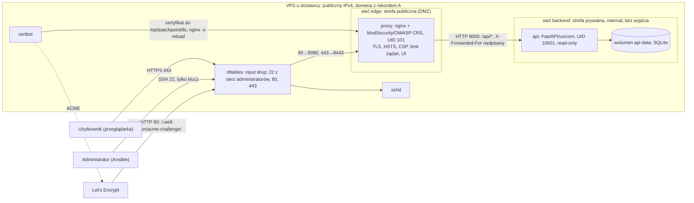
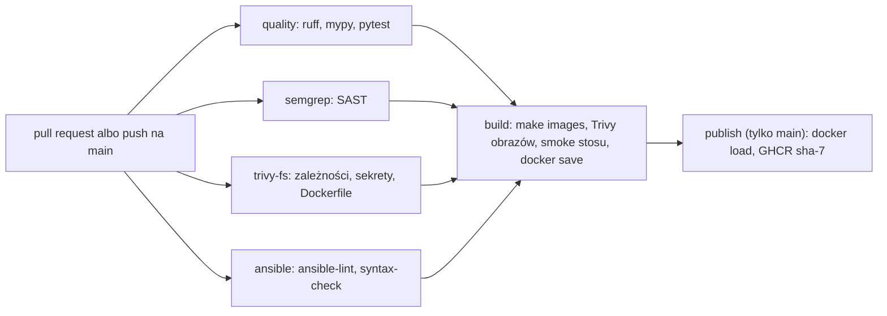

# Raport z Fazy 3 (OPS) — PatchPoint

Dokument opisuje wynik Fazy 3 projektu „AI-Driven DevSecOps” (Scenariusz 5: Menadżer Zadań IT): kontenery z bezpiecznymi obrazami, stos z reverse proxy (TLS, WAF), potok CI/CD ze skanerami, logiczną architekturę sieci oraz wdrożenie na serwerze VPS z Ansible. Jest jednocześnie Sekcją Ops końcowego Raportu Architektonicznego DevSecOps (Sekcja Sec: [`../faza-2-sec/README.md`](../faza-2-sec/README.md), raport zbiorczy: [`../raport-devsecops.md`](../raport-devsecops.md)). Powiązane dokumenty: [dowody](dowody/README.md).

## 1. Cel fazy

Punkty „Faza 3: OPS” z instrukcji kursu:

> ● Aplikacja musi działać w chmurze. Zaprojektujcie bezpieczny plik Dockerfile (wymagane m.in. zasada rootless, multi-stage build, okrojony obraz bazowy).
>
> ● Wygenerujcie z AI definicję potoku wdrożeniowego CI/CD (np. plik YAML dla GitHub Actions lub GitLab CI), który przed zbudowaniem obrazu automatycznie uruchomi narzędzia skanujące (np. Semgrep, Trivy).
>
> ● Zaprojektujcie logiczną architekturę sieciową dla Waszego rozwiązania.

| Wymaganie | Realizacja | Dowód |
|---|---|---|
| Aplikacja działa w chmurze | VPS u dostawcy (IaaS), obrazy z GHCR, wdrożenie przez Ansible; odpowiedniki w AWS w aneksie A | `compose.yaml`, `deploy/ansible/`, [`dowody/smoke-stosu.txt`](dowody/smoke-stosu.txt) |
| Bezpieczny Dockerfile (rootless, multi-stage, okrojony obraz bazowy) | `backend/Dockerfile` (API) i `deploy/proxy/Dockerfile` (proxy z WAF) | [`dowody/obrazy.txt`](dowody/obrazy.txt), [`dowody/trivy-obrazy.txt`](dowody/trivy-obrazy.txt) |
| Potok CI/CD z AI, skanery przed budową | `.github/workflows/ci.yml`: Semgrep i Trivy w jobach poprzedzających budowę obrazów | [`dowody/ci.md`](dowody/ci.md), [`dowody/semgrep.txt`](dowody/semgrep.txt), [`dowody/trivy-fs.txt`](dowody/trivy-fs.txt) |
| Logiczna architektura sieci | dwie sieci Dockera (publiczna `edge`, prywatna `backend`) za zaporą hosta | sekcja 4 |
| Sekcja Ops: podsieci, WAF, zmienne środowiskowe i sekrety | strefy sieci, ModSecurity z OWASP CRS, zmienne stosu i Ansible Vault | sekcje 4, 6 i 7 |

## 2. Metoda pracy z AI

Plan Fazy 3 powstał z AI w trybie planowania po trzech rundach pytań do zespołu (hosting, topologia, zakres potoku, sposób realizacji WAF i IaC, weryfikacja na GitHubie); sprawdzono wtedy aktualne wersje obrazów, akcji i narzędzi. Dziewięć zadań wykonali agenci delivery, a wynik każdego zadania przejrzał osobny agent-recenzent przed commitem. Definicję potoku CI/CD (`.github/workflows/ci.yml`) wygenerowała AI: najpierw jako dosłowny fragment planu, potem przez agenta w zadaniu 7. Pierwszy przebieg potoku na GitHubie wykrył błąd środowiska runnera, którego lokalne uruchomienie nie pokazało; opis i poprawka są w [`dowody/ci.md`](dowody/ci.md).

## 3. Środowisko docelowe

Aplikacja działa na jednym serwerze VPS u dostawcy (model IaaS) z publicznym adresem IPv4 i domeną z rekordem A. System: Debian 12/13 albo Ubuntu 24.04 LTS (założenie; rola `base` sprawdza tylko, że to Debian albo Ubuntu). Docker Engine i Docker Compose pochodzą z repozytorium Dockera, certyfikaty TLS wystawia certbot (Let's Encrypt). Jeden host wynika z bazy SQLite, która ma jeden proces zapisujący: skalowanie poziome wymagałoby innej bazy.

### Przypięte wersje

Obrazy i skanery są przypięte po digeście, akcje po pełnym SHA, a zależności Pythona (backend oraz narzędzia Ansible) po wersjach i hashach w plikach `uv.lock`; uv w CI, Python dla Ansible i kolekcja `community.docker` są przypięte po wersji. Wersje sprawdzono 2026-11-18; zmiana wersji oznacza zmianę we wszystkich miejscach z ostatniej kolumny. Dependabot (`.github/dependabot.yml`) podbija akcje, zależności Pythona z obu plików `uv.lock` i obrazy w Dockerfile; ręcznie podbija się obrazy skanerów (`scripts/scan.sh`), wersję uv w CI (`UV_VERSION` w `.github/workflows/ci.yml`, zawsze w tym samym PR co obraz `ghcr.io/astral-sh/uv` w `backend/Dockerfile`, który podbija Dependabot), wersję Pythona dla Ansible (`ANSIBLE_PYTHON` w `Makefile` i `requires-python` w `deploy/ansible/tools/pyproject.toml`, w granicach wersji Pythona obsługiwanych przez ansible-core) oraz kolekcję `community.docker` (`deploy/ansible/requirements.yml`).

| Komponent | Wersja (digest) | Gdzie |
|---|---|---|
| obraz uv | `ghcr.io/astral-sh/uv:0.13.8@sha256:5cc1805e2426484abca4ad46ea783bab281fdb225fd82d8ce6d66a81254bac85` | `backend/Dockerfile` |
| obraz Pythona | `python:3.14.10-slim@sha256:9aaa474097d094040649f2162a627c0049b408f52138d980916788d80f04802f` (Debian 13.8 według Trivy, po `apt-get upgrade` przy budowie bez cache) | `backend/Dockerfile` (2×) |
| obraz proxy/WAF | `owasp/modsecurity-crs:4.30.0-nginx-alpine-202611271111@sha256:e473af8dcd3ef1ecb9ad61622c0a1dc82a61b3db7844fdd500de228244e0e25f` (nginx 1.30.8, ModSecurity 3.0.17, CRS 4.30.0, Alpine 3.24; Trivy: Alpine 3.24.4) | `deploy/proxy/Dockerfile` (2×) |
| Semgrep | `semgrep/semgrep:1.185.0@sha256:67518c174185a2043fdbed16c70631b79209499b3671178e7194379b48295a0d` | `scripts/scan.sh` |
| Trivy | `aquasec/trivy:0.76.2@sha256:8f6bb947dbc528902e11f2f5be52f7b519f6a39d5d148f41166f2040499768fb` | `scripts/scan.sh` |
| `actions/checkout` | `3d3c42e5aac5ba805825da76410c181273ba90b1` (v7.0.1) | `.github/workflows/ci.yml` |
| `astral-sh/setup-uv` | `68559e99cc807c1eb7e9238fd43a15bba460eec2` (v10.3.3) | `.github/workflows/ci.yml` |
| `actions/upload-artifact` | `cf430e030ddbb5b0abf93d22962f4752f3646cd9` (v7.0.2) | `.github/workflows/ci.yml` |
| `actions/download-artifact` | `9000827ccba6bdab643e8b6fd33ac0654aef8333` (v8.0.2) | `.github/workflows/ci.yml` |
| uv w CI | 0.13.8 | `.github/workflows/ci.yml` (`UV_VERSION`) |
| ansible-core / ansible-lint | 2.19.15 / 26.11.0 (z zależnościami pośrednimi i hashami w `uv.lock`) | `deploy/ansible/tools/pyproject.toml`, `deploy/ansible/tools/uv.lock` |
| Python dla Ansible | 3.13 | `Makefile` (`ANSIBLE_PYTHON`), `deploy/ansible/tools/pyproject.toml` (`requires-python`) |
| `community.docker` | 5.4.0 | `deploy/ansible/requirements.yml` |

Środowisko, w którym zebrano dowody: Docker 29.9.3, Compose 5.8.0 (tabela w [`dowody/README.md`](dowody/README.md)). Runner CI `ubuntu-24.04` ma Docker 28.0.4 i Compose 2.38.2 (według opisu obrazu runnera sprawdzonego przy planowaniu).

## 4. Logiczna architektura sieci



| Strefa | Elementy | Dostęp z Internetu | Odpowiednik w chmurze |
|---|---|---|---|
| Internet | użytkownicy, Let's Encrypt, administratorzy | — | Internet |
| Host | nftables (tabela `patchpoint_host`), sshd, certbot, Docker Engine | 22 tylko ze źródeł `base_ssh_allowed_ipv4` i `base_ssh_allowed_ipv6` (domyślnie cały Internet, do zawężenia w inventory), 80 i 443; pozostały ruch do hosta jest odrzucany | security group i NACL instancji |
| Strefa publiczna (DMZ) | sieć `edge`, kontener proxy | 80→8080 i 443→8443 (publikacja portów Dockera) | podsieć publiczna z ALB i WAF |
| Strefa prywatna | sieć `backend` (`internal: true`), kontener API, wolumen `api-data` | brak: API nie ma opublikowanego portu, a sieć nie ma trasy do Internetu | podsieć prywatna bez NAT |

| Źródło | Cel | Port i protokół | Cel przepływu |
|---|---|---|---|
| Internet | proxy | 443, TLS 1.2/1.3 (HTTP/1.1) | UI i `/api/` |
| Internet | proxy | 80, HTTP | przekierowanie 301 na HTTPS i wyzwania ACME |
| sieci administratorów | sshd | 22, SSH, tylko klucz | administracja i Ansible |
| proxy | api (sieć backend) | 8000, HTTP | `/api/*` z nadpisanym `X-Forwarded-For` |
| api | wolumen `api-data` | system plików (`/data`) | baza SQLite |
| host | Internet | dowolny port i protokół: zapora hosta nie filtruje ruchu wychodzącego (używane m.in. 443, HTTPS) | apt, `download.docker.com`, `ghcr.io`, ACME (Let's Encrypt) |
| proxy (sieć `edge`) | Internet | dowolny port i protokół: ruch wychodzący z sieci `edge` nie jest filtrowany | niepotrzebny proxy (ryzyko rezydualne w sekcji 13) |
| pozostały ruch przychodzący | host, sieć `backend` | — | odrzucany: do hosta przez politykę `drop` łańcucha `input` nftables, do sieci `backend` przez `internal: true` i brak opublikowanego portu API |

Zapora hosta (`deploy/ansible/roles/base/templates/nftables.conf.j2`) zarządza wyłącznie własną tabelą `inet patchpoint_host` z łańcuchem `input` (hook `input`, polityka `drop`). Plik nie zawiera `flush ruleset`, bo usunięcie reguł Dockera (NAT i FORWARD) odcięłoby kontenery od sieci. Z tego samego powodu rola `base` dodaje drop-in dla `nftables.service` (`ExecStop` usuwa tylko tabelę `patchpoint_host`): domyślne `ExecStop` Debiana wykonuje `nft flush ruleset`. Demon Dockera ma `userland-proxy: false`, więc nginx widzi rzeczywisty adres IPv4 klienta (od niego zależą limit żądań i `client_ip`), a `live-restore: true` utrzymuje kontenery przy restarcie demona. Lokalnie `compose.yaml` publikuje porty tylko na `127.0.0.1` (`PATCHPOINT_HTTP_BIND`, `PATCHPOINT_HTTPS_BIND`); na serwerze `.env` ustawia je na `80` i `443`.

## 5. Bezpieczne obrazy kontenerów

| Praktyka | API (`backend/Dockerfile`) | Proxy (`deploy/proxy/Dockerfile`) |
|---|---|---|
| Multi-stage | trzy etapy: `uv` (binarka), `build` (zależności produkcyjne z `uv.lock`, `--locked --no-dev`), obraz końcowy | dwa etapy: `ui` (podmiana adresu API w kopii UI), obraz końcowy |
| Okrojony obraz bazowy przypięty po digeście | `python:3.14.10-slim` (Debian 13.7) | `owasp/modsecurity-crs` 4.30.0 na nginx-alpine (Alpine 3.24.4) |
| Rootless | `USER 10001:10001` | `USER nginx` (UID 101); porty 8080 i 8443, powyżej 1024 |
| Brak narzędzi budowania i pip | pip odinstalowany w obrazie końcowym (sprawdza to smoke), uv tylko w etapie `build` | obraz nie zawiera zależności aplikacji; UI to trzy pliki statyczne |
| Poprawki bezpieczeństwa | `apt-get upgrade` przy budowie (obraz zależy od dnia budowy; lokalna warstwa z cache potrafi zawierać starsze pakiety niż świeża budowa) | bez `apk upgrade` (moduł ModSecurity jest zbudowany dla konkretnej wersji nginx); aktualizacja przez nowszy tag obrazu CRS (tag z 2026-11-27 ma nginx 1.30.8, więc wyjątki `.trivyignore` dla nginx 1.30.6 zostały usunięte) |
| HEALTHCHECK | `python -c` z `urllib` na `/api/health`, wymaga statusu 200 | `curl -fsk` na `https://localhost:8443/healthz` (wbudowany test obrazu bazowego zwraca sukces także przy błędzie HTTP) |
| Allowlista kontekstu budowy | `backend/.dockerignore`: `*`, wyjątki `pyproject.toml`, `uv.lock`, `app/` | `deploy/proxy/Dockerfile.dockerignore`: tylko trzy pliki `frontend/`, szablony nginx i wyjątek ModSecurity |
| Brak sekretów w obrazie | hasła i tokeny tylko ze środowiska uruchomieniowego | klucz TLS montowany z hosta (tylko do odczytu); w obrazie tylko ścieżka do pliku |
| Tryb plików | `chmod -R` kodu aplikacji: czytelny dla UID 10001, niezapisywalny | `chmod -R` szablonów nginx (podkatalogi); UI i wyjątek ModSecurity przez `COPY --chmod` (pliki bez podkatalogów) |
| Etykiety OCI | `source`, `revision`, `title` | `source`, `revision`, `title` oraz etykiety dziedziczone z obrazu bazowego |
| Rozmiar (`docker image ls`) | 214 MB | 147 MB |

Szczegóły (użytkownik, porty, healthcheck, etykiety, wynik sprawdzenia braku pip, `FROM` z digestami): [`dowody/obrazy.txt`](dowody/obrazy.txt). `chmod -R` zamiast symbolicznego `COPY --chmod` dla katalogów z podkatalogami wynika z błędu wykrytego w CI: BuildKit w Dockerze 28 odbiera podkatalogom bit `x` (opis w [`dowody/ci.md`](dowody/ci.md)).

Utwardzenie w czasie działania (`compose.yaml`):

| Mechanizm | API | Proxy |
|---|---|---|
| System plików tylko do odczytu | `read_only: true`, zapisywalne tylko `/data` (wolumen) i `/tmp` (tmpfs 16 MiB) | brak (patrz niżej) |
| Uprawnienia | `cap_drop: ALL`, `no-new-privileges:true` | `cap_drop: ALL`, `no-new-privileges:true` |
| Limity zasobów | `mem_limit: 1g`, `cpus: 1.0`, `pids_limit: 256` | `mem_limit: 256m`, `cpus: 0.5`, `pids_limit: 128` |
| Restart | `unless-stopped` | `unless-stopped`, start po zdrowym API (`depends_on` z `service_healthy`) |
| Logi | `json-file`, rotacja 10 MB × 5 | `json-file`, rotacja 10 MB × 5 |
| Sieć | tylko `backend` (`internal: true`), bez opublikowanych portów | `edge` (publiczna) i `backend` z ustalonym adresem |

Proxy nie ma `read_only`, bo obraz `owasp/modsecurity-crs` zapisuje przy starcie konfigurację do `/etc/nginx`, `/etc/modsecurity.d` i `/opt/owasp-crs`, a wariant read-only nie jest publikowany.

## 6. Brzeg sieci: TLS, WAF i limit żądań

Wszystko poniżej konfiguruje `deploy/proxy/` (szablony nginx podstawiane przez entrypoint obrazu) i potwierdza [`dowody/smoke-stosu.txt`](dowody/smoke-stosu.txt).

- **TLS.** Protokoły TLS 1.2 i 1.3 (`SSL_PROTOCOLS` obrazu), szyfry AEAD z ECDHE (AES-GCM, ChaCha20-Poly1305) i DHE-RSA z AES-GCM (`SSL_CIPHERS` obrazu), `ssl_prefer_server_ciphers off`, bilety sesji wyłączone (`ssl_session_tickets off`), parametry DH 2048 bitów, zszywanie OCSP (OCSP stapling) wyłączone (`SSL_OCSP_STAPLING=off`; certyfikat deweloperski nie ma adresu OCSP, a dla Let's Encrypt ustawienie jest bezpieczne). HTTP/2 jest wyłączony (`HTTP2=off`): nginx 1.30.6 miał podatności w HTTP/2, a UI wystarcza HTTP/1.1, więc proxy nie negocjuje h2 (ALPN) i nie przyjmuje h2c.
- **HSTS i przekierowanie.** `Strict-Transport-Security: max-age=31536000` bez `includeSubDomains` i `preload` (nie zakładamy HTTPS na innych subdomenach), ustawiany na serwerze HTTPS. Serwer HTTP odpowiada 301 na HTTPS, z wyjątkiem ścieżek `/.well-known/acme-challenge/` (klucz mapy to `$uri`, więc segmenty `../` nie omijają wyjątku); brak pliku wyzwania daje 404. Przekierowanie wskazuje stałą nazwę serwera (`https://${SERVER_NAME}:<port>`), a nie nagłówek `Host` od klienta, więc żądanie przez adres IP albo inną nazwę trafia na nazwę z certyfikatu. Lokalnie `compose.yaml` wyłącza przekierowanie i HSTS (`PATCHPOINT_TLS_REDIRECT=off`, `PATCHPOINT_HSTS_MAX_AGE=0`), żeby tryb deweloperski na `patchpoint.localhost` nie wymuszał HTTPS.
- **WAF.** ModSecurity 3 z OWASP CRS 4.30.0: poziom paranoi 1 (`BLOCKING_PARANOIA=1`), progi anomalii 5 (żądania) i 4 (odpowiedzi), tryb blokujący (`MODSEC_RULE_ENGINE=on`). `ALLOWED_METHODS` to `GET HEAD POST PATCH OPTIONS`: domyślny zestaw CRS nie zawiera PATCH, a API go używa (reguła 911100). Smoke potwierdza blokadę SQL injection w parametrze `search` (reguły 942xxx) i XSS w polu `full_name` (reguły 941xxx).
- **Wyjątek dla haseł.** Reguła `10001` (`deploy/proxy/modsecurity/REQUEST-900-EXCLUSION-RULES-BEFORE-CRS.conf`) wyłącza analizę CRS pola `password` w `/api/auth/login` i `/api/auth/register`. Hasło trafia wyłącznie do Argon2id, nigdy do SQL, HTML ani powłoki, więc silne hasła ze znakami `'`, `"`, `<`, `>`, `--` nie są blokowane, a fragmenty haseł nie trafiają do komunikatów reguł w audit logu. Pozostałe pola tych żądań CRS analizuje normalnie. Smoke rejestruje konto z hasłem `Smoke' OR '1'='1' -- <b>…</b>` i oczekuje 201.
- **Odpowiedzi nginx w formacie API.** Każde 403 wygenerowane przez nginx to `{"detail":"Request blocked by the proxy"}`: komunikat jest neutralny, bo nie każde pochodzi z WAF (blokada ModSecurity zostawia wpis w audit logu, ale odmowa dostępu do `/metrics/nginx` z `includes/location_common.conf` obrazu bazowego, dozwolonego tylko z 127.0.0.0/24, też dostaje to ciało i wpisu WAF nie ma). Przekroczenie limitu to 429 `{"detail":"Too many requests, try again later"}` (`error_page` w `patchpoint-app.conf.template`); odpowiedzi samego API przechodzą bez zmian.
- **Audit log.** JSON na stdout (`MODSEC_AUDIT_LOG_FORMAT=JSON`), części `AHZ` (`MODSEC_AUDIT_LOG_PARTS`): bez części B, I i J (nagłówki i ciało żądania: ciasteczko, hasło) oraz bez F (nagłówki odpowiedzi: `Set-Cookie` z tokenem sesji trafiłby do logu każdej zapisanej odpowiedzi logowania). Smoke sprawdza, że logi proxy nie zawierają silnego hasła, hasła demo ani tokenu sesji.
- **Limit żądań.** `limit_req` per adres klienta (`$binary_remote_addr`, strefa 10 MB) dla `POST /api/auth/login` i `/api/auth/register`: 10 żądań na minutę, seria 5 (`PATCHPOINT_AUTH_RATE`, `PATCHPOINT_AUTH_BURST`), odpowiedź 429. W zebranym przebiegu smoke 10 z 12 kolejnych logowań dostało 429 (z JSON), a pozostałe 401, bez 5xx. Limit uzupełnia blokadę per konto w API (5 prób w 15 minut) i ogranicza koszt Argon2id.
- **Nagłówki UI.** Statyczne pliki dostają z nginx: `Content-Security-Policy` jako nagłówek (z `frame-ancestors 'none'` i `connect-src 'self'`), `X-Content-Type-Options: nosniff`, `X-Frame-Options: DENY`, `Referrer-Policy: no-referrer`, `Permissions-Policy`, `Cross-Origin-Opener-Policy: same-origin`, `Cache-Control: no-cache`. Nagłówka `Server` nie ma (`server_tokens off`, `more_clear_headers Server`). Odpowiedzi `/api/` mają nagłówki z API (m.in. `Cache-Control: no-store`) i HSTS z proxy. Ciało żądania ogranicza nginx do 128 KiB, a API do 64 KiB.
- **Jeden origin.** Obraz proxy podmienia przy budowie `API_BASE_URL` w `app.js` na pusty napis (żądania względne `/api/...`) i `connect-src` w CSP z `<meta>` na `'self'`; źródła w `frontend/` zostają bez zmian, bo tryb deweloperski (dwa originy) i testy CORS ich wymagają. Ciasteczko `SameSite=Strict` działa w obrębie jednej witryny, lista originów API (`PATCHPOINT_PUBLIC_ORIGINS`) to publiczny origin, a ciasteczko ma nazwę `__Host-session` (`PATCHPOINT_COOKIE_NAME`): przeglądarka przyjmuje je tylko z `Secure`, `Path=/` i bez `Domain`. Smoke sprawdza atrybuty ciasteczka i że ten sam token pod nazwą `session` daje 401.
- **Łańcuch `client_ip`.** nginx nadpisuje `X-Forwarded-For` adresem `$remote_addr` (nagłówek od klienta nie jest dopisywany), a uvicorn ufa temu nagłówkowi tylko od adresu z `FORWARDED_ALLOW_IPS`, który `compose.yaml` ustawia na adres proxy w sieci backend (`PATCHPOINT_PROXY_BACKEND_IP`, ta sama zmienna ustala adres proxy). Smoke wysyła podrobiony `X-Forwarded-For: 203.0.113.77` i sprawdza, że `client_ip` w logu API jest niepusty, różny od podrobionego adresu i od adresu proxy. Tryb `make run` zostaje z `--no-proxy-headers`, a `backend/tests/test_client_ip.py` bez zmian.
- **Nagłówek `Host` do API.** Proxy przekazuje do API stałą nazwę serwera (`proxy_set_header Host ${SERVER_NAME}`), bo przekierowania Starlette (`redirect_slashes`, 307) odbijają `Host` w `Location`, a wartość od klienta pozwalałaby ustawić dowolny adres.
- **Rozwiązywanie nazwy API.** `proxy_pass` ze zmienną rozwiązuje nazwę `api` w czasie żądania przez resolver Dockera, więc proxy startuje także bez API i po odtworzeniu kontenera API nie trzyma starego adresu.
- **Smoke łączy się przez `patchpoint.localhost`, nie przez adres IP.** Żądanie z numerycznym adresem IP w `Host` dostaje punkty anomalii z reguły CRS 920350, a `POST` bez `Content-Length` z reguły 920180; razem osiągają próg anomalii 5 i WAF blokuje takie żądania bez treści (np. wylogowanie). Przeglądarki i domeny nie wywołują obu reguł naraz.

## 7. Zmienne środowiskowe i sekrety

Zmienne stosu czyta `compose.yaml`. Lokalnie obowiązują wartości domyślne z pliku, na serwerze `.env` zapisywany przez Ansible (`deploy/ansible/roles/patchpoint/templates/env.j2`) w `/opt/patchpoint`.

| Zmienna | Usługa | Lokalnie (domyślnie w `compose.yaml`) | Produkcja (`.env` z Ansible) |
|---|---|---|---|
| `PATCHPOINT_API_IMAGE` | obraz API | `patchpoint-api:local` | `ghcr.io/l3x1cn/patchpoint/api@sha256:<64 hex>` (`patchpoint_api_digest`) albo `...api:sha-<7 znaków>` |
| `PATCHPOINT_PROXY_IMAGE` | obraz proxy | `patchpoint-proxy:local` | `ghcr.io/l3x1cn/patchpoint/proxy@sha256:<64 hex>` (`patchpoint_proxy_digest`) albo `...proxy:sha-<7 znaków>` |
| `PATCHPOINT_PUBLIC_ORIGINS` | API (jako `PATCHPOINT_CORS_ORIGINS`) | `["http://patchpoint.localhost:8080","https://patchpoint.localhost:8443"]` | `["https://<domena>"]` |
| `PATCHPOINT_COOKIE_NAME` | API | `session` | `__Host-session` |
| `PATCHPOINT_PROXY_BACKEND_IP` | API (`FORWARDED_ALLOW_IPS`) i adres proxy w sieci backend | `10.250.0.10` | `10.250.0.10` (`patchpoint_proxy_backend_ip`) |
| `PATCHPOINT_BACKEND_SUBNET` | sieć backend | `10.250.0.0/24` | `10.250.0.0/24` (`patchpoint_backend_subnet`) |
| `PATCHPOINT_API_ENV_FILE` | API (`env_file`, opcjonalny) | `.api.env` | `/opt/patchpoint/secrets/api.env` |
| `PATCHPOINT_DOMAIN` | proxy (`SERVER_NAME`) | `patchpoint.localhost` | `<domena>` (`patchpoint_domain`) |
| `PATCHPOINT_TLS_REDIRECT` | proxy (`NGINX_ALWAYS_TLS_REDIRECT`) | `off` | `on` |
| `PATCHPOINT_HTTPS_PUBLIC_PORT` | proxy (`SSL_REDIRECT_PORT`) | `8443` | `443` |
| `PATCHPOINT_HSTS_MAX_AGE` | proxy | `0` | `31536000` (`patchpoint_hsts_max_age`) |
| `PATCHPOINT_HTTP_BIND` | publikacja portu HTTP | `127.0.0.1:8080` | `80` |
| `PATCHPOINT_HTTPS_BIND` | publikacja portu HTTPS | `127.0.0.1:8443` | `443` |
| `PATCHPOINT_TLS_DIR` | proxy (montowanie `/etc/nginx/tls`, tylko do odczytu) | `./deploy/proxy/dev-tls` | `/opt/patchpoint/tls` |
| `PATCHPOINT_ACME_DIR` | proxy (montowanie `/var/www/acme`, tylko do odczytu) | `./deploy/proxy/acme` | `/opt/patchpoint/acme` |
| `PATCHPOINT_SEED_DEMO_DATA`, `PATCHPOINT_DEMO_PASSWORD` | API (tylko z pliku `PATCHPOINT_API_ENV_FILE`) | brak, chyba że w `.api.env` | brak, chyba że `patchpoint_seed_demo_data=true` (domyślnie `false`) |

Wartości wbudowane w obrazy (nadpisywane tylko świadomie): `PATCHPOINT_DATABASE_PATH=/data/patchpoint.db` w obrazie API; w obrazie proxy `PATCHPOINT_AUTH_RATE=10r/m` i `PATCHPOINT_AUTH_BURST=5` oraz ustawienia obrazu CRS (`BLOCKING_PARANOIA`, `ANOMALY_INBOUND`, `ANOMALY_OUTBOUND`, `ALLOWED_METHODS`, `MODSEC_RULE_ENGINE`, `MODSEC_AUDIT_LOG_FORMAT`, `MODSEC_AUDIT_LOG_PARTS`, `HTTP2`, `SSL_OCSP_STAPLING`, `BACKEND`, porty i ścieżki certyfikatu). Opis zmiennych aplikacji (`PATCHPOINT_*` czytane przez `backend/app/config.py`) jest w [`../../README.md`](../../README.md).

| Sekret | Przechowywanie | Dostęp | Droga do usługi | Rotacja |
|---|---|---|---|---|
| token GHCR (odczyt pakietów) | Ansible Vault (`group_vars/patchpoint/vault.yml`, ignorowany przez git) | zespół z hasłem do Vault; na serwerze root | `docker_login` (`no_log`) zapisuje go w `/root/.docker/config.json` | wystawienie nowego tokenu, aktualizacja Vault, ponowne uruchomienie playbooka |
| hasło kont demo (opcjonalne) | Vault; plik `/opt/patchpoint/secrets/api.env` (0600, root) | root | `env_file` kontenera API | brak rotacji na istniejącej bazie: zmiana w Vault i ponowne wdrożenie nadpisują tylko `secrets/api.env`, a API zakłada konta demo wyłącznie na pustej bazie (`seed_demo_data` w `backend/app/database.py`), więc nowe hasło działa dopiero po `docker compose --project-directory /opt/patchpoint down -v` (usuwa wszystkie dane z wolumenu `api-data`) i ponownym wdrożeniu; aplikacja nie ma zmiany hasła (sekcja 13); w produkcji `patchpoint_seed_demo_data` pozostaje domyślnie `false`, więc kont demo nie ma |
| klucz TLS | `/etc/letsencrypt` (certbot); kopia `/opt/patchpoint/tls/privkey.pem` (0400, UID 101) | root i UID 101 | hook certbota kopiuje klucz, nginx czyta go z montowania tylko do odczytu | automatyczne odnawianie przez `certbot.timer` i `nginx -s reload` |
| klucze SSH administratorów | stacje administratorów, `authorized_keys` na serwerze | administratorzy | logowanie tylko kluczem (`PasswordAuthentication no`) | wymiana kluczy przez administratorów |
| hasło do Ansible Vault | menedżer haseł zespołu | zespół | `--ask-vault-pass` | `ansible-vault rekey` |
| `GITHUB_TOKEN` w CI | efemeryczny, wystawiany na czas przebiegu | job `publish` (`packages: write`) | `docker login --password-stdin` | wygasa po przebiegu |

Zasady: nic tajnego nie trafia do repozytorium ani do obrazu (allowlisty kontekstów budowy, skaner sekretów Trivy, `.gitignore` dla `.env`, `.api.env`, `inventory.yml`, `vault.yml` i `dev-tls/`). Wartości sekretów nie trafiają do argumentów procesów ani do logów: smoke przekazuje hasła przez stdin, plik 0600 albo zmienną środowiskową. `env_file` jest widoczny w `docker inspect` dla roota, a dostęp do Dockera ma tylko root (żaden użytkownik nie należy do grupy `docker`).

## 8. Potok CI/CD



| Job | Narzędzie | Bramka | Artefakty |
|---|---|---|---|
| `quality` | `make lint` (Ruff z regułami `S`), `make typecheck` (mypy strict), `make test` (pytest, pokrycie co najmniej 80%) | kod wyjścia różny od 0 | — |
| `semgrep` | Semgrep 1.185.0, zestawy `p/python`, `p/javascript`, `p/dockerfile`, `p/docker-compose`, `p/github-actions`, `p/owasp-top-ten` | każde znalezisko | `semgrep` (JSON i SARIF) |
| `trivy-fs` | Trivy 0.76.2: podatności (`backend/uv.lock`), sekrety, konfiguracja Dockerfile | HIGH i CRITICAL (z poprawką) | `trivy-fs` (JSON i SARIF) |
| `ansible` | ansible-lint 26.11.0 w profilu `production`, `ansible-playbook --syntax-check` (ansible-core 2.19.15) | naruszenie reguł lub błąd składni | — |
| `build` (po czterech powyższych) | `make images`, `make trivy-images`, `make stack-smoke`, `docker save` | HIGH i CRITICAL z poprawką w obu obrazach; każda kontrola smoke | `images` (archiwa obrazów, retencja 1 dzień), `build-reports` (Trivy obrazów, wynik smoke) |
| `publish` (tylko push na `main`) | `docker load`, `docker push` do GHCR | ten sam obraz, który przeszedł bramki | — |

- **Łańcuch dostaw.** Akcje są przypięte po pełnym SHA z komentarzem wersji; skanery działają z obrazów przypiętych po digeście (`scripts/scan.sh`), bez `aquasecurity/trivy-action` i `setup-trivy`, bo w marcu 2026 nadpisano ich tagi (CVE-2026-33634). Uprawnienia: `contents: read` dla całego potoku, `packages: write` tylko w jobie `publish`, `persist-credentials: false` przy checkoutach. Wartości z kontekstów GitHuba trafiają do poleceń wyłącznie przez `env`. Domyślna powłoka kroków to `bash` (z `pipefail`), żeby `| tee` nie ukrywał błędu smoke. Dependabot sprawdza co tydzień akcje, zależności `uv` z `backend/` i obrazy Dockerfile; cooldown 7 dni opóźnia świeże wydania. Nie sprawdzono, czy Dependabot poprawnie obsługuje `uv.lock` z uv 0.13 i podbija digesty obrazów.
- **Ten sam obraz po skanie i w GHCR.** Job `build` zapisuje obrazy po bramkach (`docker save`), a `publish` ładuje ten sam artefakt (`docker load`) i wysyła go jako `ghcr.io/l3x1cn/patchpoint/{api,proxy}:sha-<7 znaków SHA>`. Tagu `latest` nie ma. Job `publish` nie wykonuje kodu z repozytorium.
- **Wyjątki.** Dopuszczone są cztery mechanizmy: `.semgrepignore` (ścieżki), komentarz `nosemgrep` z identyfikatorem reguły i uzasadnieniem (obecnie nieużywany: jedyny wyjątek, przekierowanie 301 w `default.conf.template`, został zastąpiony poprawką), `.trivyignore` (wpis z uzasadnieniem i datą `exp:` najwyżej 30 dni od dodania) oraz komentarz `# trivy:ignore:<ID>` w pliku, użyty raz dla DS-0031 w `deploy/proxy/Dockerfile` (heurystyka bierze nazwy zmiennych za sekrety). Każde znalezisko i decyzja są w [`dowody/triaz-skanow.md`](dowody/triaz-skanow.md). Obecnie `.trivyignore` nie ma aktywnych wpisów: sześć wpisów dla nginx 1.30.6 (pięć z warunkiem wykorzystania niespełnionym i CVE-2026-118899, DoS przez TLS 1.3, dotyczące tej konfiguracji) usunięto 2026-11-27 po podbiciu obrazu proxy do tagu `4.30.0-nginx-alpine-202611271111` z nginx 1.30.8-r1. Pojawiły się w bazie Trivy po skanach lokalnych z 2026-11-19 i zatrzymały pierwszy przebieg CI na końcowym stanie gałęzi.
- **Odtworzenie lokalne.** `make scan` (Semgrep, Trivy repozytorium, ShellCheck, actionlint, budowa obrazów i Trivy obrazów), `make stack-smoke` (po `make images`) i `make ansible-lint`. Docker używa lokalnego cache warstw, a `backend/Dockerfile` robi `apt-get upgrade`, więc przed skanem obrazów budowa bez cache (`docker build --no-cache backend`) daje stan zgodny z CI. Potrzebne są Docker z Compose, curl, jq, python3, openssl i uv.
- **Wynik.** [`dowody/ci.md`](dowody/ci.md) zapisuje trzy przebiegi na GitHub Actions: pierwszy zakończył się błędem joba `build` (symboliczne `COPY --chmod` w BuildKit z Dockera 28 na runnerze; poprawka potwierdzona przebiegiem `44477934521` na tymczasowej gałęzi), drugi — błędem bramki Trivy obrazów po pojawieniu się CVE-2026-118899 w bazie podatności (przebieg `44519720743`; wyjątek w `.trivyignore` opisany wyżej i w sekcji 13). Końcowy przebieg `44520467614` na gałęzi `delivery/faza-3-ops` (commit `26d93eb`, draft PR #3) miał `success` w jobach `quality`, `semgrep`, `trivy-fs`, `ansible` i `build` oraz `skipped` w `publish` (działa tylko przy pushu na `main`). To ostatni zapisany przebieg potoku dla dostarczonego stanu. Kolejne commity tej gałęzi (poprawki z przeglądu) zmieniają kod i dokumentację, a ich przebiegi CI nie są opisane w dowodach.

## 9. Wdrożenie i infrastruktura jako kod (Ansible)

Playbook `deploy/ansible/site.yml` składa się z czterech ról uruchamianych na grupie `patchpoint` z `become`.

| Rola | Co ustawia |
|---|---|
| `base` | asercja systemu (Debian lub Ubuntu) i konta połączenia (nie `root`); pakiety bazowe (w tym `python3-debian`, wymagany przez `deb822_repository`); `unattended-upgrades` dla archiwów dystrybucji (jego domyślne listy źródeł nie obejmują repozytorium Dockera, patrz rola `docker`); SSH tylko kluczem, bez roota i bez przekierowań (`/etc/ssh/sshd_config.d/10-patchpoint.conf`, walidacja `sshd -t`); zapora nftables (tabela `patchpoint_host`, walidacja `nft -c`) z drop-inem `nftables.service` |
| `docker` | usunięcie kolidujących pakietów, repozytorium Docker Engine (deb822, klucz podpisujący z `download.docker.com`), Docker Engine z Compose, źródło `origin=Docker,label=Docker CE` dopisane do `unattended-upgrades` (`/etc/apt/apt.conf.d/52patchpoint-docker`; bez niego Docker Engine, containerd i runc nie dostawałyby poprawek po instalacji), `daemon.json` (`live-restore`, `userland-proxy: false`, rotacja logów), restart demona przed rolą `patchpoint` |
| `patchpoint` | asercje zmiennych (domena, tag `sha-<7>` albo oba digesty `sha256:<64 hex>`, dane GHCR, hasło demo), katalogi w `/opt/patchpoint`, `compose.yaml`, `.env` (0600; obrazy po digeście `image@sha256:...`, a bez digestu po tagu), `secrets/api.env` (0600, `no_log`), tymczasowy certyfikat samopodpisany (7 dni) do pierwszego startu proxy, `docker_login` do GHCR i `docker_compose_v2` (`pull: always`, `wait`) |
| `letsencrypt` | certbot, hook `patchpoint-cert-deploy` (kopia certyfikatu do `/opt/patchpoint/tls`, klucz tylko dla UID 101, `nginx -s reload`), wystawienie certyfikatu metodą webroot z hookiem zapisanym w konfiguracji odnowień, `certbot.timer` |

Warunki wstępne: rekord A domeny wskazujący na serwer, konto administratora z sudo i kluczem SSH (rola `base` wyłącza logowanie roota), Python 3 na hoście, ansible-core 2.19 na stacji administratora (zablokowane wersje: `uv run --locked --project deploy/ansible/tools ansible-playbook ...`, jak w `make ansible-lint`) oraz token GHCR z prawem odczytu pakietów.

```bash
cd deploy/ansible

# Pierwsze wdrożenie
cp inventory.example.yml inventory.yml                       # adres, domena, e-mail ACME, źródła SSH
cp vault.example.yml group_vars/patchpoint/vault.yml         # login i token GHCR, opcjonalnie hasło demo
ansible-vault encrypt group_vars/patchpoint/vault.yml
ansible-galaxy collection install -r requirements.yml -p .ansible/collections
ansible-playbook site.yml -e patchpoint_image_tag=sha-<7 znaków SHA commita z main> --ask-vault-pass

# Zalecane: wdrożenie po digeście. Digesty wypisuje job publish w podsumowaniu przebiegu (sekcja
# „Opublikowane obrazy”); wdrożony jest wtedy dokładnie ten obraz, który przeszedł bramki
ansible-playbook site.yml \
  -e patchpoint_api_digest=sha256:<64 znaki hex> -e patchpoint_proxy_digest=sha256:<64 znaki hex> --ask-vault-pass

# Aktualizacja do nowego obrazu (tylko rola patchpoint)
ansible-playbook site.yml --tags deploy \
  -e patchpoint_api_digest=sha256:<nowy> -e patchpoint_proxy_digest=sha256:<nowy> --ask-vault-pass

# Wycofanie: to samo polecenie z digestami poprzedniego wdrożenia (zapisz je przy każdym wdrożeniu)
ansible-playbook site.yml --tags deploy \
  -e patchpoint_api_digest=sha256:<poprzedni> -e patchpoint_proxy_digest=sha256:<poprzedni> --ask-vault-pass

# Wariant po tagu (bez digestów): -e patchpoint_image_tag=sha-<7 znaków>; tag w GHCR można nadpisać,
# więc wycofanie po tagu nie gwarantuje tego samego obrazu
ansible-playbook site.yml --tags deploy -e patchpoint_image_tag=sha-<tag> --ask-vault-pass
```

Odnowienie certyfikatu jest automatyczne (`certbot.timer` i hook wdrożenia). Playbook sprawdzono wyłącznie przez `ansible-lint` w profilu `production` i `ansible-playbook --syntax-check` ([`dowody/ansible-lint.txt`](dowody/ansible-lint.txt)); nie został uruchomiony na serwerze, więc wystawienie certyfikatu Let's Encrypt i działanie zapory na prawdziwym hoście nie są sprawdzone.

## 10. Logi, monitoring i kopie zapasowe

Źródła logów: zdarzenia bezpieczeństwa API (logger `patchpoint.security`, JSON, lista zdarzeń w sekcji 6 [raportu Fazy 2](../faza-2-sec/README.md)), access i error log nginx oraz audit log ModSecurity (JSON, części `AHZ`). Oba kontenery używają sterownika `json-file` z rotacją 10 MB × 5 plików; logi czyta się przez `docker compose logs` (`--project-directory /opt/patchpoint` na serwerze). Nie ma centralnego zbierania logów ani alertów.

Kopia zapasowa bazy SQLite jest ręczna; spójną kopię daje API `backup` biblioteki `sqlite3` wykonane w kontenerze, a plik pobiera `docker compose cp`:

```bash
docker compose --project-directory /opt/patchpoint exec -T api python -c "import sqlite3; s = sqlite3.connect('/data/patchpoint.db'); d = sqlite3.connect('/data/backup.db'); s.backup(d); d.close(); s.close()"
docker compose --project-directory /opt/patchpoint cp api:/data/backup.db ./patchpoint-$(date +%F).db
docker compose --project-directory /opt/patchpoint exec -T api python -c "import os; os.remove('/data/backup.db')"
```

Kopię przechowuj poza serwerem. Procedura odtwarzania nie została opisana ani sprawdzona.

## 11. Realizacja przekazania z Fazy 2

Pozycje pochodzą z sekcji 9 [raportu Fazy 2](../faza-2-sec/README.md).

| Pozycja z sekcji 9 Fazy 2 | Stan w Fazie 3 | Gdzie |
|---|---|---|
| TLS i HSTS | zrealizowane: TLS 1.2/1.3 z certyfikatem Let's Encrypt, HSTS `max-age=31536000`, przekierowanie 301 | sekcja 6; `deploy/proxy/`, `deploy/ansible/roles/letsencrypt/` |
| Nagłówki frontendu | zrealizowane: CSP z `frame-ancestors 'none'` i pozostałe nagłówki wysyła nginx | sekcja 6; `patchpoint-app.conf.template` |
| Jedna witryna dla UI i API | zrealizowane: jeden origin za proxy | sekcja 6; `compose.yaml` |
| Sekrety | częściowo: Ansible Vault i pliki 0600 zamiast menedżera sekretów chmury | sekcja 7 |
| Limit prób per IP | częściowo: `limit_req` per adres dla logowania i rejestracji (10 na minutę, seria 5); nie zatrzymuje ataku rozproszonego | sekcja 6 |
| Enumeracja loginów przez rejestrację | bez zmian (ryzyko zaakceptowane) | — |
| Polityka haseł | bez zmian | — |
| Zbieranie logów | częściowo: logi lokalne z rotacją, bez centralnego systemu i alertów | sekcja 10 |
| Źródło `client_ip` za reverse proxy (SEC-003) | zrealizowane: nadpisany `X-Forwarded-For` i `FORWARDED_ALLOW_IPS` tylko dla adresu proxy; `make run` z `--no-proxy-headers` i `test_client_ip.py` bez zmian; stos sprawdza smoke | sekcja 6; `scripts/stack_smoke.sh` |
| Zależności i obraz (A03) | zrealizowane: Trivy (zależności z `uv.lock`, obrazy), Semgrep, Dependabot | sekcja 8; [`dowody/triaz-skanow.md`](dowody/triaz-skanow.md) |
| Migracja schematu | bez zmian | — |
| Konta agentów | bez zmian | — |
| Safari | nieistotne w produkcji: produkcja działa po HTTPS, więc `Secure` jest przyjmowane | — |
| Ciasteczko sesji nie jest izolowane portem (SEC-001) | zrealizowane po stronie serwera: jeden origin, dedykowana domena, ciasteczko `__Host-session` (smoke); zachowanie w przeglądarce nie jest objęte dowodami tego dokumentu | sekcja 6 |
| Hashowanie Argon2 poza pętlą zdarzeń (PERF-001) | częściowo: limit żądań dla logowania i rejestracji oraz `mem_limit` kontenera API | sekcje 5 i 6 |
| Luki w testach zdarzeń | bez zmian | — |

## 12. Weryfikacja

Wyniki z plików w [`dowody/`](dowody/README.md), zebrane po zadaniach 1–8:

- Testy ([`dowody/testy.txt`](dowody/testy.txt)): 145 zaliczonych, 0 niezaliczonych; pokrycie `TOTAL` 98% (98,32%, próg 80%); w tym testy nazwy ciasteczka `backend/tests/test_cookie_name.py`.
- Jakość ([`dowody/jakosc.txt`](dowody/jakosc.txt)): `make lint` — „All checks passed!” i „29 files already formatted”; `make typecheck` — „Success: no issues found in 29 source files”.
- Semgrep ([`dowody/semgrep.txt`](dowody/semgrep.txt)): 275 reguł na 71 plikach, 0 znalezisk.
- Trivy repozytorium ([`dowody/trivy-fs.txt`](dowody/trivy-fs.txt)): 0 podatności w `backend/uv.lock`, 0 błędów konfiguracji w obu Dockerfile, brak sekretów (bramka HIGH i CRITICAL bez znalezisk).
- Trivy obrazów ([`dowody/trivy-obrazy.txt`](dowody/trivy-obrazy.txt)): stan z 2026-11-27: `brak znalezisk HIGH i CRITICAL` dla obrazu API (Debian 13.8) i proxy (Alpine 3.24.4, nginx 1.30.8) bez żadnych wyjątków w `.trivyignore`. Wcześniejszy stan z 2026-11-19 (nginx 1.30.6 z sześcioma wyjątkami) potwierdzał przebieg CI `44520467614` ([`dowody/ci.md`](dowody/ci.md)).
- Smoke obrazów i stosu ([`dowody/smoke-stosu.txt`](dowody/smoke-stosu.txt)): 28 kontroli `[OK]`, 0 `[BŁĄD]`, w tym PoC z Fazy 2 w kontenerze API (22 × `[NAPRAWIONE]`) i demo end-to-end przez proxy, odmowa dostępu do `/metrics/nginx` z neutralnym komunikatem 403 (`DEMO ZAKOŃCZONE POWODZENIEM`); ostatnia linia `STACK SMOKE ZAKOŃCZONY POWODZENIEM`.
- Ansible ([`dowody/ansible-lint.txt`](dowody/ansible-lint.txt)): „Passed: 0 failure(s), 0 warning(s) in 28 files processed of 29 encountered. Profile 'production' was required, and it passed.”; `--syntax-check` playbooka bez błędów.
- CI ([`dowody/ci.md`](dowody/ci.md)): zielony przebieg `44520467614` na gałęzi `delivery/faza-3-ops` (commit `26d93eb`; `success` w pięciu jobach, `publish` `skipped`) oraz dwa wcześniejsze przebiegi nieudane z poprawkami, opisane w sekcji 8.

QA i końcowy code review działają po tym dokumencie, w procesie delivery; ich raporty trafiają do `docs/testing/reports/` i `docs/reviews/`.

## 13. Ryzyka rezydualne

- Jeden host i brak wysokiej dostępności; SQLite z jednym procesem zapisującym (skalowanie wymaga PostgreSQL).
- Proxy ma zapisywalny system plików (ograniczenie obrazu CRS).
- Proxy ma wyjście do Internetu przez sieć `edge`, choć go nie potrzebuje; do zablokowania regułą w łańcuchu `DOCKER-USER`.
- Zapora hosta filtruje wyłącznie ruch przychodzący (łańcuch `input` w `deploy/ansible/roles/base/templates/nftables.conf.j2`): ruch wychodzący z hosta i z sieci `edge` nie jest filtrowany ani ograniczony do portów i celów z tabeli przepływów w sekcji 4.
- Docker Engine, containerd i runc pochodzą z `download.docker.com`, a ich poprawki dostarcza wyłącznie `unattended-upgrades` ze źródłem `origin=Docker,label=Docker CE` (`/etc/apt/apt.conf.d/52patchpoint-docker`). Nazwy `Docker` i `Docker CE` wywnioskowano z pliku `Release` repozytorium i nie sprawdzono ich na serwerze docelowym (`apt-cache policy`); po pierwszym wdrożeniu potwierdź je poleceniem `unattended-upgrade --dry-run --debug`. Poprawka wydana po wdrożeniu trafia na host dopiero przy kolejnym przebiegu `unattended-upgrades`, a luka w runc lub containerd wykorzystana z kontenera proxy (zapisywalny system plików, wyjście do Internetu) daje root na hoście. Aktualizacja demona restartuje go, a `live-restore` utrzymuje kontenery.
- Obraz proxy z 2026-11-16 (nginx 1.30.6) miał sześć CVE objętych wyjątkami w `.trivyignore`, w tym CVE-2026-118899 (DoS przez TLS 1.3, dotyczący tej konfiguracji). Podbicie do tagu `4.30.0-nginx-alpine-202611271111` (nginx 1.30.8-r1) usunęło je, a wpisy skasowano. Ograniczenie zostaje ogólne: proces nginx w nieskończonej pętli nie kończy się, więc `restart: unless-stopped` nie wyprowadzi kontenera z takiego stanu, a HEALTHCHECK tylko oznacza go jako `unhealthy` (usługę przywraca ręczny `docker compose restart proxy`). Wyłączenie HTTP/2 oznacza, że klienci używają HTTP/1.1.
- Dostęp do Dockera oznacza root; `env_file` jest widoczny w `docker inspect`; token GHCR leży w `/root/.docker/config.json` (base64).
- Tagi `sha-<7>` w GHCR są zmienne: ponowne uruchomienie przebiegu dla tego samego commita buduje obraz od nowa (`apt-get upgrade` zależy od dnia budowy) i nadpisuje tag, a każdy, kto ma `packages: write`, może go podmienić. Job `publish` zapisuje digesty wysłanych obrazów w podsumowaniu przebiegu, a rola `patchpoint` wdraża po digeście, gdy podano `patchpoint_api_digest` i `patchpoint_proxy_digest`; bez nich (wariant po tagu) serwer nie sprawdza, że obraz jest tym, który przeszedł bramki, a wycofanie po tagu może uruchomić inny obraz. Odczyt digestu przez `docker buildx imagetools inspect` w `publish` i wdrożenie po digeście nie zostały sprawdzone na GHCR ani na serwerze (publikacja możliwa dopiero po scaleniu do `main`). Podpis cosign obrazów i jego weryfikacja przed wdrożeniem nie są wdrożone.
- Playbook Ansible nie został uruchomiony na serwerze (nie sprawdzono wystawienia certyfikatu Let's Encrypt, zapory ani wdrożenia). Uwagi z przeglądu (kolejność handlerów `Przeładuj konfigurację systemd` i `Przeładuj nftables` oraz brak prefiksu `-` przy `ExecStop` w drop-inie nftables) poprawiono 2026-11-27 w `roles/base`; poprawka nie była testowana na serwerze, sprawdzono tylko `ansible-lint` i `--syntax-check`.
- Brak IPv6: rekord AAAA, IPv6 w sieciach Dockera; `userland-proxy: false` zakłada IPv4.
- WAF na poziomie paranoi 1: możliwe fałszywe alarmy i obejścia; hasła z logowania i rejestracji są wyłączone z analizy. Reguły 920350 i 920180 razem blokują żądania `POST` bez treści wysyłane na numeryczny adres IP w `Host` (klienci powinni używać nazwy domeny).
- Limit per IP nie zatrzymuje ataku rozproszonego.
- Aplikacja nie ma zmiany ani resetu hasła, a hasło zapisane w bazie zmienia się wyłącznie przez usunięcie danych (`docker compose --project-directory /opt/patchpoint down -v` usuwa wolumen `api-data` razem ze wszystkimi kontami i zgłoszeniami). Po wycieku hasła kont demo stare hasło działa więc nadal na istniejącej bazie dla wszystkich kont demo, także dla konta agenta `helpdesk`, które powstaje tylko z danych początkowych. W produkcji `patchpoint_seed_demo_data` pozostaje domyślnie `false`, więc kont demo nie ma.
- Brak centralnych logów i alertów; kopie zapasowe wykonuje się ręcznie, a odtwarzanie nie jest opisane.
- Obraz API zależy od dnia budowy (`apt-get upgrade`). Plik `/app/.venv/.lock` w obrazie API jest pustym plikiem zapisywalnym dla wszystkich (pozostałość po uv); w kontenerze z `read_only: true` nie ma to praktycznego znaczenia.
- Nie sprawdzono podpisu cosign obrazu CRS ani obsługi `uv.lock` i digestów przez Dependabot.
- Publikacja w GHCR (`publish`) zostanie sprawdzona dopiero po scaleniu do `main`.
- Lokalnie port 8080 bywa zajęty przez inne projekty; zmiana portu wymaga ustawienia `PATCHPOINT_HTTP_BIND` razem z `PATCHPOINT_PUBLIC_ORIGINS`, bo API zwraca 403 `Origin not allowed` dla originu spoza tej listy (konfiguracja QA używa stosu na 8080).
- Pozostałe ryzyka Fazy 2 bez zmian: sekcja 9 [raportu Fazy 2](../faza-2-sec/README.md) (zob. też tabela w sekcji 11).

## Aneks A. Odpowiedniki w chmurze publicznej (AWS)

| Element (VPS) | Odpowiednik w AWS |
|---|---|
| VPS z Dockerem | ECS na Fargate albo EC2 |
| sieć `edge` i proxy z TLS | podsieć publiczna z Application Load Balancer i certyfikatem ACM |
| ModSecurity + CRS i limit nginx | AWS WAF na ALB (`AWSManagedRulesCommonRuleSet`, `AWSManagedRulesSQLiRuleSet`, `AWSManagedRulesKnownBadInputsRuleSet`, reguła rate-based dla `/api/auth/*`) |
| sieć `backend` | podsieć prywatna bez NAT Gateway, z VPC endpoints do ECR, Secrets Manager i CloudWatch Logs |
| nftables i publikacja tylko 80/443 | security groups (ALB: 443 z Internetu; zadanie API: 8000 tylko z SG ALB) i NACL |
| Ansible Vault i `env_file` | Secrets Manager albo SSM Parameter Store przez `secrets` w definicji zadania |
| GHCR | ECR (skanowanie, niezmienne tagi) |
| certbot | ACM |
| `json-file` | CloudWatch Logs z filtrami metryk i alarmami na `patchpoint.security` |
| wolumen SQLite | EFS z jednym zadaniem albo RDS for PostgreSQL |

SQLite ogranicza wdrożenie do jednej instancji API, a skalowanie poziome w chmurze wymaga migracji danych do RDS for PostgreSQL (poza zakresem Fazy 3).
