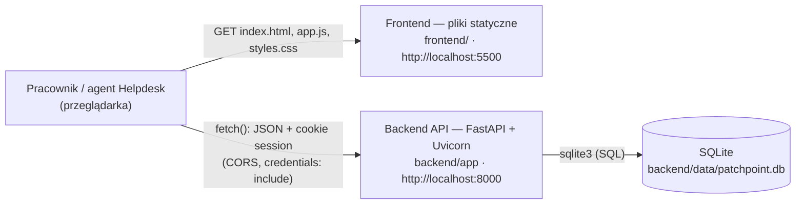
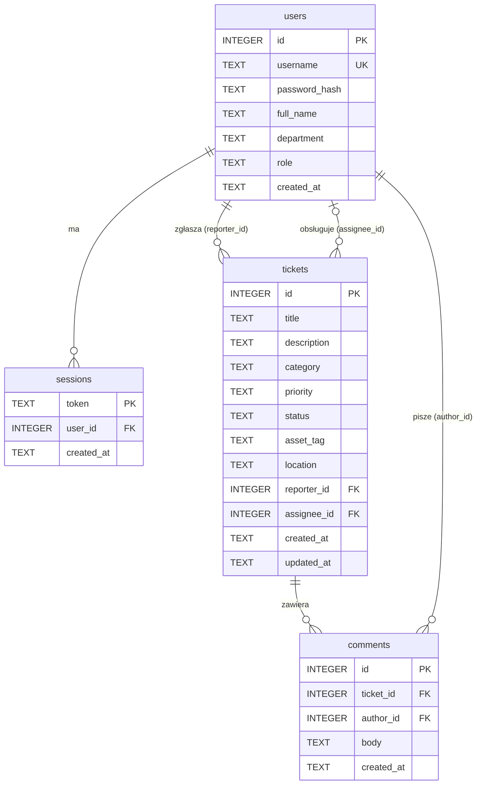
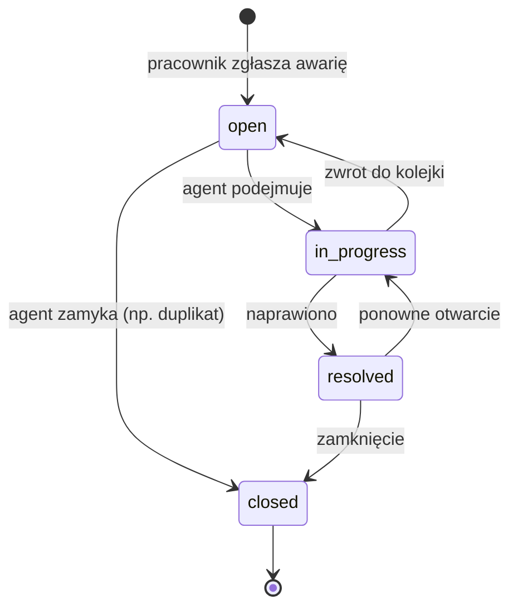
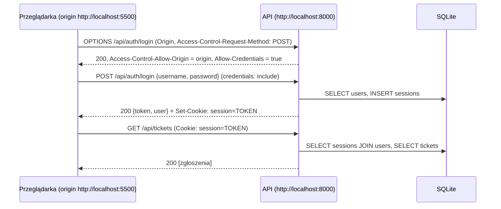

# Faza 1 (DEV) — MVP systemu zgłoszeń IT „PatchPoint”

## Context

Kurs „AI-Driven DevSecOps”, Scenariusz 5 (Menadżer Zadań IT / IT Ticketing System). Celem Fazy 1 jest wygenerowany przez AI, celowo „szybki” (Draft/MVP) system zgłaszania awarii sprzętu do Helpdesku. System korzysta z bazy SQLite. Faza obejmuje też dowód działania i dokumentację. Repozytorium `github.com/l3x1cn/patchpoint` zawiera dziś tylko pusty `README.md` (commit `init`).

Decyzje zespołu (odpowiedzi na pytania AI):
- stos: Python + FastAPI + SQLite;
- zależności: uv, doinstalowany w katalogu użytkownika;
- frontend: minimalny HTML/JS na osobnym originie;
- dokumentacja po polsku, kod i identyfikatory po angielsku;
- pełny rejestr celowych słabości w `docs/`.

Stan końcowy:
- `make install && make lint && make typecheck && make test` przechodzą przy pokryciu ≥ 80%;
- `make run` (API `http://localhost:8000`) i `make frontend` (UI `http://localhost:5500`) dają działający system;
- `make demo` przechodzi scenariusz end-to-end;
- `docs/faza-1-dev/` zawiera raport fazy, dziennik promptów, rejestr słabości W-01…W-18 i dowody uruchomienia.

Słabości W-01…W-18 są wymaganiami Fazy 1 i stanowią wejście dla Fazy 2 (Red Team / SAST). Odpowiadają wektorom scenariusza: Information Disclosure, Broken Authentication oraz CORS przy rozdzieleniu frontendu i backendu. Reviewerzy zadań, QA i końcowy code review nie mogą ich usuwać. Zgłoszenia końcowego code review dotyczące W-xx są oczekiwane; w pytaniu po przeglądzie nie uruchamiamy dla nich poprawek.

Routing delivery (`route_task.py`): zadania 1–2 (`.py`) trafiają do `python-developer:developer`, a zadania 3–5 (HTML/JS/CSS bez `package.json`, `.sh`, `.md`) do `delivery:implementer`. Plan zostanie skopiowany do `docs/plans/<RRRR-MM-DD>-faza-1-mvp.md` i zacommitowany na gałęzi `delivery/faza-1-mvp`.

Fakty zweryfikowane 2026-11-15:
- Środowisko: systemowy Python 3.14.9, brak uv. Dostępne są make, curl, jq i node 26.
- PyPI: fastapi 0.163.1 (Starlette 1.10.0), uvicorn 0.54.0, pydantic 2.14.3, pydantic-settings 2.16.3, httpx2 2.16.0, pytest 9.2.0, pytest-cov 7.1.0, mypy 2.4.1, ruff 0.17.5, uv 0.13.8.
- Starlette 1.10 `CORSMiddleware` przy `allow_origins=["*"]` i `allow_credentials=True` odbija dowolny `Origin` razem z `Access-Control-Allow-Credentials: true`.
- `Response.set_cookie` ma domyślnie `httponly=False`, `secure=False` i `samesite="lax"`.
- `TestClient` importuje `httpx2`; z `httpx` emituje DeprecationWarning.
- Handlery wyjątków innych niż `Exception`/500 działają w `ExceptionMiddleware`, więc `debug=True` ich nie omija.
- Zapytanie `... LIKE '%O'Brien%' ...` kończy się w SQLite błędem `OperationalError: near "Brien": syntax error`.
- Payload `') OR 1=1 OR ('` w tym samym miejscu zwraca wszystkie wiersze.

## Approach

Kolejność zadań: 1 → 2 → 3 → 4 → 5.
- Zadanie 2 korzysta z helperów, zależności i fikstur zadania 1.
- Zadanie 3 opiera się na kontrakcie API z zadań 1–2.
- Zadanie 4 potrzebuje działającego API i danych demo.
- Zadanie 5 dokumentuje wszystko i uruchamia system, żeby zebrać dowody.

### Task 1: Backend — szkielet API, SQLite i uwierzytelnianie sesyjne
**Commit:** feat(backend): add FastAPI MVP skeleton with SQLite and session auth

**Files:**
- Create: `.gitignore`
- Create: `Makefile`
- Create: `backend/.python-version`
- Create: `backend/pyproject.toml`
- Create: `backend/uv.lock`
- Create: `backend/app/__init__.py`
- Create: `backend/app/config.py`
- Create: `backend/app/schema.sql`
- Create: `backend/app/database.py`
- Create: `backend/app/security.py`
- Create: `backend/app/schemas.py`
- Create: `backend/app/dependencies.py`
- Create: `backend/app/routers/__init__.py`
- Create: `backend/app/routers/health.py`
- Create: `backend/app/routers/auth.py`
- Create: `backend/app/main.py`
- Test: `backend/tests/conftest.py`
- Test: `backend/tests/test_auth.py`
- Test: `backend/tests/test_health.py`
- Test: `backend/tests/test_cors.py`
- Test: `backend/tests/test_errors.py`

**Ramy zadania (obowiązują implementera i reviewera):**
- Projekt kursowy „AI-Driven DevSecOps”, Faza 1: celowo uproszczone MVP. Elementy oznaczone `[W-xx]` są wymaganiami tej fazy, więc implementuj je dokładnie tak, jak opisano. Dla reviewera: brak albo „naprawienie” W-xx to finding `important` (odstępstwo od specyfikacji), a sama obecność W-xx nie jest findingiem. Usunie je Faza 2.
- W kodzie nie może być komentarzy, docstringów ani nazw wskazujących słabości (np. „insecure”, „vuln”, „W-07”, „TODO security”), bo audyt AI w Fazie 2 ma je znaleźć samodzielnie.
- Nie pisz testów utrwalających W-xx; sprawdza je sekcja Verification planu. Testy obejmują logikę biznesową i kontrakty, które przetrwają łatanie.
- Architektura MVP jest nadrzędna wobec wzorców ze skilli fastapi/sqlalchemy/pydantic:
  - surowy `sqlite3` bez ORM i bez warstw serwis/UoW/repozytorium; routery wołają helpery z `app.database`;
  - endpointy `async def` na `APIRouter`;
  - zależności jako aliasy PEP 695 `type X = Annotated[T, Depends(fn)]` (FastAPI 0.163.1 rozpakowuje je w `analyze_param`).
- Obowiązują: importy absolutne (`from app.database import fetch_one`), pełne adnotacje typów, `X | None`, `pathlib.Path` i łapanie tylko konkretnych wyjątków. Nie edytuj `README.md`, bo pisze go zadanie 5.
- Backend nie importuje modułu `logging` i nie rejestruje zdarzeń bezpieczeństwa, takich jak nieudane logowania, rejestracje czy zmiany ról [W-18]. Uvicorn loguje żądania sam.

**Krok 0 — uv:**
- Gdy `uv --version` zawodzi, uruchom `curl -LsSf https://astral.sh/uv/install.sh | env UV_NO_MODIFY_PATH=1 sh`. Instalator wstawia uv do `~/.local/bin`, który jest już w `PATH`; sudo nie jest potrzebne.
- Gdy astral.sh jest nieosiągalne, użyj `python3 -m pip install --user --break-system-packages uv`.

**Konfiguracja projektu:**
- `backend/.python-version`: `3.14`.
- `backend/pyproject.toml`:
  - `[project]`: `name = "patchpoint-backend"`, `version = "0.1.0"`, `description = "PatchPoint — API systemu zgłoszeń IT (Faza 1, MVP)"`, `requires-python = ">=3.12"`, `dependencies = ["fastapi>=0.163.1", "uvicorn>=0.54.0", "pydantic-settings>=2.16.3"]`. Bez sekcji `[build-system]`: uv traktuje wtedy projekt jako niepakietowy, a importowalność `app` zapewniają `pythonpath` i katalog roboczy.
  - `[dependency-groups]`: `dev = ["httpx2>=2.16.0", "mypy>=2.4.1", "pytest>=9.2.0", "pytest-cov>=7.1.0", "ruff>=0.17.5"]`. Pakiet `httpx2`, a nie `httpx`, bo TestClient Starlette 1.x importuje `httpx2`.
  - `[tool.pytest.ini_options]`: `testpaths = ["tests"]`, `pythonpath = ["."]`, `addopts = "--cov=app --cov-report=term-missing --cov-fail-under=80"`.
  - `[tool.ruff]`: `target-version = "py312"`, `line-length = 100`.
  - `[tool.ruff.lint]`: `select = ["E", "F", "W", "I", "B", "UP", "N", "SIM"]`. Bez reguł `S` (bandit), bo skanowanie bezpieczeństwa należy do Faz 2–3.
  - `[tool.ruff.lint.isort]`: `known-first-party = ["app"]`.
  - `[tool.mypy]`: `python_version = "3.12"`, `strict = true`, `plugins = ["pydantic.mypy"]`.
- `backend/uv.lock`: wynik `cd backend && uv sync`, commitowany.
- `Makefile` w katalogu głównym:
  - zmienne: `BACKEND := backend`, `API_HOST ?= 127.0.0.1`, `API_PORT ?= 8000`;
  - cele `.PHONY`:
    - `install`: `cd $(BACKEND) && uv sync`;
    - `run`: `cd $(BACKEND) && uv run uvicorn app.main:app --host $(API_HOST) --port $(API_PORT)`;
    - `test`: `cd $(BACKEND) && uv run pytest`;
    - `lint`: `cd $(BACKEND) && uv run ruff check . && uv run ruff format --check .`;
    - `format`: `cd $(BACKEND) && uv run ruff format . && uv run ruff check --fix .`;
    - `typecheck`: `cd $(BACKEND) && uv run mypy app tests`.
- `.gitignore` w katalogu głównym, po jednym wzorcu w linii: `__pycache__/`, `*.py[cod]`, `.venv/`, `.pytest_cache/`, `.mypy_cache/`, `.ruff_cache/`, `.coverage`, `coverage.xml`, `htmlcov/`, `backend/data/`, `*.db`, `*.sqlite3`, `.idea/`, `.vscode/`, `.DS_Store`.

**`backend/app/config.py`:**
- stałe `APP_VERSION: Final = "0.1.0"` i `BACKEND_DIR: Final = Path(__file__).resolve().parent.parent`;
- `class Settings(BaseSettings)` z `model_config = SettingsConfigDict(env_prefix="PATCHPOINT_")`;
- pola `database_path: Path = BACKEND_DIR / "data" / "patchpoint.db"` oraz `seed_demo_data: bool = True` [W-12]; zmienne środowiskowe to `PATCHPOINT_DATABASE_PATH` i `PATCHPOINT_SEED_DEMO_DATA`.

**`backend/app/schema.sql`** — dokładnie ten DDL. To pełny model danych; tabele `tickets` i `comments` wykorzystuje zadanie 2. Tabela `sessions` nie ma kolumn wygasania [W-09].
```sql
CREATE TABLE IF NOT EXISTS users (
    id            INTEGER PRIMARY KEY AUTOINCREMENT,
    username      TEXT    NOT NULL UNIQUE,
    password_hash TEXT    NOT NULL,
    full_name     TEXT    NOT NULL,
    department    TEXT    NOT NULL DEFAULT '',
    role          TEXT    NOT NULL DEFAULT 'employee',
    created_at    TEXT    NOT NULL
);

CREATE TABLE IF NOT EXISTS sessions (
    token      TEXT    PRIMARY KEY,
    user_id    INTEGER NOT NULL REFERENCES users(id),
    created_at TEXT    NOT NULL
);

CREATE TABLE IF NOT EXISTS tickets (
    id          INTEGER PRIMARY KEY AUTOINCREMENT,
    title       TEXT    NOT NULL,
    description TEXT    NOT NULL,
    category    TEXT    NOT NULL,
    priority    TEXT    NOT NULL,
    status      TEXT    NOT NULL DEFAULT 'open',
    asset_tag   TEXT,
    location    TEXT,
    reporter_id INTEGER NOT NULL REFERENCES users(id),
    assignee_id INTEGER REFERENCES users(id),
    created_at  TEXT    NOT NULL,
    updated_at  TEXT    NOT NULL
);

CREATE TABLE IF NOT EXISTS comments (
    id         INTEGER PRIMARY KEY AUTOINCREMENT,
    ticket_id  INTEGER NOT NULL REFERENCES tickets(id),
    author_id  INTEGER NOT NULL REFERENCES users(id),
    body       TEXT    NOT NULL,
    created_at TEXT    NOT NULL
);
```

**`backend/app/database.py`:**
- `SCHEMA_PATH = Path(__file__).with_name("schema.sql")`.
- `class DatabaseError(Exception)`:
  - `__init__(self, sql: str, params: Sequence[object], original: sqlite3.Error)`;
  - atrybuty `sql`, `params` i `original`;
  - `str(exc) == str(original)`.
- `utc_now_iso() -> str`: zwraca `datetime.now(UTC).isoformat(timespec="seconds")`.
- `connect(database_path: Path) -> sqlite3.Connection`:
  - otwiera `sqlite3.connect(database_path, check_same_thread=False)`;
  - ustawia `row_factory = sqlite3.Row`;
  - wykonuje `PRAGMA foreign_keys = ON`.
- Helpery zapytań:
  - `fetch_one(conn: sqlite3.Connection, sql: str, params: Sequence[object] = ()) -> sqlite3.Row | None`;
  - `fetch_all(conn: sqlite3.Connection, sql: str, params: Sequence[object] = ()) -> list[sqlite3.Row]`;
  - `execute(conn: sqlite3.Connection, sql: str, params: Sequence[object] = ()) -> int`: wykonuje `commit` i zwraca `lastrowid` (0, gdy `None`).
  - Każdy helper łapie wyłącznie `sqlite3.Error` wokół `conn.execute(...)`/`commit` i rzuca `raise DatabaseError(sql, params, exc) from exc`.
- `create_user(conn: sqlite3.Connection, *, username: str, password: str, full_name: str, department: str, role: Role) -> int`: wykonuje INSERT z `hash_password(password)` i `utc_now_iso()` i zwraca id.
- `DEMO_USERS: Final` to krotki `(username, password, full_name, department, Role)` z poniższej tabeli [W-12].
- `seed_demo_data(conn: sqlite3.Connection) -> None`: tylko gdy `SELECT COUNT(*) AS n FROM users` daje 0, tworzy `DEMO_USERS` przez `create_user`.

| username | hasło | rola | full_name | department |
|---|---|---|---|---|
| `admin` | `admin123` | agent | Administrator Systemu | IT |
| `helpdesk` | `helpdesk123` | agent | Piotr Serwisant | IT Helpdesk |
| `jan.kowalski` | `password123` | employee | Jan Kowalski | Księgowość |
| `anna.nowak` | `password123` | employee | Anna Nowak | Marketing |

- `init_db(database_path: Path, *, with_demo_data: bool) -> None`:
  1. `database_path.parent.mkdir(parents=True, exist_ok=True)`;
  2. w ramach `contextlib.closing(connect(...))`: `conn.executescript(SCHEMA_PATH.read_text(encoding="utf-8"))`;
  3. przy `with_demo_data` wywołanie `seed_demo_data(conn)`;
  4. `conn.commit()`.

**`backend/app/security.py`:**
- `SESSION_COOKIE_NAME: Final = "session"`.
- `hash_password(password: str) -> str`: `hashlib.md5(password.encode("utf-8")).hexdigest()` [W-07].
- `verify_password(password: str, password_hash: str) -> bool`: `hash_password(password) == password_hash`.
- `generate_session_token(username: str) -> str`: `hashlib.md5(f"{username}:{int(time.time())}".encode("utf-8")).hexdigest()` [W-08].

**`backend/app/schemas.py`:**
- `class Role(StrEnum)`: `EMPLOYEE = "employee"`, `AGENT = "agent"`.
- Modele Pydantic v2:
  - `UserCreate`: `username: str = Field(min_length=3, max_length=50)`; `password: str` bez ograniczeń [W-12]; `full_name: str = Field(min_length=1)`; `department: str = ""`; `role: Role = Role.EMPLOYEE` [W-15].
  - `UserResponse`: `id: int`, `username: str`, `full_name: str`, `department: str`, `role: Role`, `created_at: datetime`, `password_hash: str` [W-06]. To jedyny model użytkownika, służy też jako typ bieżącego użytkownika.
  - `LoginRequest`: `username: str`, `password: str`.
  - `LoginResponse`: `token: str`, `user: UserResponse` [W-11].
  - `MessageResponse`: `message: str`.
  - `HealthResponse`: `status: str`, `version: str`, `database: str`, `sqlite_version: str`, `python_version: str` [W-04].

**`backend/app/dependencies.py`:**
- Ustawienia: `def get_settings(request: Request) -> Settings` zwraca `request.app.state.settings`; alias `type AppSettings = Annotated[Settings, Depends(get_settings)]`.
- Połączenie z bazą: `async def get_db(settings: AppSettings) -> AsyncIterator[sqlite3.Connection]` robi `with closing(connect(settings.database_path)) as conn: yield conn`; alias `type DbConnection = Annotated[sqlite3.Connection, Depends(get_db)]`.
- Bieżący użytkownik: `async def get_current_user(request: Request, conn: DbConnection) -> UserResponse`.
  - Token pochodzi z nagłówka `Authorization`, gdy ten zaczyna się od `Bearer ` (reszta nagłówka), a w przeciwnym razie z cookie `session` [W-11].
  - Brak tokenu daje 401 `"Not authenticated"`.
  - Wyszukanie sesji: `fetch_one(conn, "SELECT u.* FROM sessions s JOIN users u ON u.id = s.user_id WHERE s.token = ?", (token,))`, bez sprawdzania wieku sesji [W-09].
  - Brak wiersza daje 401 `"Invalid session token"`; w przeciwnym razie zwraca `UserResponse.model_validate(dict(row))`.
- Alias `type CurrentUser = Annotated[UserResponse, Depends(get_current_user)]`.

**`backend/app/routers/health.py`:**
- `router = APIRouter(prefix="/api", tags=["health"])`.
- Funkcja `health` obsługuje `GET /health` i zwraca `HealthResponse`; endpoint nie wymaga uwierzytelnienia [W-04]. Pola odpowiedzi:
  - `status="ok"` i `version=APP_VERSION`;
  - `database=str(settings.database_path.resolve())`;
  - `sqlite_version` z `fetch_one(conn, "SELECT sqlite_version() AS version")`;
  - `python_version=platform.python_version()`.

**`backend/app/routers/auth.py`** (`router = APIRouter(prefix="/api/auth", tags=["auth"])`):
- `register`, czyli `POST /register` (`status_code=201`) → `UserResponse`.
  - Wywołuje `create_user(...)` z polami `UserCreate`, także z `role` [W-15].
  - `DatabaseError` z `original` typu `sqlite3.IntegrityError` zamienia na `HTTPException(409, detail=f"Registration failed: {exc.original}")` [W-02]; pozostałe `DatabaseError` propaguje.
  - Zwraca świeżo odczytany wiersz `SELECT * FROM users WHERE id = ?`.
- `login`, czyli `POST /login` → `LoginResponse`; parametry `payload: LoginRequest, response: Response, conn: DbConnection`.
  - Nieznany login daje 404 `f"User '{payload.username}' does not exist"`, a złe hasło 401 `"Invalid password"` [W-05].
  - Przy sukcesie: `token = generate_session_token(payload.username)` i `execute(conn, "INSERT OR IGNORE INTO sessions (token, user_id, created_at) VALUES (?, ?, ?)", ...)`. Ponowne logowanie w tej samej sekundzie daje ten sam token, a `OR IGNORE` zapobiega błędowi.
  - Cookie: `response.set_cookie(key=SESSION_COOKIE_NAME, value=token)` bez `httponly`, `secure` i `max_age`, czyli z domyślnym `SameSite=lax` [W-11].
  - Zwraca `LoginResponse(token=token, user=...)`.
- `logout`, czyli `POST /logout` → `MessageResponse(message="Logged out")`. Wywołuje wyłącznie `response.delete_cookie(SESSION_COOKIE_NAME)`: nie zmienia bazy i nie wymaga uwierzytelnienia [W-10].
- `get_me`, czyli `GET /me` → `UserResponse`; zwraca wprost `CurrentUser` [W-06].

**`backend/app/main.py`:** definiuje `create_app(settings: Settings | None = None) -> FastAPI` (gdy `None`, używa `Settings()`) oraz moduł-poziomowe `app = create_app()`. W `create_app`:
- `lifespan` jako `asynccontextmanager` woła `init_db(settings.database_path, with_demo_data=settings.seed_demo_data)`.
- Aplikacja: `FastAPI(title="PatchPoint API", version=APP_VERSION, debug=True, lifespan=lifespan)`. `debug=True` jest wpisane na sztywno, a `/docs`, `/redoc` i `/openapi.json` mają wartości domyślne [W-03]. Następnie `app.state.settings = settings`.
- CORS: `app.add_middleware(CORSMiddleware, allow_origins=["*"], allow_credentials=True, allow_methods=["*"], allow_headers=["*"])` jako literał w kodzie, a nie z ustawień [W-13].
- Handler `DatabaseError` (`@app.exception_handler(DatabaseError)`) zwraca [W-01]: `JSONResponse(status_code=500, content={"error": "DatabaseError", "message": str(exc.original), "query": exc.sql, "params": list(exc.params), "database": str(settings.database_path.resolve()), "traceback": "".join(traceback.format_exception(exc)).splitlines()})`.
- `include_router` dla `health.router` i `auth.router`.

**Testy (pisz najpierw).** Fikstury w `backend/tests/conftest.py` (używa ich zadanie 2):
- `settings(tmp_path: Path) -> Settings` z `database_path=tmp_path / "test.db"` i `seed_demo_data=False`.
- `app(settings) -> FastAPI` zwraca `create_app(settings)`.
- `client(app) -> Iterator[TestClient]` używa `with TestClient(app) as test_client`, co uruchamia lifespan.
- `user_factory(client, settings) -> Callable[..., int]` zwraca funkcję `(username: str, *, role: Role = Role.EMPLOYEE, password: str = "Secret123!", full_name: str | None = None) -> int`.
  - Tworzy użytkownika bezpośrednio w bazie przez `connect` i `create_user`, z `department="QA"` i `full_name` domyślnie równym `username`.
  - Nie korzysta z API, żeby testy przetrwały usunięcie `role` z rejestracji w Fazie 2.
- `login_as(app, client) -> Iterator[Callable[..., TestClient]]` zwraca funkcję `(username: str, password: str = "Secret123!") -> TestClient`.
  - Tworzy nowy `TestClient(app)` z osobnym słoikiem cookies, wysyła `POST /api/auth/login` i sprawdza 200.
  - Po teście zamyka utworzone klienty.

Przypadki testowe:
- `test_auth.py`:
  - rejestracja nowego konta → 201 i `role == "employee"`;
  - duplikat loginu (po `user_factory`) → 409;
  - walidacja (parametrize: brak `username`, `username="ab"`, `full_name=""`) → 422;
  - logowanie, potem `GET /api/auth/me` → 200 z poprawnymi `username` i `full_name`;
  - złe hasło → 401 i brak cookie `session` w odpowiedzi;
  - `/me` bez sesji → 401; `/me` z cookie `session=forged` → 401;
  - `POST /api/auth/logout` → 200 `{"message": "Logged out"}`, a potem `/me` tym samym klientem → 401;
  - świeża baza z `seed_demo_data=True`: `jan.kowalski`/`password123` loguje się z rolą `employee`, a `helpdesk`/`helpdesk123` z rolą `agent`;
  - dwa kolejne uruchomienia lifespan (`with TestClient(app)`) na tej samej bazie z seedem → nadal dokładnie 4 użytkowników.
- `test_health.py`: `GET /api/health` → 200 i `status == "ok"`.
- `test_cors.py`: preflight `OPTIONS /api/auth/me` z `Origin: http://localhost:5500` i `Access-Control-Request-Method: GET` → 200, `access-control-allow-origin == "http://localhost:5500"`, `access-control-allow-credentials == "true"`. To kontrakt frontendu.
- `test_errors.py`: po `DROP TABLE sessions`, wykonanym bezpośrednio przez `connect(settings.database_path)`, logowanie istniejącego użytkownika → 500 z treścią JSON, w której `body["error"]` jest niepustym stringiem.

**Gotowe, gdy:** przechodzą `make install`, `make lint`, `make typecheck` i `make test` (pokrycie ≥ 80%), a `make run` uruchamia API na `127.0.0.1:8000`.

### Task 2: Backend — zgłoszenia, przepływ statusów, komentarze i dane demo
**Commit:** feat(backend): add ticket workflow, comments and demo data

**Files:**
- Modify: `backend/app/schemas.py`
- Modify: `backend/app/dependencies.py`
- Modify: `backend/app/database.py`
- Modify: `backend/app/main.py`
- Create: `backend/app/routers/tickets.py`
- Test: `backend/tests/conftest.py`
- Test: `backend/tests/test_tickets.py`

**Ramy zadania (obowiązują implementera i reviewera):**
- Projekt kursowy „AI-Driven DevSecOps”, Faza 1: celowo uproszczone MVP. Elementy oznaczone `[W-xx]` są wymaganiami. Dla reviewera: brak albo „naprawienie” W-xx to finding `important`, a obecność W-xx nie jest findingiem.
- W kodzie nie może być komentarzy, docstringów ani nazw wskazujących słabości. Nie pisz testów utrwalających W-xx.
- Architektura bez zmian względem zadania 1: surowy `sqlite3`, routery wołają helpery `app.database`, endpointy `async def`, zależności jako aliasy `type X = Annotated[...]`. Obowiązują importy absolutne i pełne typy. Nie importuj `logging` [W-18]. Nie edytuj `README.md`.

**Istniejące elementy z zadania 1 do wykorzystania:**
- `app.database`: `fetch_one`, `fetch_all`, `execute`, `utc_now_iso`, `create_user`, `seed_demo_data`, `DEMO_USERS`, `connect`.
- `app.dependencies`: `DbConnection`, `CurrentUser`, `get_current_user`.
- `app.schemas`: `Role`, `UserResponse`.
- Fikstury `settings`, `app`, `client`, `user_factory` i `login_as` z `backend/tests/conftest.py`.
- Tabele `tickets` (`id, title, description, category, priority, status, asset_tag, location, reporter_id, assignee_id, created_at, updated_at`) i `comments` (`id, ticket_id, author_id, body, created_at`) istnieją w `backend/app/schema.sql`.

**`backend/app/schemas.py` — nowe typy i modele:**
- Enumy `StrEnum`:
  - `TicketCategory`: `LAPTOP="laptop"`, `DESKTOP="desktop"`, `MONITOR="monitor"`, `PRINTER="printer"`, `PERIPHERAL="peripheral"`, `NETWORK="network"`, `OTHER="other"`;
  - `TicketPriority`: `LOW="low"`, `MEDIUM="medium"`, `HIGH="high"`, `CRITICAL="critical"`;
  - `TicketStatus`: `OPEN="open"`, `IN_PROGRESS="in_progress"`, `RESOLVED="resolved"`, `CLOSED="closed"`.
- `TicketCreate`: `title: str = Field(min_length=1)`, `description: str = Field(min_length=1)`, `category: TicketCategory`, `priority: TicketPriority = TicketPriority.MEDIUM`, `asset_tag: str | None = None`, `location: str | None = None`.
- `TicketUpdate`: `status: TicketStatus | None = None`, `priority: TicketPriority | None = None`, `assignee_id: int | None = None`.
- `TicketResponse`: `id: int`, `title: str`, `description: str`, `category: TicketCategory`, `priority: TicketPriority`, `status: TicketStatus`, `asset_tag: str | None`, `location: str | None`, `reporter_id: int`, `reporter_name: str`, `assignee_id: int | None`, `assignee_name: str | None`, `created_at: datetime`, `updated_at: datetime`.
- `CommentCreate`: `body: str = Field(min_length=1)`.
- `CommentResponse`: `id: int`, `ticket_id: int`, `author_id: int`, `author_name: str`, `body: str`, `created_at: datetime`.
- `TicketDetailResponse(TicketResponse)`: `comments: list[CommentResponse]`.

**`backend/app/dependencies.py` — dodaj:**
- `async def require_agent(user: CurrentUser) -> UserResponse`: rola inna niż `agent` daje 403 `"Helpdesk agent role required"`.
- Alias `type AgentUser = Annotated[UserResponse, Depends(require_agent)]`.

**`backend/app/routers/tickets.py`:**
- `router = APIRouter(prefix="/api/tickets", tags=["tickets"])`.
- `ALLOWED_TRANSITIONS: Final[dict[TicketStatus, frozenset[TicketStatus]]]`:
  - `open → {in_progress, closed}`;
  - `in_progress → {open, resolved}`;
  - `resolved → {in_progress, closed}`;
  - `closed → ∅`.
- Stała `TICKET_SELECT`, którą wszystkie odczyty zgłoszeń uzupełniają klauzulami WHERE/ORDER BY:
```sql
SELECT t.id, t.title, t.description, t.category, t.priority, t.status,
       t.asset_tag, t.location, t.reporter_id, r.full_name AS reporter_name,
       t.assignee_id, a.full_name AS assignee_name, t.created_at, t.updated_at
FROM tickets t
JOIN users r ON r.id = t.reporter_id
LEFT JOIN users a ON a.id = t.assignee_id
```
- `create_ticket`, czyli `POST ""` (`status_code=201`) → `TicketResponse`.
  - Dostęp ma każdy zalogowany (`CurrentUser`).
  - Zapis: `reporter_id` = id bieżącego użytkownika, `status='open'`, `created_at = updated_at = utc_now_iso()`; INSERT jest parametryzowany.
  - Zwraca zgłoszenie odczytane przez `TICKET_SELECT`.
- `list_tickets`, czyli `GET ""` → `list[TicketResponse]`; parametry query `status: TicketStatus | None = None`, `search: str | None = None` [W-14].
  - Warunki budowane są f-stringami w liście `conditions`:
    - dla roli `employee` `t.reporter_id = {user.id}`;
    - dla podanego `status` `t.status = '{status}'`;
    - dla niepustego `search` `(t.title LIKE '%{search}%' OR t.description LIKE '%{search}%')`.
  - Warunki łączy ` AND `, a `where = f" WHERE {...}"`, gdy lista nie jest pusta.
  - Wynik: `fetch_all(conn, f"{TICKET_SELECT}{where} ORDER BY t.id DESC")` bez parametrów.
  - Agent widzi wszystkie zgłoszenia. To jedyne nieparametryzowane zapytanie w projekcie.
- `get_ticket`, czyli `GET "/{ticket_id}"` → `TicketDetailResponse` [W-16].
  - Dostęp: `dependencies=[Depends(get_current_user)]`; endpoint nie sprawdza, czy pracownik jest zgłaszającym.
  - Brak zgłoszenia daje 404 `"Ticket not found"`.
  - Komentarze pobiera zapytanie `SELECT c.id, c.ticket_id, c.author_id, u.full_name AS author_name, c.body, c.created_at FROM comments c JOIN users u ON u.id = c.author_id WHERE c.ticket_id = ? ORDER BY c.id`.
- `update_ticket`, czyli `PATCH "/{ticket_id}"` → `TicketResponse`; dostęp `dependencies=[Depends(require_agent)]`. Kolejność walidacji:
  1. wszystkie pola `None` → 400 `"Nothing to update"`;
  2. brak zgłoszenia → 404 `"Ticket not found"`;
  3. `status` różny od bieżącego i spoza `ALLOWED_TRANSITIONS[bieżący]` → 400 `f"Invalid status transition: {current} -> {new}"` (ten sam status oznacza brak zmiany i jest dozwolony);
  4. `assignee_id` wskazujący nieistniejącego użytkownika albo rolę inną niż `agent` → 400 `"Assignee must be a helpdesk agent"`.
  - Następnie wykonuje parametryzowany UPDATE wyłącznie kolumn `status`, `priority`, `assignee_id` z ustalonej listy, plus `updated_at = utc_now_iso()`.
- `add_comment`, czyli `POST "/{ticket_id}/comments"` (`status_code=201`) → `CommentResponse` [W-16].
  - Dostęp ma każdy zalogowany (`CurrentUser`), bez sprawdzania, czyje jest zgłoszenie.
  - Brak zgłoszenia daje 404.
  - Parametryzowany INSERT komentarza, potem `UPDATE tickets SET updated_at = ? WHERE id = ?`.
- W `backend/app/main.py` dodaj `include_router(tickets.router)`.

**`backend/app/database.py` — dane demo:** `seed_demo_data` w tej samej gałęzi „pusta tabela `users`” po utworzeniu kont dodaje zgłoszenia (id zgłaszających i przypisanych wyszukuje po `username`). Następnie dodaje komentarz `helpdesk` do zgłoszenia #2 o treści „Zamówiono nowy podajnik papieru, wymiana planowana na piątek.”

| # | zgłaszający | title | description | category | priority | status | asset_tag | location | przypisany |
|---|---|---|---|---|---|---|---|---|---|
| 1 | jan.kowalski | Laptop nie uruchamia się po aktualizacji | Po nocnej aktualizacji systemu laptop zatrzymuje się na logo producenta. | laptop | high | open | LAP-0042 | B-204 | — |
| 2 | jan.kowalski | Drukarka zacina papier | Drukarka sieciowa na 2. piętrze zacina papier przy druku dwustronnym. | printer | medium | in_progress | PRN-0007 | Korytarz, 2. piętro | helpdesk |
| 3 | anna.nowak | Migający monitor | Monitor zewnętrzny miga co kilka sekund po podłączeniu przez HDMI. | monitor | low | open | MON-0113 | C-012 | — |

**Testy (pisz najpierw).** W `conftest.py` dodaj fiksturę `ticket_factory() -> Callable[..., int]`. Zwraca funkcję `(client: TestClient, *, title: str = "Laptop się przegrzewa", description: str = "Wentylator pracuje głośno, obudowa jest gorąca.", category: str = "laptop", priority: str = "high") -> int`, która wysyła `POST /api/tickets`, sprawdza 201 i zwraca `id`. Przypadki w `test_tickets.py`:
- Tworzenie:
  - przez pracownika → 201, `status == "open"`, `reporter_id` i `reporter_name` wskazują twórcę, `assignee_id is None`;
  - bez sesji → 401;
  - walidacja (parametrize: `category="toaster"`, `priority="urgent"`, `title=""`) → 422.
- Lista:
  - pracownik widzi wyłącznie swoje zgłoszenia (dwóch pracowników);
  - agent widzi wszystkie;
  - filtr `status=in_progress` zwraca tylko przestawione zgłoszenie;
  - `search` dopasowuje tytuł i opis bez względu na wielkość liter ASCII (parametrize: `MONITOR` znajduje zgłoszenie „Monitor flickers”, `toner` znajduje zgłoszenie ze słowem „toner” w opisie).
- Szczegóły: zawierają komentarze z `author_name`; nieistniejące id → 404.
- PATCH:
  - dozwolone ścieżki (parametrize: `[in_progress]`, `[in_progress, resolved]`, `[in_progress, resolved, closed]`, `[closed]`, `[in_progress, open]`, `[in_progress, resolved, in_progress]`) → każdy krok 200, a status końcowy jest zgodny z ostatnim krokiem;
  - niedozwolone przejścia (parametrize: `open→resolved`, `closed→open`, `closed→in_progress`) → 400;
  - pracownik → 403;
  - przypisanie agenta → 200 z `assignee_name`;
  - przypisanie pracownika albo id 9999 → 400;
  - `{}` → 400;
  - nieistniejące zgłoszenie → 404.
- Komentarze: dodanie → 201 z `author_name`, widoczny w szczegółach; do nieistniejącego zgłoszenia → 404; `body=""` → 422.
- Seed: świeża baza z `seed_demo_data=True`.
  - `jan.kowalski` widzi 2 zgłoszenia, a `helpdesk` 3.
  - „Drukarka zacina papier” ma `status == "in_progress"`, `assignee_name == "Piotr Serwisant"` i 1 komentarz.

**Gotowe, gdy:** przechodzą `make lint`, `make typecheck` i `make test` (pokrycie ≥ 80%).

### Task 3: Frontend — statyczny klient HTML/JS na osobnym originie
**Commit:** feat(frontend): add static helpdesk client on a separate origin

**Files:**
- Create: `frontend/index.html`
- Create: `frontend/app.js`
- Create: `frontend/styles.css`
- Modify: `Makefile`

**Ramy zadania (obowiązują implementera i reviewera):**
- Faza 1 kursu „AI-Driven DevSecOps” to celowo uproszczone MVP.
- [W-17]: wszystkie wartości z API (tytuły, opisy, komentarze, imiona i nazwiska, numery inwentarzowe, lokalizacje) trafiają do DOM przez `innerHTML` z template literali, bez escapowania i bez helperów sanityzujących. To wymaganie fazy: reviewer zgłasza escapowanie, a nie jego brak. W kodzie nie może być komentarzy wskazujących słabość.
- Technologia: czysty HTML, CSS i JavaScript (ES2020, klasyczny `<script defer>`). Bez npm, `package.json`, bundlera, frameworków i CDN; `package.json` z Reactem przekierowałby routing delivery do innego agenta.
- Token nie jest przechowywany w `localStorage`; sesję niesie wyłącznie cookie `session`. Nie edytuj `README.md`.

**Kontrakt API (backend z zadań 1–2):**
- Wszystkie wywołania: `fetch(API_BASE_URL + path, { method, credentials: "include", headers: { "Content-Type": "application/json" }, body })`, gdzie `const API_BASE_URL = "http://localhost:8000";` jest pierwszą linią `app.js`. Błędy HTTPException mają postać `{"detail": "<tekst>"}`, walidacja 422 `{"detail": [...]}`, a błąd bazy 500 obiekt z polem `error`.
- Endpointy uwierzytelniania:
  - `POST /api/auth/register` z `{username, password, full_name, department}` → 201 obiekt użytkownika;
  - `POST /api/auth/login` z `{username, password}` → 200 `{token, user}` i ustawia cookie `session`;
  - `POST /api/auth/logout` → 200 `{message}`;
  - `GET /api/auth/me` → 200 obiekt użytkownika albo 401.
- Obiekt użytkownika: `{id, username, full_name, department, role ("employee" | "agent"), created_at, password_hash}`.
- Endpointy zgłoszeń:
  - `GET /api/tickets?status=<s>&search=<q>` → lista zgłoszeń;
  - `POST /api/tickets` z `{title, description, category, priority, asset_tag, location}` → 201;
  - `GET /api/tickets/{id}` → zgłoszenie z polem `comments`;
  - `PATCH /api/tickets/{id}` z `{status?, priority?, assignee_id?}` (tylko agent) → 200 albo 400/403;
  - `POST /api/tickets/{id}/comments` z `{body}` → 201.
- Zgłoszenie: `{id, title, description, category, priority, status, asset_tag, location, reporter_id, reporter_name, assignee_id, assignee_name, created_at, updated_at}`. Komentarz: `{id, ticket_id, author_id, author_name, body, created_at}`.
- Wartości enumów i polskie etykiety:
  - kategorie: `laptop` Laptop, `desktop` Komputer stacjonarny, `monitor` Monitor, `printer` Drukarka, `peripheral` Urządzenie peryferyjne, `network` Sieć, `other` Inne;
  - priorytety: `low` Niski, `medium` Średni, `high` Wysoki, `critical` Krytyczny;
  - statusy: `open` Otwarte, `in_progress` W realizacji, `resolved` Rozwiązane, `closed` Zamknięte.

**`frontend/index.html`** (`lang="pl"`, `<meta charset="utf-8">`, tytuł „PatchPoint — Helpdesk IT”):
- `<header>` z nagłówkiem „PatchPoint”, podtytułem „System zgłoszeń awarii sprzętu IT” i paskiem `#user-bar` (ukryty). Pasek zawiera `#user-info` („Zalogowano: <full_name> (<rola>)”) i przycisk `#logout-button` „Wyloguj”.
- `#message` (`role="status"`) na komunikaty.
- `#auth-view` z dwoma formularzami:
  - `#login-form`: pola `username` i `password`, przycisk „Zaloguj”;
  - `#register-form`: pola `username`, `full_name` („Imię i nazwisko”), `department` („Dział”) i `password`, przycisk „Zarejestruj konto”. Bez pola roli.
- `#app-view` (ukryty), zawiera:
  - `#ticket-form` „Nowe zgłoszenie”: `title`, `category` (select), `priority` (select, domyślnie Średni), `asset_tag` („Nr inwentarzowy”), `location` („Lokalizacja”), `description` (textarea) i przycisk „Wyślij zgłoszenie”;
  - `#filter-form`: select `status` z opcją „Wszystkie” = pusta wartość, input `search` i przycisk „Filtruj”;
  - tabelę z `<tbody id="ticket-list">` i kolumnami „#”, „Tytuł”, „Kategoria”, „Priorytet”, „Status”, „Zgłaszający”, „Przypisany”, „Utworzono”;
  - panel `#ticket-detail` (ukryty).

**`frontend/app.js`:**
- Stan i komunikaty:
  - zmienne `currentUser` i `selectedTicketId`;
  - `async function api(path, options)` rzuca `Error` z `detail` (gdy jest stringiem) albo z `JSON.stringify(body)`;
  - `showMessage(text, isError)` wyświetla komunikat w `#message`.
- Renderowanie [W-17]:
  - `renderTickets(tickets)` generuje wiersze przez `innerHTML`; kliknięcie wiersza otwiera szczegóły;
  - `openTicket(id)` renderuje `#ticket-detail` przez `innerHTML`: tytuł, metadane, opis, listę komentarzy i formularz `#comment-form` (textarea `body`, przycisk „Dodaj komentarz”);
  - gdy `currentUser.role === "agent"`, panel pokazuje też select `#status-select` z przyciskiem „Zmień status” i przycisk „Przypisz do mnie” (`PATCH {assignee_id: currentUser.id}`).
- Start: `GET /api/auth/me`; przy 200 pokazuje `#app-view` i ładuje listę, inaczej `#auth-view`.
- Obsługa zdarzeń:
  - logowanie ustawia `currentUser = data.user` i ładuje listę;
  - rejestracja pokazuje komunikat „Konto utworzone — możesz się zalogować”;
  - wylogowanie wywołuje `POST /api/auth/logout` i pokazuje `#auth-view`;
  - nowe zgłoszenie resetuje formularz i odświeża listę;
  - filtr buduje `URLSearchParams` z niepustych pól;
  - komentarz, zmiana statusu i przypisanie odświeżają szczegóły i listę.
- Daty formatuje `new Date(value).toLocaleString("pl-PL")`.

**`frontend/styles.css`:** czytelny, minimalny wygląd: systemowy font, kontener o maksymalnej szerokości ~1100 px, tabela z obramowaniem, klasy `status-open`, `status-in_progress`, `status-resolved` i `status-closed` jako kolorowe etykiety, poszanowanie atrybutu `hidden`.

**`Makefile` — dodaj:**
- zmienną `FRONTEND_PORT ?= 5500`;
- cel `.PHONY` `frontend`: `python3 -m http.server $(FRONTEND_PORT) --bind 127.0.0.1 --directory frontend`.
- UI otwiera się pod `http://localhost:5500`, a nie `127.0.0.1`. Wtedy cookie z `localhost:8000` jest same-site i przy `SameSite=lax` trafia do `fetch`.

**Gotowe, gdy:**
- `node --check frontend/app.js` przechodzi;
- przy `make frontend` uruchomionym w tle `curl -s http://127.0.0.1:5500/` zwraca HTML zawierający „PatchPoint”;
- `grep -c innerHTML frontend/app.js` ≥ 2.

### Task 4: Skrypt demonstracyjny end-to-end
**Commit:** chore(scripts): add end-to-end API demo script

**Files:**
- Create: `scripts/demo.sh`
- Modify: `Makefile`

**Ramy:**
- Skrypt demonstruje funkcje biznesowe (dowód działania Fazy 1), a nie luki.
- Nie wypisuje tokenów ani `password_hash`; z odpowiedzi wybiera pola przez `jq`.
- Nie zmienia kodu w `backend/` ani `frontend/` i nie edytuje `README.md`.

**`scripts/demo.sh`** (wykonywalny, `chmod +x`):
- Nagłówek:
  - shebang `#!/usr/bin/env bash` i `set -euo pipefail`;
  - wymagane `curl` i `jq` sprawdzane przez `command -v`; przy braku komunikat i `exit 2`;
  - `API_URL="${API_URL:-http://127.0.0.1:8000}"`;
  - słoiki cookies w `WORKDIR=$(mktemp -d)` z `trap 'rm -rf "$WORKDIR"' EXIT`;
  - na początku drukuje „PatchPoint — demo end-to-end”, `API: $API_URL` i `Data: $(date -Iseconds)`.
- Helper `request <oczekiwany_status> <słoik> <METODA> <ścieżka> [json]`:
  - wywołuje curl z `-b/-c <słoik>`, a treść odpowiedzi zapisuje do `$WORKDIR/body.json`;
  - drukuje `→ METODA ścieżka (status)`;
  - przy innym statusie drukuje `BŁĄD: METODA ścieżka zwróciło <status>, oczekiwano <oczekiwany>` i treść odpowiedzi, po czym kończy `exit 1`.
- Kroki, każdy z nagłówkiem `==> Krok N: <opis>` i krótkim wynikiem z `jq`:
  1. `GET /api/health` (200): pola `status` i `version`.
  2. Logowanie `jan.kowalski`/`password123` (słoik `jan`, 200): `full_name` i `role`.
  3. Jan tworzy zgłoszenie (201): tytuł „Stacja dokująca nie wykrywa monitorów”, `category=peripheral`, `priority=high`, `asset_tag=DOC-0310`, `location=B-204`, opis „Po podłączeniu laptopa do stacji dokującej oba monitory pozostają czarne.”. Wypisuje `id` i `status`.
  4. Jan pobiera swoją listę (200): liczba zgłoszeń i linie `#id [status] tytuł`.
  5. Logowanie `helpdesk`/`helpdesk123` (słoik `helpdesk`, 200): zapamiętuje `user.id`.
  6. Helpdesk pobiera listę wszystkich zgłoszeń (200): liczba.
  7. Helpdesk wysyła `PATCH` nowego zgłoszenia z `{"status":"in_progress","assignee_id":<id helpdesk>}` (200): `status` i `assignee_name`.
  8. Helpdesk dodaje komentarz „Sprawdzam sterowniki stacji dokującej — proszę nie odłączać laptopa.” (201).
  9. Jan pobiera szczegóły (200): `status`, `assignee_name` i treści komentarzy.
  10. Helpdesk ustawia `resolved`, potem `closed` (oba 200): status końcowy.
  11. Jan wyszukuje przez `GET /api/tickets?search=dokuj` (200): tytuły trafień, wśród nich nowe zgłoszenie (sprawdzane przez `jq -e`).
  12. Jan wysyła `POST /api/auth/logout` (200), a potem `GET /api/auth/me` (oczekiwane 401): wypisuje „Sesja zakończona (HTTP 401)”.
- Ostatnia linia wyjścia: `DEMO ZAKOŃCZONE POWODZENIEM`.

**`Makefile` — dodaj:**
- zmienną `API_URL ?= http://$(API_HOST):$(API_PORT)`;
- cel `.PHONY` `demo`: `API_URL=$(API_URL) ./scripts/demo.sh`.

**Gotowe, gdy:**
- `bash -n scripts/demo.sh` przechodzi;
- API uruchomione na świeżej bazie poza repo (`cd backend && PATCHPOINT_DATABASE_PATH="$(mktemp -d)/demo.db" uv run uvicorn app.main:app --host 127.0.0.1 --port 8000`) pozwala, by `make demo` zakończyło się kodem 0 i linią `DEMO ZAKOŃCZONE POWODZENIEM`;
- po teście serwer jest zatrzymany.

### Task 5: Dokumentacja Fazy 1, rejestr słabości i dowody działania
**Commit:** docs: add phase 1 report, prompt log, weakness register and run evidence

**Files:**
- Modify: `README.md`
- Create: `docs/faza-1-dev/README.md`
- Create: `docs/faza-1-dev/prompty.md`
- Create: `docs/faza-1-dev/rejestr-slabosci.md`
- Create: `docs/faza-1-dev/dowody/README.md`
- Create: `docs/faza-1-dev/dowody/jakosc.txt`
- Create: `docs/faza-1-dev/dowody/testy.txt`
- Create: `docs/faza-1-dev/dowody/demo.txt`
- Create: `docs/faza-1-dev/dowody/openapi.json`

**Ramy:**
- Dokumentacja jest po polsku, a nazwy kodu, ścieżki i komendy w oryginale. Mermaid tylko tam, gdzie wskazano. Bez emoji.
- Nie zmieniaj plików w `backend/`, `frontend/`, `scripts/` ani `Makefile`.
- Każdy fakt (endpointy, wersje, liczby testów, pokrycie) bierz z kodu, `backend/uv.lock` albo plików dowodów. Niczego nie zgaduj.
- Gdy opis z tego zadania różni się od kodu (np. nazwa funkcji), dokumentuj stan faktyczny.
- Jeśli którejś W-xx nie ma w kodzie, nie dopisuj jej do rejestru jako istniejącej; zgłoś rozbieżność w raporcie zadania (Status ⚠️).

**Krok 1 — zbierz dowody** (w katalogu głównym repo, przed pisaniem tekstu):
```bash
make install
{ echo '$ make lint'; make lint; echo; echo '$ make typecheck'; make typecheck; } > docs/faza-1-dev/dowody/jakosc.txt 2>&1
make test > docs/faza-1-dev/dowody/testy.txt 2>&1
DEMO_DIR="$(mktemp -d)"
(cd backend && exec env PATCHPOINT_DATABASE_PATH="$DEMO_DIR/demo.db" uv run uvicorn app.main:app --host 127.0.0.1 --port 8000 >"$DEMO_DIR/api.log" 2>&1) &
API_PID=$!
for i in $(seq 1 30); do curl -sf http://127.0.0.1:8000/api/health >/dev/null && break; sleep 1; done
make demo > docs/faza-1-dev/dowody/demo.txt 2>&1
curl -s http://127.0.0.1:8000/openapi.json | jq . > docs/faza-1-dev/dowody/openapi.json
kill "$API_PID"; sleep 1; pkill -f "uvicorn app.main:app --host 127.0.0.1 --port 8000" || true
```
Każda komenda musi zakończyć się sukcesem. Jeśli `make test` albo `make demo` zawodzi, przerwij zadanie ze Status ❌ i dołącz wyjście. Zanotuj do `dowody/README.md`:
- `date -Iseconds`;
- `git rev-parse --short HEAD` (stan kodu, którego dotyczą dowody);
- `uname -sr`;
- `python3 --version`;
- `uv --version`;
- `cd backend && uv run python --version`.

**`README.md` (katalog główny, obecnie pusty)** — sekcje w tej kolejności:
- tytuł „PatchPoint — system zgłoszeń IT (Helpdesk)” i dwuzdaniowy opis: projekt kursu „AI-Driven DevSecOps”, Scenariusz 5;
- blok `> **Uwaga:**`: wersja z Fazy 1 to celowo podatne MVP (patrz rejestr słabości); uruchamiać wyłącznie lokalnie, nie wdrażać ani nie wystawiać do sieci;
- `Status faz`: tabela Faza / Rola / Zakres / Status / Dokumentacja:
  - Faza 1 DEV: zrealizowana, link `docs/faza-1-dev/README.md`;
  - Faza 2 SEC (audyt SAST z AI, threat modeling, poprawki): do realizacji;
  - Faza 3 OPS (Dockerfile, CI/CD z Semgrep i Trivy, architektura sieci): do realizacji;
- `Architektura w skrócie`: dwa zdania i link do raportu;
- `Struktura repozytorium`: drzewo rzeczywistych katalogów i plików z jednozdaniowymi opisami;
- `Wymagania`: Python ≥ 3.12 (projekt przypięty do 3.14 przez `backend/.python-version`), uv, make, curl i jq (demo) oraz przeglądarka;
- `Szybki start`: blok z `make install`, `make run` (API `http://localhost:8000`, Swagger `/docs`), `make frontend` w drugim terminalu (UI `http://localhost:5500`; otwierać przez `localhost`, nie `127.0.0.1`), `make test` i `make demo`. Reset danych: usunięcie `backend/data/patchpoint.db`; seed odtwarza się przy starcie. Zmienne `PATCHPOINT_DATABASE_PATH` i `PATCHPOINT_SEED_DEMO_DATA`;
- `Konta demo`: tabela 4 kont z hasłami i rolami (`admin`/`admin123` agent, `helpdesk`/`helpdesk123` agent, `jan.kowalski`/`password123` pracownik, `anna.nowak`/`password123` pracownik);
- `Polecenia make`: tabela wszystkich celów z `Makefile` (`install`, `run`, `test`, `lint`, `format`, `typecheck`, `frontend`, `demo`);
- `Dokumentacja`: linki do `docs/faza-1-dev/README.md`, `prompty.md`, `rejestr-slabosci.md`, `dowody/README.md` i do pliku planu `docs/plans/*-faza-1-mvp.md` (rzeczywista nazwa przez `ls docs/plans`).

**`docs/faza-1-dev/README.md` — Raport z Fazy 1 (DEV)**, sekcje:
1. Cel fazy: cytat trzech punktów „Faza 1: DEV” z instrukcji kursu (są w prompcie nr 1 poniżej) i tabela Wymaganie / Realizacja / Dowód z wierszami:
   - generowanie kodu z AI → `prompty.md`;
   - logika biznesowa i SQLite → `dowody/testy.txt`, `dowody/demo.txt`;
   - celowy Draft/MVP → `rejestr-slabosci.md`;
   - dowód uruchomienia → `dowody/`.
2. Scenariusz 5 i wektory ataku (Information Disclosure, Broken Authentication, CORS przy rozdzieleniu frontend/backend) wraz z tym, które elementy MVP ich dotyczą (odwołania do W-xx).
3. Metoda pracy z AI: 4–6 zdań, szczegóły w `prompty.md`.
4. Architektura logiczna: diagram A poniżej i tabela komponentów (frontend statyczny, backend FastAPI/Uvicorn, plik SQLite; porty, katalogi, technologie).
5. Stos technologiczny: tabela pakietów i wersji odczytanych z `backend/uv.lock` (fastapi, starlette, pydantic, pydantic-settings, uvicorn; dev: pytest, pytest-cov, httpx2, mypy, ruff) oraz wersja Pythona z dowodów.
6. Model danych: diagram B i opis tabel na podstawie `backend/app/schema.sql`.
7. Role i uprawnienia: tabela funkcja / pracownik (`employee`) / agent Helpdesk (`agent`) zgodna z kodem routerów.
8. Cykl życia zgłoszenia: diagram C, zgodny z `ALLOWED_TRANSITIONS`.
9. API: tabela Metoda / Ścieżka / Uwierzytelnienie / Rola / Opis / Kody odpowiedzi dla wszystkich endpointów z `dowody/openapi.json` i routerów; link do `dowody/openapi.json` i `/docs`.
10. Sesja i komunikacja frontend–backend: diagram D i fakty o cookie `session` (atrybuty z kodu) oraz aktualnej konfiguracji CORS (literal z `backend/app/main.py`).
11. Dowód działania:
    - liczba testów zaliczonych i niezaliczonych oraz pokrycie `TOTAL`, przepisane z `dowody/testy.txt`;
    - wynik lint i typecheck z `dowody/jakosc.txt`;
    - fragment `dowody/demo.txt` (kroki 1–3 i ostatnia linia);
    - link do `dowody/README.md`.
12. Świadome uproszczenia MVP: akapit i link do `rejestr-slabosci.md`. Kod nie zawiera komentarzy wskazujących słabości, bo audyt w Fazie 2 ma je znaleźć samodzielnie.
13. Przekazanie do Fazy 2:
    - zakres audytu AI: `backend/app/**` i `frontend/**`, bez `docs/`, żeby audyt był „ślepy”;
    - `rejestr-slabosci.md` służy jako wzorzec do oceny wyników audytu (trafne, fałszywie dodatnie, pominięte);
    - `make test` i `make demo` stanowią regresję funkcjonalną po łataniu; testy celowo nie utrwalają W-xx.

Diagramy do wstawienia (treść dokładnie taka):
````markdown







````

**`docs/faza-1-dev/prompty.md` — Dziennik promptów AI**, sekcje:
1. Narzędzia: Claude (Anthropic) uruchomiony w harnessie omp. Tryb planowania obejmował analizę repozytorium i środowiska, weryfikację wersji pakietów w PyPI i kodu Starlette (CORS), pytania doprecyzowujące, plan i jego przegląd przez model doradczy. Realizację prowadziła wtyczka delivery:
   - zadania 1–2 wykonał agent `python-developer:developer` (TDD, ruff, mypy);
   - zadania 3–5 wykonał `delivery:implementer`;
   - każdy wynik przed commitem przeglądał `delivery:task-reviewer` (do 3 rund poprawek);
   - po zadaniach przewidziano weryfikację z planu, QA i końcowy code review; ich wyniki powstają po tym dokumencie, w osobnych raportach.
2. Prompt nr 1 (zespół → AI, tryb planowania), dosłownie, w bloku `text`:
```text
do przygotowania jest projekt z takimi zalozeniami: Instrukcja Realizacji Projektu: AI-Driven DevSecOps
Zadaniem Waszego zespołu jest wygenerowanie, zabezpieczenie i przygotowanie do
wdrożenia chmurowego przydzielonej mikrousługi webowej. W ramach projektu
pełnicie naprzemiennie role Programistów (Dev), Inżynierów Bezpieczeństwa (Sec)
oraz Inżynierów Chmurowych (Ops), wykorzystując modele LLM jako asystentów na
każdym etapie prac.
Faza 1: DEV (Generowanie Kodu)
● Wykorzystajcie wybrane narzędzie AI (np. ChatGPT, Gemini, Claude), aby
wygenerować działający kod backendu (np. w Python/FastAPI,
Node.js/Express lub PHP) dla Waszego scenariusza.
● Zadbajcie o to, aby aplikacja realizowała podstawową logikę biznesową i
posiadała komunikację z bazą danych (np. SQLite dla uproszczenia testów).
● Celowo poproście AI o szybki kod (Draft/MVP), aby pozostawić przestrzeń na
luki bezpieczeństwa. Udowodnijcie, że kod się uruchamia i realizuje swoje
funkcje.
Faza 2: SEC (Audyt i Remediacja z AI)
● Zmieńcie rolę i stwórzcie z AI "Wirtualnego Red Teamera". Przeprowadźcie
statyczną analizę wygenerowanego kodu (SAST), prosząc o wskazanie luk z
listy OWASP Top 10.
● Zweryfikujcie poprawność wykrytych podatności (Threat Modeling) dla
Waszego konkretnego wektora ataku opisanego w scenariuszu.
● Wykorzystajcie AI do naprawienia kodu (np. wdrożenie parametryzacji
zapytań SQL, sanityzacji wejścia, ukrycia ścieżek). Sprawdźcie, czy połatana
aplikacja nadal poprawnie funkcjonuje.
Faza 3: OPS (Infrastruktura i Automatyzacja)
● Aplikacja musi działać w chmurze. Zaprojektujcie bezpieczny plik
Dockerfile (wymagane m.in. zasada rootless, multi-stage build, okrojony
obraz bazowy).

● Wygenerujcie z AI definicję potoku wdrożeniowego CI/CD (np. plik YAML dla
GitHub Actions lub GitLab CI), który przed zbudowaniem obrazu
automatycznie uruchomi narzędzia skanujące (np. Semgrep, Trivy).
● Zaprojektujcie logiczną architekturę sieciową dla Waszego rozwiązania.
Efekt Końcowy (Wymagane Dokumenty Zaliczeniowe)
Każdy zespół musi oddać repozytorium kodu (lub paczkę plików) zawierające
następujące elementy:
1. Działający, bezpieczny kod aplikacji: Finalna wersja kodu połatana w
Fazie 2.
2. Bezpieczny Dockerfile: Zgodny z chmurowymi praktykami least privilege.
3. Pipeline CI/CD (.yaml): Kod potoku automatyzującego skanowanie i
budowanie.
4. Raport Architektoniczny DevSecOps (Dokumentacja w formacie
Markdown lub PDF), zawierający:
○ Sekcję Sec: Zestawienie luk wykrytych w Fazie 1, opis wektorów ataku
oraz wyjaśnienie, jakich mechanizmów użyto do ich naprawy.
○ Sekcję Ops: Opis docelowego środowiska chmurowego (np.
zarysowanie podsieci prywatnych/publicznych, zastosowanie WAF,
sposób zarządzania zmiennymi środowiskowymi i sekretami w
chmurze). \n\n scenariusz wyglada tak: Scenariusz 5: Menadżer Zadań IT (IT Ticketing System)
● Funkcja: System wsparcia technicznego do zgłaszania awarii
sprzętowych przez pracowników do działu Helpdesk.
● Kluczowe wektory ataku (Focus SEC): Information
Disclosure (nadmiernie gadatliwe błędy ujawniające architekturę
bazy danych) oraz Broken Authentication (np. słabe zarządzanie
sesją). Bezpieczna konfiguracja nagłówków CORS przy rozdzieleniu
frontend/backend.  \n\n przygotowane zostalo repozytorium git. przygotuj plan implementacyjny fazy 1. dokumentacja rowniez jest wazna.
```
3. Pytania doprecyzowujące AI i odpowiedzi zespołu (tabela):
   - „W jakim stosie generujemy backend MVP?” → Python + FastAPI + SQLite;
   - „Jak zarządzać zależnościami (uv nie był zainstalowany)?” → uv (doinstalować);
   - „Czy w Fazie 1 powstaje frontend?” → minimalny frontend HTML/JS;
   - „Język dokumentacji?” → polski (kod po angielsku);
   - „Czy dokumentacja ma zawierać rejestr celowo pozostawionych słabości?” → tak, pełny rejestr w docs.
4. Prompt nr 2: plan wygenerowany przez AI, czyli specyfikacja zadań z wymaganiami `[W-xx]`. Link do pliku `docs/plans/*-faza-1-mvp.md` (rzeczywista nazwa) i wyjaśnienie, że instrukcja „Draft/MVP” z promptu nr 1 przełożyła się na wymagania W-xx oraz zakaz komentarzy zdradzających słabości.
5. Prompty nr 3–7: treść zadań 1–5 planu przekazana agentom w szablonie delivery (zacytuj w bloku `text`):
```text
You are implementing Task <N> of the plan <PLAN_PATH>.

<TASK_BLOCK>

Rules:
- Implement exactly this task. Write tests first when the task lists a Test file.
- Do not commit, stash, switch branches or rewrite history. Leave all changes in the working tree.
- End with your report, including a **Status:** line (✅ Complete | ⚠️ Partial | ❌ Failed).
```
6. Tabela zadanie → agent → commit. Commity zadań 1–4 pochodzą z `git log --format='%h %s%n%b' --grep='Delivery-Task:'`; zadanie 5 to bieżący commit dokumentacji.

**`docs/faza-1-dev/rejestr-slabosci.md` — Rejestr świadomych uproszczeń (W-01…W-18):**
- Wstęp:
  - rejestr powstał w Fazie 1 jako wzorzec („ground truth”);
  - audyt AI w Fazie 2 dostaje wyłącznie kod (`backend/app`, `frontend`), bez tego pliku i bez `docs/plans`;
  - wyniki porównuje się z rejestrem;
  - kategorie według OWASP Top 10:2025 (link https://owasp.org/Top10/2025/).
- Tabela (lokalizacje zweryfikuj w kodzie):

| ID | Słabość | Lokalizacja | Wektor scenariusza | OWASP Top 10:2025 | CWE | Objaw (weryfikacja) |
|---|---|---|---|---|---|---|
| W-01 | Gadatliwy handler błędów bazy: 500 z komunikatem SQLite, pełnym SQL, parametrami, ścieżką pliku bazy i tracebackiem | `backend/app/main.py` (handler `DatabaseError`), `backend/app/database.py` | Information Disclosure | A10 Mishandling of Exceptional Conditions | CWE-209, CWE-550 | `GET /api/tickets?search=O'Brien` → 500 z `query`, `database`, `traceback` |
| W-02 | Zajęty login zwraca surowy komunikat ograniczenia SQLite (tabela i kolumna) | `backend/app/routers/auth.py` (`register`) | Information Disclosure | A10 Mishandling of Exceptional Conditions | CWE-209 | 409 `Registration failed: UNIQUE constraint failed: users.username` |
| W-03 | Tryb debug na sztywno (`debug=True`): traceback nieobsłużonych wyjątków; publiczne `/docs`, `/redoc`, `/openapi.json` | `backend/app/main.py` | Information Disclosure | A02 Security Misconfiguration | CWE-489, CWE-215 | `GET /docs` → 200 bez logowania |
| W-04 | `GET /api/health` bez uwierzytelnienia ujawnia bezwzględną ścieżkę bazy i wersje aplikacji, SQLite, Pythona | `backend/app/routers/health.py` | Information Disclosure | A01 Broken Access Control | CWE-497 | pole `database` w odpowiedzi |
| W-05 | Enumeracja kont: 404 dla nieistniejącego loginu, 401 dla złego hasła, różne komunikaty | `backend/app/routers/auth.py` (`login`) | Information Disclosure / Broken Authentication | A07 Authentication Failures | CWE-204 | 404 `User 'x' does not exist` vs 401 `Invalid password` |
| W-06 | Hash hasła w odpowiedziach API (`UserResponse.password_hash`): `/register`, `/login`, `/me` | `backend/app/schemas.py` (`UserResponse`) | Information Disclosure | A01 Broken Access Control | CWE-200 | `GET /api/auth/me` zawiera `password_hash` |
| W-07 | Hasła haszowane MD5 bez soli | `backend/app/security.py` (`hash_password`, `verify_password`) | Broken Authentication | A04 Cryptographic Failures | CWE-328, CWE-916 | hash Jana = `482c811da5d5b4bc6d497ffa98491e38` (MD5 „password123”) |
| W-08 | Przewidywalny token sesji `md5("<login>:<czas_unix>")` | `backend/app/security.py` (`generate_session_token`) | Broken Authentication | A07 Authentication Failures (oraz A04) | CWE-330, CWE-340 | token odtwarzalny z loginu i czasu logowania |
| W-09 | Sesje nigdy nie wygasają (brak TTL i limitu bezczynności) | `backend/app/schema.sql` (`sessions`), `backend/app/dependencies.py` (`get_current_user`) | Broken Authentication | A07 Authentication Failures | CWE-613 | stary token działa bez końca |
| W-10 | Wylogowanie nie unieważnia sesji na serwerze, tylko kasuje cookie | `backend/app/routers/auth.py` (`logout`) | Broken Authentication | A07 Authentication Failures | CWE-613 | po `/logout` token w `Authorization: Bearer` nadal daje 200 na `/me` |
| W-11 | Cookie `session` bez `HttpOnly` i `Secure`; token także w JSON logowania i akceptowany w nagłówku `Authorization` | `backend/app/routers/auth.py` (`login`), `backend/app/dependencies.py` | Broken Authentication | A02 Security Misconfiguration, A07 | CWE-1004, CWE-614 | `Set-Cookie` bez flag; pole `token` w odpowiedzi |
| W-12 | Domyślne konta ze słabymi hasłami tworzone przy starcie na pustej bazie; brak polityki haseł (puste hasło dozwolone); brak limitu prób logowania | `backend/app/database.py` (`DEMO_USERS`, `seed_demo_data`), `backend/app/config.py`, `backend/app/schemas.py` (`UserCreate`) | Broken Authentication | A07 Authentication Failures | CWE-1392, CWE-1393, CWE-521, CWE-307 | logowanie `admin`/`admin123`; rejestracja z `password=""` → 201 |
| W-13 | CORS: `allow_origins=["*"]` + `allow_credentials=True` + wszystkie metody i nagłówki; Starlette odbija dowolny `Origin` z `Allow-Credentials: true` | `backend/app/main.py` | CORS (rozdzielenie frontend/backend) | A02 Security Misconfiguration | CWE-942 | preflight z `Origin: http://evil.example` → ten origin w `Access-Control-Allow-Origin` |
| W-14 | SQL injection w wyszukiwaniu (`search` doklejany f-stringiem do `LIKE`); z W-01 ujawnia strukturę bazy | `backend/app/routers/tickets.py` (`list_tickets`) | Information Disclosure (łańcuch z W-01) | A05 Injection | CWE-89 | `search=') OR 1=1 OR ('` → pracownik widzi cudze zgłoszenia |
| W-15 | Mass assignment: pole `role` w rejestracji pozwala nadać sobie rolę `agent` | `backend/app/schemas.py` (`UserCreate`), `backend/app/routers/auth.py` (`register`) | Broken Authentication (eskalacja uprawnień) | A08 Software or Data Integrity Failures, A01 | CWE-915 | rejestracja z `"role": "agent"` → konto agenta |
| W-16 | IDOR: szczegóły zgłoszenia i komentarze bez sprawdzenia, czy pracownik jest zgłaszającym | `backend/app/routers/tickets.py` (`get_ticket`, `add_comment`) | Information Disclosure | A01 Broken Access Control | CWE-639 | `anna.nowak` czyta `GET /api/tickets/1` (zgłoszenie Jana) |
| W-17 | Stored XSS: dane z API wstawiane przez `innerHTML` bez escapowania; skrypt odczyta cookie `session` (brak `HttpOnly`, W-11) | `frontend/app.js` | Broken Authentication (kradzież sesji) | A05 Injection | CWE-79 | tytuł `` wykonuje skrypt |
| W-18 | Brak logowania i alertowania zdarzeń bezpieczeństwa (nieudane logowania, rejestracje, zmiany ról) | `backend/app` | utrudnione wykrycie ataków | A09 Security Logging & Alerting Failures | CWE-778 | brak użycia modułu `logging` w `backend/app` |

- Pod tabelą: podsumowanie liczby W-xx według wektora scenariusza i według kategorii OWASP, zliczone z tabeli.

**`docs/faza-1-dev/dowody/README.md`:**
- tabela Plik / Jak powstał (komenda z kroku 1) / Co dowodzi;
- blok środowiska z wartościami zanotowanymi w kroku 1;
- informacja, że dowody pochodzą ze świeżej bazy demo poza repozytorium i zawierają lokalne ścieżki oraz znaczniki czasu.

**Gotowe, gdy:**
- istnieją wszystkie pliki z listy, a `jq . docs/faza-1-dev/dowody/openapi.json` przechodzi;
- `dowody/testy.txt` zawiera „passed” i nie zawiera „failed”;
- `dowody/demo.txt` kończy się linią `DEMO ZAKOŃCZONE POWODZENIEM`;
- każdy względny link w `README.md` i `docs/faza-1-dev/**/*.md` wskazuje istniejący plik;
- rejestr ma 18 wierszy `W-01`…`W-18`;
- `git status --porcelain` pokazuje wyłącznie pliki z listy tego zadania.

## Critical files & anchors

- `backend/app/main.py` (`create_app`) — skupia W-01, W-03 i W-13 (handler `DatabaseError`, `debug=True`, literal CORS). To pierwszy cel poprawek w Fazie 2.
- `backend/app/routers/tickets.py` (`list_tickets`, `ALLOWED_TRANSITIONS`) — jedyne zapytanie składane f-stringiem (W-14) obok parametryzowanych; przepływ statusów to rdzeń logiki biznesowej.
- `backend/tests/conftest.py` — `user_factory` tworzy użytkowników bezpośrednio w bazie, a `login_as` daje klienta z osobnym słoikiem cookies. Dzięki temu testy przetrwają łatanie rejestracji i sesji w Fazie 2.
- `~/.omp/plugins/cache/plugins/av-marketplace___delivery___0.8.1/scripts/route_task.py` (`frontend_or_generic`) — `package.json` z Reactem w `frontend/` przekierowałby zadanie 3 do agenta React, a zadanie z `.py` i `.js` naraz zostałoby odrzucone jako „split”.

## Verification

Uruchamiane z katalogu głównego repo po zadaniach 1–5. Prerekwizyty: `uv` w `PATH` (instaluje go zadanie 1), wolne porty 8000 i 5500. Wszystkie pliki tymczasowe trafiają do `VERIFY_DIR="$(mktemp -d)"`, poza repozytorium.

1. **Bramki jakości:** `make install && make lint && make typecheck && make test` → kod wyjścia 0. Podsumowanie pytest ma 0 `failed`, a wiersz `TOTAL` pokazuje pokrycie ≥ 80%.
2. **Start API na świeżej bazie** jako usługa w tle: `cd backend && PATCHPOINT_DATABASE_PATH="$VERIFY_DIR/verify.db" uv run uvicorn app.main:app --host 127.0.0.1 --port 8000`. W ciągu 30 s `curl -sf http://127.0.0.1:8000/api/health` musi zwrócić 200.
3. **Demo end-to-end:** `make demo` → kod 0 i ostatnia linia `DEMO ZAKOŃCZONE POWODZENIEM`.
4. **Kryteria akceptacji celowych słabości** (`B=http://127.0.0.1:8000`, `J=$VERIFY_DIR/jan.txt`):
   1. W-13: `curl -si -X OPTIONS $B/api/tickets -H 'Origin: http://evil.example' -H 'Access-Control-Request-Method: GET'` zwraca `access-control-allow-origin: http://evil.example` i `access-control-allow-credentials: true`.
   2. W-05: `POST $B/api/auth/login` z `{"username":"nobody","password":"x"}` → 404 z „does not exist”; `jan.kowalski` ze złym hasłem → 401 `Invalid password`.
   3. W-06, W-07, W-08, W-11: `curl -s -D "$VERIFY_DIR/login.h" -o "$VERIFY_DIR/login.json" -c $J -H 'Content-Type: application/json' -d '{"username":"jan.kowalski","password":"password123"}' $B/api/auth/login`, potem `TOKEN=$(jq -r .token "$VERIFY_DIR/login.json")`.
      - `jq -r .user.password_hash "$VERIFY_DIR/login.json"` daje `482c811da5d5b4bc6d497ffa98491e38`, a `$TOKEN` jest niepusty.
      - Linia `set-cookie: session=…` w `$VERIFY_DIR/login.h` nie zawiera `HttpOnly` ani `Secure` (bez rozróżniania wielkości liter).
      - `python3 -c 'import hashlib,sys,time; t=int(time.time()); print(any(hashlib.md5(f"jan.kowalski:{s}".encode()).hexdigest()==sys.argv[1] for s in range(t-120,t+1)))' "$TOKEN"` wypisuje `True`.
   4. W-01 + W-14: `curl -s -b $J -G --data-urlencode "search=O'Brien" $B/api/tickets` → HTTP 500 z treścią JSON.
      - `error == "DatabaseError"`, `message` zawiera `syntax error`, `query` zawiera `LIKE '%O'Brien%'`.
      - `database` to bezwzględna ścieżka `verify.db`, a `traceback` jest niepustą listą.
   5. W-14: `curl -s -b $J -G --data-urlencode "search=') OR 1=1 OR ('" $B/api/tickets` zawiera zgłoszenie z `reporter_name == "Anna Nowak"`. Zwykłe `GET $B/api/tickets` z `$J` go nie zawiera.
   6. W-16: zalogowana `anna.nowak`/`password123` dostaje na `GET $B/api/tickets/1` odpowiedź 200 z `reporter_name == "Jan Kowalski"`.
   7. W-10: po `POST $B/api/auth/logout` z `-b $J -c $J` wywołanie `curl -s -o /dev/null -w '%{http_code}' -H "Authorization: Bearer $TOKEN" $B/api/auth/me` daje `200`.
   8. W-12 + W-15: `POST $B/api/auth/register` z `{"username":"mallory","password":"","full_name":"M","role":"agent"}` → 201 i `role == "agent"`.
   9. W-02: ponowna rejestracja `jan.kowalski` → 409, `detail` zawiera `UNIQUE constraint failed: users.username`.
   10. W-04: `GET $B/api/health` → `database` równe bezwzględnej ścieżce `verify.db`; obecne `sqlite_version` i `python_version`.
   11. W-03: `curl -s -o /dev/null -w '%{http_code}' $B/docs` daje `200`, a `grep -n "debug=True" backend/app/main.py` jedno trafienie.
   12. W-09 i W-18 (statycznie): `grep -niE "expire|ttl" backend/app/schema.sql backend/app/dependencies.py` nie zwraca nic; `grep -rn "import logging" backend/app` nie zwraca nic.
   13. Brak podpowiedzi w kodzie: `grep -rniE "vuln|insecure|W-[0-9]{2}" backend/app frontend` nie zwraca nic.
5. **UI** (narzędzie przeglądarki albo ręcznie; API z kroku 2 nadal działa): `make frontend` w tle, potem `http://localhost:5500`.
   - `jan.kowalski`/`password123`: lista pokazuje ≥ 2 zgłoszenia. Zgłoszenie „Test UI — klawiatura” (kategoria Urządzenie peryferyjne) pojawia się na liście. Wylogowanie wraca do ekranu logowania.
   - `helpdesk`/`helpdesk123`: w szczegółach tego zgłoszenia „Przypisz do mnie”, status „W realizacji” i dodany komentarz dają widoczne: przypisany „Piotr Serwisant”, nowy status i komentarz.
   - W konsoli przeglądarki brak błędów CORS.
   - W-17: zgłoszenie z tytułem `` po odświeżeniu listy daje `document.title === "XSS"`.
6. **Dokumentacja:**
   - skrypt Pythona wyciągający linki `](...)` bez `://` z `README.md` i `docs/faza-1-dev/**/*.md` i sprawdzający `Path(md.parent, link).exists()` wypisuje 0 brakujących;
   - `jq -e '.paths["/api/tickets"] and .paths["/api/auth/login"]' docs/faza-1-dev/dowody/openapi.json` daje `true`;
   - `grep -c '^| W-' docs/faza-1-dev/rejestr-slabosci.md` daje `18`;
   - `docs/faza-1-dev/dowody/demo.txt` kończy się `DEMO ZAKOŃCZONE POWODZENIEM`.
7. **Sprzątanie:** zatrzymaj API i serwer frontendu (`pkill -f "uvicorn app.main:app --host 127.0.0.1 --port 8000"`, `pkill -f "http.server 5500"`). `git status --porcelain` musi być puste; dane runtime są ignorowane albo leżą w `$VERIFY_DIR`.

## Assumptions & contingencies

- Instalacja uv w katalogu użytkownika (`~/.local/bin`) jest akceptowana przez zespół. Jeśli astral.sh jest niedostępne, zadanie 1 instaluje uv z PyPI (`pip install --user --break-system-packages uv`).
- Python 3.14 (systemowy) jest wersją projektu. Jeśli którakolwiek zależność nie instaluje się na 3.14, zmień `backend/.python-version` na `3.13` (uv pobierze CPython 3.13); `requires-python` zostaje `>=3.12`.
- Gdyby FastAPI odrzucił alias `type X = Annotated[...]` w pozycji zależności (zweryfikowane w 0.163.1, że działa), użyj przypisań `X = Annotated[...]`.
- Gdyby `kill` procesu `uv run` nie zatrzymał uvicorna, polecenie `pkill -f "uvicorn app.main:app --host 127.0.0.1 --port 8000"` (w zadaniu 5 i w Verification) jest drogą podstawową.
- Końcowy code review i QA zgłoszą W-01…W-18 jako podatności. To oczekiwane: w pytaniu po przeglądzie wybierz brak automatycznych poprawek. Raport z przeglądu może posłużyć w Fazie 2 jako dodatkowy audyt AI do porównania z rejestrem.
- Dowody (`docs/faza-1-dev/dowody/*`) zawierają lokalne ścieżki (`/home/lex/...`) i znaczniki czasu. Commitujemy je bez anonimizacji.
- Tag wersji bazowej Fazy 1 (np. `faza-1-mvp`) nie jest częścią delivery; zespół tworzy go ręcznie po scaleniu gałęzi `delivery/faza-1-mvp`.
