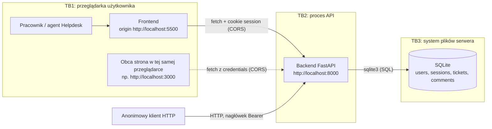
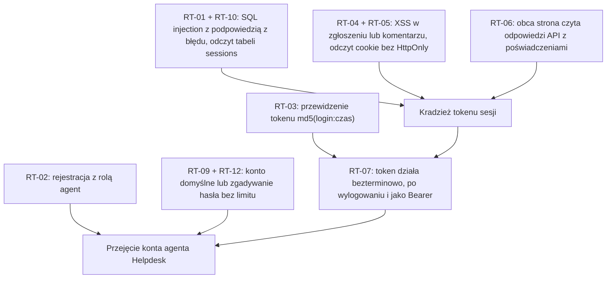

# Faza 2 (SEC) — audyt Red Team, threat modeling i naprawa „PatchPoint”

## Context

Kurs „AI-Driven DevSecOps”, Scenariusz 5 (IT Ticketing System). Faza 2 ma trzy punkty: AI jako „Wirtualny Red Teamer” robi SAST według OWASP Top 10; zespół weryfikuje wykryte podatności (Threat Modeling) dla wektorów scenariusza; AI naprawia kod, a zespół sprawdza, że połatana aplikacja działa. Wektory scenariusza to Information Disclosure (gadatliwe błędy bazy), Broken Authentication (słabe zarządzanie sesją) oraz bezpieczny CORS przy rozdzieleniu frontendu i backendu. Dokument wynikowy Fazy 2 (`docs/faza-2-sec/README.md`) jest jednocześnie „Sekcją Sec” końcowego Raportu Architektonicznego DevSecOps: zestawieniem luk z Fazy 1, opisem wektorów ataku i mechanizmów naprawy.

Decyzje zespołu (odpowiedzi na pytania AI):
- Ślepy audyt AI przeprowadzono przed planem. Osobny agent tylko do odczytu widział wyłącznie `backend/app/**` i `frontend/**`, bez rejestru słabości i bez tego planu. Plan rozpisuje naprawę zweryfikowanych znalezisk.
- Zakres poprawek: W-01…W-18 z rejestru, znaleziska audytu, SEC-017/020/021/022 z końcowego code review Fazy 1 oraz uwagi jakościowe ARCH-001, ARCH-002, MAINT-001…005 i DOC-001 z tego samego przeglądu (`docs/reviews/2026-11-16-delivery-faza-1-mvp.md`).

Stan końcowy:
- `make lint` (z regułami bezpieczeństwa Ruff `S`), `make typecheck` i `make test` przechodzą; pokrycie ≥ 80%. Każde zachowanie bezpieczeństwa ma test regresyjny.
- `scripts/security_check.sh` uruchomiony na kodzie Fazy 1 (`ab08633`) zgłasza 22 sprawdzenia `[PODATNE]`, a na kodzie Fazy 2 — 22 `[NAPRAWIONE]`.
- `make demo` przechodzi na kontach demo tworzonych na żądanie.
- `docs/faza-2-sec/` zawiera audyt, threat model, raport Sekcji Sec, dziennik promptów i dowody. README opisuje nową konfigurację.

Artefakty z sesji planowania (czytane przez zadania 1 i 7, kopiowane do repozytorium w zadaniu 1):
- `local://faza-2-audyt-red-team.md` — dosłowna odpowiedź audytora (29 347 B; 16 luk RT-01…RT-16).
- `local://faza-2-prompty-red-team.md` — dosłowne prompty obu prób audytu (pierwszą odrzucił filtr bezpieczeństwa modelu), metadane i weryfikacja „ślepoty” z transkryptu agenta.

Przygotowanie gałęzi (orkiestrator, przed startem delivery): PR #1 z Fazą 1 jest scalony na GitHubie (`origin/main` = `a59e790`), a lokalny `main` stoi na `3444344`. Uruchom `git switch main && git pull --ff-only origin main`. Delivery utworzy wtedy gałąź `delivery/faza-2-sec` od `main`. Stan kodu Fazy 1 to drzewo commita `ab08633` (głowa `delivery/faza-1-mvp`, lokalnie i na `origin`); dowody „przed” powstają z `git archive ab08633`.

Routing delivery (`route_task.py`):
- zadania 2–4 (`.py`) → `python-developer:developer`;
- zadania 1, 5, 6 i 7 (`.md`, `.txt`, `.json`, `.js`/`.css`/`.html` bez `package.json`, `.sh`, `Makefile`, `.toml`) → `delivery:implementer`.

W Fazie 2 nie ma celowych słabości: odstępstwo od zachowań opisanych w zadaniu to finding. Wyniki QA i końcowego code review są realnymi uwagami; decyzję po przeglądzie podejmuje zespół.

Fakty zweryfikowane 2026-11-16:
- Środowisko: Python 3.14.10, uv 0.13.8, node v26.13.1, curl 8.23.0. `jq` w `PATH` to `jaq 3.1.1` — skrypty używają tylko konstrukcji z `scripts/demo.sh` oraz `has`, `keys`, `length`, `map`, `any`, `select`, `type`.
- Pakiety w `backend/.venv`: fastapi 0.163.1, starlette 1.10.0, pydantic 2.14.3, pydantic-settings 2.16.3, uvicorn 0.54.0, httpx2 2.16.0, ruff 0.17.5. PyPI: `argon2-cffi` 25.1.0; `argon2-cffi-bindings` 26.2.0 ma koła abi3 (cp310+) dla manylinux i musllinux x86_64/aarch64.
- Ruff `--select S` na `backend/app` z Fazy 1 daje 3 diagnostyki:
  - `app/security.py:9:12 S324` i `app/security.py:17:12 S324` (md5);
  - `app/routers/tickets.py:149:19 S608` — `update_ticket`, fałszywie dodatnie: wartości są parametryzowane.
  Regex S608 dopasowuje tylko literały zawierające `SELECT…FROM`, `DELETE FROM`, `INSERT…VALUES` lub `UPDATE…SET`. Dlatego f-string `search` w `list_tickets` (W-14) nie jest wykrywany.
- Starlette 1.10 ma `starlette.middleware.body_limit.RequestBodyLimitMiddleware(app, max_body_size)`, które odpowiada 413 „Content Too Large”. FastAPI 0.163.1 nie przekazuje `max_body_size`, więc trzeba dodać middleware. `HTTPException` rzucony przy czytaniu ciała FastAPI przepuszcza dalej (`except HTTPException: raise`), więc wynikiem jest JSON 413.
- `Starlette.add_middleware` wstawia na pozycję 0, więc ostatnio dodane jest najbardziej zewnętrzne. Handler dla `Exception` trafia do `ServerErrorMiddleware`, który leży poza middleware użytkownika: odpowiedź nie ma nagłówków CORS, a wyjątek jest ponownie zgłaszany. W testach potrzebny jest `TestClient(app, raise_server_exceptions=False)`.
- `CORSMiddleware` przy niedozwolonym originie odpowiada na preflight 400 „Disallowed CORS origin” bez `Access-Control-Allow-Origin`. Przy `allow_origins=["*"]` i `allow_credentials=True` odbija dowolny `Origin` (`starlette/middleware/cors.py:163-164`).
- `Response.set_cookie(..., samesite="lax")` jest domyślne. `delete_cookie` przyjmuje `path`, `secure`, `httponly` i `samesite`.
- TestClient (httpx2) używa `http.cookiejar`: ciasteczka `Secure` wysyła tylko dla schematów `https`/`wss`. Testy potrzebują więc `base_url="https://testserver"`.
- curl 8.23 traktuje `localhost`, `127.0.0.1` i `::1` jako bezpieczny kontekst dla ciasteczek, o ile nie używa proxy (`Curl_secure_context` w `lib/cookie.c`). Skrypty wywołują curl z `--noproxy '*'`.
- Chrome i Firefox przyjmują `Secure` na `http://localhost`, Safari nie. Chrome odrzuca prefiks `__Host-` na localhost, więc ciasteczko nie ma prefiksu.
- `sqlite3` dla liczby > 2⁶³−1 rzuca `OverflowError: Python int too large to convert to SQLite INTEGER`. Nie jest to `sqlite3.Error`, a Pydantic przyjmuje `99999999999999999999` jako `int`. Potwierdza to wyzwalacz z RT-13.
- NIST SP 800-63B-4 (§3.1.1.2): hasło jako jedyny czynnik ma mieć co najmniej 15 znaków. Weryfikator powinien dopuszczać co najmniej 64.
- QA rejestruje konta z loginem w stylu `qa+<tag>-owner@test.local` i hasłem `secrets.token_urlsafe(18) + "Aa1!"` (28 znaków), więc wzorzec loginu musi dopuszczać `+`, `@`, `.`, `-`. Agent QA loguje się danymi `QA_AGENT_EMAIL`/`QA_AGENT_PASSWORD` z ignorowanego `.av/secrets.local.env` (klucze nieoznaczone cudzysłowami; plik ma mode 600).
- FastAPI 0.163.1 rozpakowuje aliasy PEP 695 we wszystkich parametrach (`analyze_param`), także `Annotated[int, Path(...)]`.

## Approach

Kolejność zadań: 1 → 2 → 3 → 4 → 5 → 6 → 7.
- Zadanie 1 dokumentuje audyt i weryfikację na kodzie Fazy 1, zanim cokolwiek zostanie zmienione.
- Zadania 2–4 łatają backend warstwami: platforma, uwierzytelnianie, zgłoszenia. Każde kończy się zielonym `make lint && make typecheck && make test`.
- Zadanie 5 dostosowuje frontend do nowego kontraktu API.
- Zadanie 6 dodaje PoC, aktualizuje demo i konfigurację QA.
- Zadanie 7 zbiera dowody i pisze dokumentację.

### Task 1: Audyt Red Team i threat model na kodzie Fazy 1
**Commit:** docs: add red team audit and threat model for phase 2

**Files:**
- Create: `docs/faza-2-sec/audyt-red-team.md`
- Create: `docs/faza-2-sec/audyt-red-team-wynik.md`
- Create: `docs/faza-2-sec/threat-model.md`
- Create: `docs/faza-2-sec/dowody/ruff-s-faza-1.txt`

**Ramy:**
- Dokumentacja po polsku; identyfikatory, ścieżki i komendy w oryginale; bez emoji; diagramy Mermaid tylko podane niżej.
- Kod jest w stanie Fazy 1 (drzewo `ab08633`). Nie zmieniaj żadnego pliku spoza listy.
- Źródła faktów:
  - `local://faza-2-audyt-red-team.md`, `local://faza-2-prompty-red-team.md`;
  - `docs/faza-1-dev/rejestr-slabosci.md` (rejestr W-01…W-18);
  - `docs/reviews/2026-11-16-delivery-faza-1-mvp.md` (code review Fazy 1, SEC-001…022);
  - kod w `backend/app` i `frontend`.
  Numery linii poniżej to podpowiedzi: sprawdź je w kodzie i wpisz stan faktyczny.
- Gdy któregoś pliku `local://` nie da się odczytać, zakończ zadanie ze Status ❌. Nie odtwarzaj i nie powtarzaj audytu.

**Krok 1 — dowód klasycznego SAST** (z katalogu głównego repo):
```bash
(cd backend && uv run --quiet ruff check --no-cache --select S --output-format concise app) > docs/faza-2-sec/dowody/ruff-s-faza-1.txt 2>&1; test $? -eq 1
```
Oczekiwane są 3 diagnostyki (S324 ×2 w `app/security.py`, S608 w `app/routers/tickets.py`). W dokumentach opisz rzeczywistą zawartość pliku.

**`docs/faza-2-sec/audyt-red-team-wynik.md`:** kopia bajt w bajt, `cp local://faza-2-audyt-red-team.md docs/faza-2-sec/audyt-red-team-wynik.md`. `cmp` obu plików musi przejść.

**`docs/faza-2-sec/audyt-red-team.md`** — sekcje:
1. `# Audyt SAST z AI — „Wirtualny Red Teamer” (Faza 2)` i akapit: realizuje pierwszy punkt Fazy 2; wynik dosłownie w [`audyt-red-team-wynik.md`](audyt-red-team-wynik.md); weryfikacja w [`threat-model.md`](threat-model.md).
2. `## Metadane` — tabela Parametr / Wartość:
   - Data: 2026-11-16.
   - Narzędzie: Claude (Anthropic) w harnessie omp, agent `security-reviewer` (tylko odczyt), uruchomiony z sesji planowania Fazy 2.
   - Model: `anthropic/claude-opus-5-5`.
   - Zakres: `backend/app/**` i `frontend/**` (15 plików), stan kodu `ab08633`.
   - Wejście agenta: wyłącznie prompt, bez rejestru słabości, planu i historii rozmowy.
   - Próby: 2. Pierwszą odrzucił filtr bezpieczeństwa modelu po 27,9 s; druga trwała 4 min 58 s.
   - Wynik: 16 luk RT-01…RT-16 (3 krytyczne, 6 wysokich, 4 średnie, 3 niskie).
3. `## Prompty` — treść `local://faza-2-prompty-red-team.md` od akapitu „Oba prompty wysłano…” do końca, dosłownie. Jedyna zmiana: nagłówki `##` stają się `###`.
4. `## Wniosek z odrzuconej próby` — 2–3 zdania:
   - filtr odrzucił prośbę o krokowe scenariusze ataku z payloadami;
   - ujęcie defensywne (przegląd własnego kodu w celu naprawy, koncepcyjny opis nadużycia) dało pełny audyt;
   - rolę „Red Teamera” pełni więc AI jako recenzent SAST, a odtworzenie ataków zapewnia własny skrypt PoC zespołu (`scripts/security_check.sh`, dodawany w Fazie 2).

**`docs/faza-2-sec/threat-model.md`** — sekcje w tej kolejności:
1. `# Threat model PatchPoint (Faza 2)` i akapit: cel to weryfikacja znalezisk audytu dla wektorów scenariusza. Metoda: STRIDE na diagramie przepływu danych. Źródła: linki do `audyt-red-team-wynik.md`, `../faza-1-dev/rejestr-slabosci.md`, `../reviews/2026-11-16-delivery-faza-1-mvp.md`, `dowody/ruff-s-faza-1.txt`.
2. `## 1. Zakres i założenia`:
   - stan kodu Fazy 1 (`ab08633`);
   - uruchomienie lokalne: UI `http://localhost:5500`, API `http://localhost:8000`, plik SQLite;
   - poza zakresem: TLS, hosting, łańcuch dostaw zależności (A03) — Faza 3 (Dockerfile, CI z Semgrep i Trivy, architektura sieci).
3. `## 2. Model systemu`:
   - diagram DFD (treść niżej);
   - tabela aktywów:
     - A1 hasła i ich hashe (`users.password_hash`);
     - A2 tokeny sesji (cookie `session`, tabela `sessions`);
     - A3 dane zgłoszeń i komentarzy (opisy, lokalizacje, numery inwentarzowe);
     - A4 integralność obsługi (status, przypisanie);
     - A5 informacje o architekturze (schemat bazy, ścieżki, wersje);
     - A6 dostępność API;
   - tabela aktorów:
     - T1 anonimowy klient HTTP;
     - T2 zalogowany pracownik (konto z samodzielnej rejestracji);
     - T3 obca strona otwarta w przeglądarce zalogowanego użytkownika (inny port `localhost` = ten sam site);
     - T4 osoba z dostępem do pliku bazy lub kopii;
     - T5 podsłuch sieci (HTTP bez TLS, Faza 3);
   - tabela punktów wejścia (metoda / ścieżka / uwierzytelnienie / rola) dla wszystkich 10 operacji z routerów `health`, `auth` i `tickets`, przepisana z kodu.
4. `## 3. Analiza STRIDE` — tabela Kategoria / Zagrożenie / Element DFD / Aktor / Luki (RT / W) z wierszami:
   - S: przewidywalny token → podszycie pod agenta | API (sesje) | T1 | RT-03 / W-08
   - S: konto domyślne lub zgadywanie hasła bez limitu | API (logowanie) | T1 | RT-09, RT-12 / W-12, W-05
   - S: kradzież sesji przez XSS lub SQLi i użycie bez wygaśnięcia | przeglądarka, API | T2 | RT-05, RT-01, RT-07 / W-17, W-14, W-09…W-11
   - T: samodzielne nadanie roli agenta | API (rejestracja) | T1 | RT-02 / W-15
   - T: komentarze do cudzych zgłoszeń | API (komentarze) | T2 | RT-04 / W-16
   - T: akcje z obcego originu w imieniu zalogowanego | przeglądarka ↔ API | T3 | RT-06 / W-13
   - R: brak śladu logowań, odmów i zmian zgłoszeń | API | T1, T2 | RT-15 / W-18
   - I: gadatliwe błędy bazy (SQL, parametry, ścieżka, traceback) | API | T1, T2 | RT-10 / W-01, W-02
   - I: tryb debug i publiczna dokumentacja API | API | T1 | RT-13 / W-03
   - I: ścieżka bazy i wersje w `/api/health` | API | T1 | RT-14 / W-04
   - I: hash hasła w odpowiedziach; MD5 bez soli | API, SQLite | T2, T3 | RT-11, RT-08 / W-06, W-07
   - I: odczyt cudzych zgłoszeń i zrzut bazy | API, SQLite | T2 | RT-04, RT-01 / W-16, W-14
   - I: enumeracja kont | API (logowanie) | T1 | RT-12 / W-05
   - I: tokeny sesji jawnym tekstem w bazie | SQLite | T4 | SEC-020 (code review; rekomendacja w RT-03)
   - D: brak limitów długości pól i rozmiaru żądań, lista bez paginacji | API | T2 | SEC-017 (code review; w audycie odnotowane jako CWE-770)
   - D/I: nieobsłużony `OverflowError` dla identyfikatorów > 2⁶³−1 | API | T2 | RT-13
   - E: pracownik → agent (rejestracja z rolą lub przejęcie sesji agenta) | API | T1, T2 | RT-02, RT-01, RT-03, RT-05
   - (mitigacje): brak CSP i nagłówków ochronnych; HTTP bez TLS | przeglądarka, API | T3, T5 | RT-16 / SEC-021
5. `## 4. Weryfikacja znalezisk audytu` — akapit o kryterium: „potwierdzona” oznacza, że kod we wskazanym miejscu ma opisane zachowanie. Dla RT-06 i RT-13 dochodzą fakty z uruchomienia bibliotek opisane w tabeli. Tabela RT / Tytuł (skrót) / Ważność (audyt) / Werdykt / Dowód w kodzie / Pozycja rejestru / Wektor scenariusza / Priorytet:
   - RT-01 SQLi w `search` | krytyczna | potwierdzona | `backend/app/routers/tickets.py:86` (f-string z `search`), `:89` (`fetch_all` bez parametrów) | W-14 | Information Disclosure (łańcuch z W-01) | P1
   - RT-02 rejestracja z rolą `agent` | krytyczna | potwierdzona | `backend/app/schemas.py:17`, `backend/app/routers/auth.py:28` | W-15 | Broken Authentication | P1
   - RT-03 przewidywalny token | krytyczna | potwierdzona | `backend/app/security.py:17`, `backend/app/dependencies.py:33-37` (Bearer) | W-08 (i Bearer z W-11) | Broken Authentication | P1
   - RT-04 IDOR | wysoka | potwierdzona | `backend/app/routers/tickets.py:94-105`, `:158-164` | W-16 | Information Disclosure | P1
   - RT-05 stored XSS | wysoka | potwierdzona | `frontend/app.js:100`, `:110-122`, `:172-201` | W-17 | Broken Authentication (kradzież sesji) | P1
   - RT-06 CORS `*` z credentials | wysoka | potwierdzona; pewność audytu „średnia” podniesiona, bo Starlette 1.10 odbija `Origin` (`starlette/middleware/cors.py:163-164`), co potwierdziła też weryfikacja Fazy 1 (preflight z `Origin: http://evil.example`) | `backend/app/main.py:26-32` | W-13 | CORS | P1
   - RT-07 cykl życia sesji | wysoka | potwierdzona | `backend/app/routers/auth.py:58`, `:60`, `:64-66`; `backend/app/schema.sql:11-15`; `backend/app/dependencies.py:33-48` | W-09, W-10, W-11 | Broken Authentication | P1
   - RT-08 MD5 bez soli | wysoka | potwierdzona | `backend/app/security.py:8-13` | W-07 | Broken Authentication | P1
   - RT-09 konta domyślne, brak polityki haseł | wysoka | potwierdzona | `backend/app/database.py:13-18`, `backend/app/config.py:14`, `backend/app/schemas.py:14`, `frontend/index.html:52` | W-12 (konta i polityka haseł) | Broken Authentication | P1
   - RT-10 gadatliwe błędy bazy | średnia | potwierdzona | `backend/app/main.py:34-46`, `backend/app/database.py:21-27`, `backend/app/routers/auth.py:31-34`, `frontend/app.js:67` | W-01, W-02 | Information Disclosure | P2
   - RT-11 `password_hash` w API | średnia | potwierdzona | `backend/app/schemas.py:27` | W-06 | Information Disclosure | P2
   - RT-12 enumeracja i brak limitu prób | średnia | potwierdzona | `backend/app/routers/auth.py:46-50` | W-05, W-12 (limit prób) | Information Disclosure / Broken Authentication | P2
   - RT-13 `debug=True`, publiczne `/docs` | średnia | potwierdzona. Wyzwalacz `OverflowError` sprawdzono uruchomieniem: `sqlite3` rzuca `OverflowError` (nie `sqlite3.Error`), a Pydantic przyjmuje `99999999999999999999`. To nowe znalezisko spoza rejestru | `backend/app/main.py:23` | W-03 (+ nowe) | Information Disclosure | P2
   - RT-14 health | niska | potwierdzona | `backend/app/routers/health.py:13-23` | W-04 | Information Disclosure | P3
   - RT-15 brak logowania | niska | potwierdzona | brak `logging` w `backend/app` | W-18 | wykrywalność ataków | P3
   - RT-16 brak CSP i nagłówków, HTTP | niska | potwierdzona dla CSP i nagłówków; część „HTTP bez TLS” poza zakresem Fazy 2 (Faza 3) | `frontend/index.html:3-9`, `backend/app/main.py:23-32` | spoza rejestru (SEC-021 w code review) | mitigacja XSS | P3

   Pod tabelą jedno zdanie: priorytet P1 = ważność krytyczna lub wysoka, P2 = średnia, P3 = niska. Zespół nie zmienił żadnej oceny audytu.
6. `## 5. Porównanie z rejestrem słabości` — tabela W / Słabość (skrót) / Audyt AI (RT) / Code review Fazy 1 (SEC) / Ruff S:
   - W-01 | RT-10 | SEC-013 | —
   - W-02 | RT-10 | SEC-018 | —
   - W-03 | RT-13 | SEC-014 | —
   - W-04 | RT-14 | SEC-015 | —
   - W-05 | RT-12 | SEC-012 | —
   - W-06 | RT-11 | SEC-016 | —
   - W-07 | RT-08 | SEC-006 | S324 (`security.py:9`)
   - W-08 | RT-03 | SEC-005 | S324 (`security.py:17`)
   - W-09 | RT-07 | SEC-010 | —
   - W-10 | RT-07 | SEC-011 | —
   - W-11 | RT-07, RT-03 | SEC-009 | —
   - W-12 | RT-09, RT-12 | SEC-002 | —
   - W-13 | RT-06 | SEC-008 | —
   - W-14 | RT-01 | SEC-003 | — (pominięta)
   - W-15 | RT-02 | SEC-001 | —
   - W-16 | RT-04 | SEC-007 | —
   - W-17 | RT-05 | SEC-004 | — (Ruff nie analizuje JS)
   - W-18 | RT-15 | SEC-019 | —

   Druga tabela „Poza rejestrem”:
   - SEC-017 (limity, paginacja) — audyt: odnotowane jako CWE-770, bez osobnego RT;
   - SEC-020 (jawne tokeny) — audyt: haszowanie tokenu w rekomendacji RT-03;
   - SEC-021 (nagłówki) — RT-16;
   - SEC-022 (`/tmp` w konfiguracji QA) — poza zakresem audytu (`.av/`);
   - `OverflowError` — RT-13, nowe.

   Trzecia tabela — metryki, kolumny: Źródło / Ślepe wobec rejestru / Trafione pozycje rejestru / Fałszywie dodatnie / Pominięte / Dodatkowe prawdziwe:
   - Audyt AI (RT) | tak | 18/18 (16 znalezisk: RT-07 obejmuje W-09…W-11, RT-10 obejmuje W-01 i W-02, W-12 rozpada się na RT-09 i RT-12) | 0 | 0 | RT-16 i wyzwalacz `OverflowError` w RT-13; częściowo SEC-017 i SEC-020.
   - Ruff S (reguły Bandit) | tak | 2/18 (W-07, W-08 przez S324) | 1 (S608 w `update_ticket`: składane są tylko stałe fragmenty, wartości idą jako parametry) | 16 (w tym W-14: literał f-stringa z `search` nie zawiera słów kluczowych SQL) | 0.
   - Code review delivery Fazy 1 | nie (znał rejestr) | 18/18 | 0 | 0 | SEC-017, SEC-020, SEC-021, SEC-022.
7. `## 6. Scenariusze ataku dla wektorów scenariusza` — diagram drzewa ataku (treść niżej), potem trzy podsekcje `###`: Information Disclosure, Broken Authentication, CORS. Każdy łańcuch opisz punktami: aktor, kroki (RT), skutek, „Faza 2 przerywa przez”:
   - ID-1 „Od błędu do zrzutu bazy”:
     - aktor T2;
     - kroki: apostrof w `search` → RT-10 ujawnia pełne SQL z JOIN-ami i ścieżkę bazy → RT-01 `UNION SELECT` z `sessions` i `users` → tokeny ważne bezterminowo i przyjmowane jako Bearer (RT-07) oraz hashe MD5 (RT-08); rekonesans przez RT-14 i `/docs` (RT-13);
     - Faza 2 przerywa przez: parametryzację z `ESCAPE`, ogólny 500 z `error_id`, SHA-256 tokenów w bazie, Argon2id, minimalny health i wyłączone docs.
   - BA-1 „Konto domyślne i zgadywanie”:
     - aktor T1;
     - kroki: RT-12 (404 kontra 401) → RT-09 (`admin`/`admin123`) lub zgadywanie bez limitu;
     - Faza 2 przerywa przez: brak kont domyślnych, politykę haseł, jednolite 401 i limit 5 prób w 15 min (429).
   - BA-2 „Przewidywalny token”:
     - aktor T1;
     - kroki: login (z enumeracji lub danych demo) i przybliżony czas → kandydaci `md5(login:czas)` → Bearer; RT-07 usuwa limit czasu;
     - Faza 2 przerywa przez: `secrets.token_urlsafe(32)`, tylko cookie oraz wygasanie po 30 min bezczynności i po 8 h.
   - BA-3 „Stored XSS → sesja agenta”:
     - aktor T2;
     - kroki: zgłoszenie albo komentarz z HTML, także w cudzym zgłoszeniu (RT-04) → agent otwiera → skrypt (RT-05) czyta cookie bez `HttpOnly` (RT-07) i `password_hash` (RT-11);
     - Faza 2 przerywa przez: DOM przez `textContent`, CSP, `HttpOnly` i 404 dla cudzych zgłoszeń.
   - BA-4 „Samoeskalacja”:
     - aktor T1;
     - kroki: rejestracja z `"role": "agent"` (RT-02);
     - Faza 2 przerywa przez: `extra="forbid"` i rolę zawsze równą `employee`.
   - CORS-1 „Obca strona na localhost”:
     - aktor T3;
     - kroki: strona na innym porcie `localhost` (ten sam site, więc cookie `Lax` jest wysyłane) robi `fetch` z `credentials: "include"` → RT-06 odbija `Origin` → odczyt `/api/auth/me` z hashem i listy zgłoszeń;
     - Faza 2 przerywa przez: listę originów z konfiguracji (bez `*`), `SameSite=Strict`, metody GET/POST/PATCH i nagłówek `Content-Type`; preflight z obcego originu dostaje 400.
     - Ryzyko rezydualne: proste żądanie `POST /api/auth/logout` z tego samego site nadal może wylogować.
8. `## 7. Priorytety i plan naprawy` — tabela RT / Priorytet / Mechanizm naprawy / Zadanie planu Fazy 2:
   - RT-01 P1 | statyczne zapytanie z parametrami i `LIKE … ESCAPE` | 4
   - RT-02 P1 | `extra="forbid"`, rola zawsze `employee` | 3
   - RT-03 P1 | losowy token 256 bitów, SHA-256 w bazie, bez Bearer | 3
   - RT-04 P1 | wspólna kontrola własności, 404 | 4
   - RT-05 P1 | DOM bez `innerHTML` | 5
   - RT-06 P1 | lista originów, ograniczone metody i nagłówki | 2
   - RT-07 P1 | wygasanie, usuwanie sesji przy wylogowaniu, `HttpOnly; Secure; SameSite=Strict` | 3
   - RT-08 P1 | Argon2id | 3
   - RT-09 P1 | seed tylko na żądanie z hasłem z env, bez `admin`, polityka haseł, `required minlength` w UI | 3, 5
   - RT-10 P2 | ogólne 500 z `error_id`, stały komunikat 409, czytelne błędy w UI | 2, 3, 5
   - RT-11 P2 | `UserResponse` bez hasha | 3
   - RT-12 P2 | jednolite 401, weryfikacja na stałym hashu, limit prób per konto | 3
   - RT-13 P2 | debug wyłączony, docs na żądanie, handler `Exception`, zakres id | 2, 4
   - RT-14 P3 | `{"status": "ok"}` | 2
   - RT-15 P3 | zdarzenia bezpieczeństwa w JSON | 2, 3, 4
   - RT-16 P3 | nagłówki API i CSP w UI | 2, 5

   Pod tabelą:
   - Pozycje spoza audytu w tym samym planie: SEC-017 (zadania 2, 4, 5), SEC-020 (3), SEC-022 (6) oraz jakość: ARCH-001 (3), ARCH-002 (5), MAINT-001 (3), MAINT-002 (4), MAINT-003 (2), MAINT-004 (5), MAINT-005 (3), DOC-001 (7).
   - Odstępstwa od rekomendacji audytu:
     - brak migracji MD5 → Argon2 przy logowaniu: bazę Fazy 1 trzeba odtworzyć, a API odmawia startu na starym schemacie;
     - limit prób per konto, bez limitu per IP (ten należy do brzegu sieci w Fazie 3);
     - nagłówek `Authorization` usunięty całkowicie, zamiast dopuszczać go w CORS;
     - bez endpointu nadawania ról: konta agentów tworzy tylko seed demo.
   - Link do pliku planu Fazy 2 (rzeczywista nazwa z `ls docs/plans/*-faza-2-sec.md`).

Diagramy do wstawienia (treść dokładnie taka; pierwszy w sekcji 2, drugi na początku sekcji 6):
````markdown



````

**Gotowe, gdy:**
- `cmp local://faza-2-audyt-red-team.md docs/faza-2-sec/audyt-red-team-wynik.md` przechodzi;
- `docs/faza-2-sec/dowody/ruff-s-faza-1.txt` zawiera `S324` dwa razy i `S608` raz;
- `threat-model.md` ma 16 wierszy `| RT-` w sekcji 4, 18 wierszy `| W-` w sekcji 5 i dokładnie 2 bloki `mermaid`;
- każdy względny link w nowych plikach wskazuje istniejący plik;
- `git status --porcelain` pokazuje wyłącznie pliki z listy.

### Task 2: Backend — bezpieczna konfiguracja, obsługa błędów, nagłówki i limity
**Commit:** fix(backend): harden error handling, CORS, API docs exposure and response headers

**Files:**
- Modify: `backend/pyproject.toml`
- Modify: `backend/app/config.py`
- Create: `backend/app/audit.py`
- Create: `backend/app/middleware.py`
- Modify: `backend/app/main.py`
- Modify: `backend/app/database.py`
- Modify: `backend/app/routers/health.py`
- Modify: `backend/app/schemas.py`
- Test: `backend/tests/test_errors.py`
- Test: `backend/tests/test_health.py`
- Test: `backend/tests/test_cors.py`
- Test: `backend/tests/test_platform.py`

**Ramy (zadania 2–4):**
- Faza 2, łatanie: każde zachowanie z zadania jest wymaganiem i dostaje test regresyjny, pisany przed kodem.
- Architektura Fazy 1 zostaje:
  - surowy `sqlite3` bez ORM i warstw serwis/repozytorium;
  - routery wołają funkcje modułów `app.*`;
  - endpointy `async def`;
  - zależności jako aliasy PEP 695 `type X = Annotated[...]`;
  - importy absolutne, pełne adnotacje, `X | None`, `pathlib.Path`, łapanie tylko konkretnych wyjątków;
  - ruff i mypy strict bez wyjątków.
- W kodzie i testach nie ma identyfikatorów W-xx, RT-xx ani SEC-xxx; mapowanie trzyma dokumentacja.
- Nie edytuj `README.md`, `docs/`, `frontend/`, `scripts/` ani `.av/`.
- Zdarzenia bezpieczeństwa nigdy nie zawierają haseł, tokenów ani hashy.

**Zmiany:**
- `backend/pyproject.toml`: `version = "0.2.0"`, `description = "PatchPoint — API systemu zgłoszeń IT (Faza 2, po audycie bezpieczeństwa)"`.
- `backend/app/config.py`:
  - `APP_VERSION: Final = "0.2.0"`;
  - nowe pola `Settings`:
    - `docs_enabled: bool = False`;
    - `cors_origins: list[str] = ["http://localhost:5500"]`;
    - `max_body_bytes: int = Field(default=65_536, ge=1_024, le=10_485_760)`;
  - `@field_validator("cors_origins")`: gdy lista zawiera `"*"`, rzuca `ValueError("cors_origins must list explicit origins; '*' cannot be combined with credentials")`;
  - zmienne środowiskowe to `PATCHPOINT_DOCS_ENABLED`, `PATCHPOINT_CORS_ORIGINS` (lista JSON) i `PATCHPOINT_MAX_BODY_BYTES`.
- `backend/app/audit.py` (nowy; logger aplikacji, nie istnieje odpowiednik):
  - `SECURITY_LOGGER: Final = logging.getLogger("patchpoint.security")`, `ERROR_LOGGER: Final = logging.getLogger("patchpoint.errors")`.
  - `def configure_logging() -> None`: logger `"patchpoint"` dostaje jeden `logging.StreamHandler()` (stderr) z `logging.Formatter("%(asctime)s %(levelname)s %(name)s %(message)s")` tylko wtedy, gdy nie ma jeszcze handlerów, i poziom `logging.INFO`. `propagate` zostaje `True`, żeby `caplog` widział rekordy.
  - `def log_security_event(event: str, request: Request | None, *, level: int = logging.INFO, **fields: str | int | None) -> None` loguje do `SECURITY_LOGGER` wynik `json.dumps({"event": event, "client_ip": <request.client.host lub None>, **fields}, ensure_ascii=False, sort_keys=True)`.
- `backend/app/middleware.py` (nowy): czysty middleware ASGI `SecurityHeadersMiddleware(app: ASGIApp)`.
  - Dla `scope["type"] == "http"` opakowuje `send`: przy `http.response.start` wywołuje `MutableHeaders(scope=message).setdefault(...)` dla każdego nagłówka z `COMMON_SECURITY_HEADERS`. Gdy `scope["path"]` zaczyna się od `/api/`, dokłada też `API_SECURITY_HEADERS`.
  - Pozostałe typy scope przekazuje bez zmian.
  - `COMMON_SECURITY_HEADERS: Final = {"X-Content-Type-Options": "nosniff", "X-Frame-Options": "DENY", "Referrer-Policy": "no-referrer"}`.
  - `API_SECURITY_HEADERS: Final = {"Content-Security-Policy": "default-src 'none'; frame-ancestors 'none'", "Cache-Control": "no-store"}`.
  - Strony `/docs` i `/redoc` (gdy włączone) nie dostają CSP, bo Swagger UI ładuje zasoby z CDN.
- `backend/app/database.py`: `DatabaseError.__init__(self, sql: str, original: sqlite3.Error)` — bez `params` (czysta zmiana: popraw miejsca `raise` w `fetch_one`, `fetch_all`, `execute`). Reszta modułu bez zmian.
- `backend/app/main.py`:
  - usuń `import traceback`, alias `app_settings` (używaj `settings`) i `debug=True`;
  - na początku `create_app` wywołaj `configure_logging()`;
  - `FastAPI(title="PatchPoint API", version=APP_VERSION, lifespan=lifespan, docs_url="/docs" if settings.docs_enabled else None, redoc_url="/redoc" if settings.docs_enabled else None, openapi_url="/openapi.json" if settings.docs_enabled else None)`;
  - middleware dodawaj dokładnie w tej kolejności (zewnętrzne jest ostatnie, więc CORS obejmuje też odpowiedzi 413):
    1. `app.add_middleware(RequestBodyLimitMiddleware, max_body_size=settings.max_body_bytes)` (import z `starlette.middleware.body_limit`);
    2. `app.add_middleware(SecurityHeadersMiddleware)`;
    3. `app.add_middleware(CORSMiddleware, allow_origins=settings.cors_origins, allow_credentials=True, allow_methods=["GET", "POST", "PATCH"], allow_headers=["Content-Type"], max_age=600)`.
  - Jedna funkcja `async def internal_error_handler(request: Request, exc: Exception) -> JSONResponse`, rejestrowana przez `app.add_exception_handler` dla `DatabaseError` i `Exception`:
    - `error_id = uuid.uuid4().hex`;
    - `ERROR_LOGGER.error(json.dumps({"event": "internal_error", "error_id": error_id, "method": request.method, "path": request.url.path, "exception": type(exc).__name__, "sql": exc.sql if isinstance(exc, DatabaseError) else None}, sort_keys=True), exc_info=exc)`;
    - odpowiedź 500 `{"detail": "Internal server error", "error_id": error_id}`.
- `backend/app/routers/health.py`: `health(conn: DbConnection) -> HealthResponse` wykonuje `fetch_one(conn, "SELECT 1")` i zwraca `HealthResponse(status="ok")`. Usuń importy `platform`, `APP_VERSION` i `AppSettings`.
- `backend/app/schemas.py`: `HealthResponse` ma tylko `status: str`.

**Testy (najpierw):**
- `tests/test_errors.py` (przepisz):
  - `test_database_error_returns_generic_body_and_logs_details`: przez surowe `sqlite3` (`conn.execute("DROP TABLE sessions")`, `conn.commit()`; bez helperów `app.database`) usuń tabelę, potem zaloguj użytkownika z `user_factory`. Oczekiwane:
    - 500, klucze ciała dokładnie `{"detail", "error_id"}`, `detail == "Internal server error"`, `error_id` pasuje do `[0-9a-f]{32}`;
    - tekst odpowiedzi nie zawiera `sessions`, `INSERT`, `sqlite`, `Traceback` ani `str(settings.database_path)`;
    - `caplog` ma rekord loggera `patchpoint.errors` z JSON: `event == "internal_error"`, tym samym `error_id`, `sql` zawierającym `sessions` i niepustym `exc_info`.
  - `test_unhandled_exception_returns_generic_json`: do aplikacji dodaj trasę `GET /api/test-failure`, która rzuca `RuntimeError("failure-detail")`. Użyj `TestClient(app, raise_server_exceptions=False)`. Oczekiwane: 500, `detail == "Internal server error"`, `error_id` obecny, w treści brak `failure-detail` i `Traceback`.
- `tests/test_health.py`: `test_health_reports_only_status` — `response.json() == {"status": "ok"}`.
- `tests/test_cors.py`: zostaje istniejący test, dochodzą:
  - `test_preflight_rejects_unknown_origin` — `Origin: http://evil.example` daje 400 bez `access-control-allow-origin`;
  - `test_preflight_rejects_unlisted_header` — `Access-Control-Request-Headers: Authorization` daje 400;
  - `test_simple_request_from_unknown_origin_gets_no_cors_headers` — `GET /api/health` z obcym `Origin` daje 200 bez `access-control-allow-origin`;
  - `test_wildcard_origin_is_rejected_in_settings` — `Settings(database_path=..., cors_origins=["*"])` rzuca `ValidationError`.
- `tests/test_platform.py` (nowy):
  - `test_api_docs_are_disabled_by_default` — `/docs`, `/redoc` i `/openapi.json` dają 404;
  - `test_api_docs_can_be_enabled_for_development` — przy `docs_enabled=True` wszystkie trzy dają 200;
  - `test_api_responses_carry_security_headers` — `GET /api/health` ma dokładne wartości nagłówków z `COMMON_SECURITY_HEADERS` i `API_SECURITY_HEADERS`;
  - `test_non_api_responses_skip_api_only_headers` — przy `docs_enabled=True` `GET /docs` ma `x-content-type-options: nosniff` i nie ma `content-security-policy`;
  - `test_oversized_request_body_is_rejected` — `POST /api/auth/register` z `Content-Type: application/json` i ciałem 70 000 bajtów daje 413.

**Gotowe, gdy:** `make lint && make typecheck && make test` przechodzą; pokrycie `TOTAL` ≥ 80%.

### Task 3: Backend — hasła, sesje, logowanie i dane demo
**Commit:** fix(backend): secure passwords, sessions, login and demo accounts

**Files:**
- Modify: `backend/pyproject.toml`
- Modify: `backend/uv.lock`
- Modify: `backend/app/config.py`
- Modify: `backend/app/security.py`
- Create: `backend/app/sessions.py`
- Modify: `backend/app/schema.sql`
- Modify: `backend/app/database.py`
- Modify: `backend/app/dependencies.py`
- Modify: `backend/app/schemas.py`
- Modify: `backend/app/routers/auth.py`
- Modify: `backend/app/routers/tickets.py`
- Modify: `backend/app/main.py`
- Create: `backend/tests/__init__.py`
- Create: `backend/tests/support.py`
- Test: `backend/tests/conftest.py`
- Test: `backend/tests/test_auth.py`
- Test: `backend/tests/test_sessions.py`
- Test: `backend/tests/test_database.py`
- Test: `backend/tests/test_errors.py`
- Test: `backend/tests/test_tickets.py`

**Ramy:** jak w zadaniu 2. Moduł `app.audit` (`log_security_event(event, request, *, level, **fields)`) i `DatabaseError(sql, original)` już istnieją.

**Zależność:** `cd backend && uv add "argon2-cffi>=25.1.0"` (zmienia `pyproject.toml` i `uv.lock`).

**`backend/app/config.py`** — zmiany i nowe pola `Settings`:
- `seed_demo_data: bool = False` (było `True`);
- `demo_password: SecretStr | None = None`;
- `cookie_secure: bool = True`;
- `session_idle_minutes: int = Field(default=30, ge=1, le=1_440)`;
- `session_absolute_minutes: int = Field(default=480, ge=1, le=10_080)`;
- `login_max_failures: int = Field(default=5, ge=1, le=100)`;
- `login_lockout_minutes: int = Field(default=15, ge=1, le=1_440)`;
- `@model_validator(mode="after")`: gdy `seed_demo_data` i `demo_password is None`, rzuca `ValueError("PATCHPOINT_DEMO_PASSWORD is required when PATCHPOINT_SEED_DEMO_DATA is true")`.

**`backend/app/security.py`** (zastępuje MD5):
- stałe: `SESSION_COOKIE_NAME: Final = "session"`, `PASSWORD_MIN_LENGTH: Final = 15`, `PASSWORD_MAX_LENGTH: Final = 128`;
- `_password_hasher: Final = argon2.PasswordHasher()` (parametry domyślne biblioteki, Argon2id) oraz `_DUMMY_PASSWORD_HASH: Final = _password_hasher.hash(secrets.token_urlsafe(16))`;
- `hash_password(password: str) -> str`;
- `verify_password(password: str, password_hash: str) -> bool` — `_password_hasher.verify(password_hash, password)`; `argon2.exceptions.VerificationError` i `InvalidHashError` dają `False`, więc stary hash MD5 też daje `False`;
- `simulate_password_check(password: str) -> None` — weryfikuje hasło na `_DUMMY_PASSWORD_HASH`, wyrównując czas odpowiedzi dla nieistniejącego loginu;
- `generate_session_token() -> str` — `secrets.token_urlsafe(32)`;
- `hash_session_token(token: str) -> str` — `hashlib.sha256(token.encode("utf-8")).hexdigest()`;
- `password_policy_violation(password: str, username: str) -> str | None` zwraca dokładnie:
  - `f"Password must be at least {PASSWORD_MIN_LENGTH} characters long"`;
  - `f"Password must be at most {PASSWORD_MAX_LENGTH} characters long"`;
  - `"Password must not contain the username"` (porównanie `casefold()`);
  - `None`, gdy hasło spełnia politykę.

**`backend/app/schema.sql`** — `users`, `tickets` i `comments` bez zmian; `sessions` zastąp, dodaj `login_failures`, indeks i wersję:
```sql
CREATE TABLE IF NOT EXISTS sessions (
    token_hash   TEXT    PRIMARY KEY,
    user_id      INTEGER NOT NULL REFERENCES users(id),
    created_at   TEXT    NOT NULL,
    last_seen_at TEXT    NOT NULL,
    expires_at   TEXT    NOT NULL
);

CREATE TABLE IF NOT EXISTS login_failures (
    id           INTEGER PRIMARY KEY AUTOINCREMENT,
    username     TEXT    NOT NULL,
    attempted_at TEXT    NOT NULL
);

CREATE INDEX IF NOT EXISTS idx_login_failures_username
    ON login_failures (username, attempted_at);

PRAGMA user_version = 2;
```
`PRAGMA user_version = 2;` jest ostatnią instrukcją pliku.

**`backend/app/database.py`:**
- `type SqlParams = Sequence[object] | Mapping[str, object]` — typ parametrów `fetch_one`, `fetch_all` i `run`; zadanie 4 używa parametrów nazwanych.
- `run(conn, sql: str, params: SqlParams = ()) -> int`:
  - wykonuje instrukcję bez commitu;
  - `sqlite3.Error` zamienia na `DatabaseError(sql, exc)`;
  - zwraca `cursor.lastrowid or 0`.
- `@contextmanager transaction(conn) -> Iterator[None]`:
  - każdy wyjątek z bloku robi `conn.rollback()` i jest zgłaszany dalej;
  - po bloku wykonuje `conn.commit()`; błąd commitu staje się `DatabaseError("COMMIT", exc)`.
- Usuń `execute()`. Każdy zapis w aplikacji i testach idzie przez `with transaction(conn): run(...)`.
- Zasada: gdy zapis ma przetrwać mimo odpowiedzi błędem (np. nieudane logowanie), `HTTPException` rzucaj po wyjściu z bloku `transaction`.
- `create_user` używa `run` i nie zarządza transakcją; wołający owija ją w `transaction`.
- `utc_now() -> datetime` (`datetime.now(UTC).replace(microsecond=0)`), `isoformat(moment: datetime) -> str` (`timespec="seconds"`); `utc_now_iso()` zostaje jako `isoformat(utc_now())`.
- `SCHEMA_VERSION: Final = 2` i `class SchemaVersionError(RuntimeError)`.
- `init_db(database_path: Path, *, demo_password: str | None) -> None`:
  - tworzy katalog i łączy się z bazą;
  - gdy istnieje tabela `users`, a `PRAGMA user_version` ≠ `SCHEMA_VERSION`, rzuca `SchemaVersionError(f"Database {database_path} uses schema version {version}, expected {SCHEMA_VERSION}. Delete the file and restart the API to recreate it.")`;
  - wykonuje `schema.sql`;
  - gdy `demo_password is not None`, wywołuje `seed_demo_data(conn, password=demo_password)`.
- Dane demo:
  - `class DemoUser(NamedTuple)` z polami `username`, `full_name`, `department`, `role`;
  - `class DemoTicket(NamedTuple)` z polami `title`, `description`, `category`, `priority`, `status`, `asset_tag`, `location`, `reporter`, `assignee: str | None`;
  - `class DemoComment(NamedTuple)` z polami `ticket_title`, `author`, `body`;
  - `DEMO_USERS: Final` = `helpdesk` („Piotr Serwisant”, „IT Helpdesk”, agent), `jan.kowalski` („Jan Kowalski”, „Księgowość”, pracownik), `anna.nowak` („Anna Nowak”, „Marketing”, pracownik); konta `admin` nie ma;
  - `DEMO_TICKETS: Final` — trzy zgłoszenia z obecnego `seed_demo_data`, wartości 1:1;
  - `DEMO_COMMENTS: Final` — komentarz `helpdesk` do „Drukarka zacina papier” o dotychczasowej treści.
- `_user_id(conn, username: str) -> int` rzuca `ValueError(f"Unknown demo user: {username}")` zarówno dla zgłaszającego, jak i dla przypisanego.
- `seed_demo_data(conn, *, password: str) -> None`:
  - najpierw sprawdza `password_policy_violation(password, user.username)` dla każdego `DEMO_USERS`; przy naruszeniu rzuca `ValueError(f"PATCHPOINT_DEMO_PASSWORD rejected for demo user {user.username}: {violation}")`;
  - gdy `users` nie jest puste, kończy pracę;
  - w jednej transakcji tworzy użytkowników, zgłoszenia i komentarze;
  - na końcu woła `log_security_event("demo_data_seeded", None, users=len(DEMO_USERS))`;
  - usuń `insert_demo_ticket`.

**`backend/app/sessions.py`** (nowy; funkcje sesji i limitu prób, bez odpowiednika w kodzie):
- `create_session(conn, *, user_id: int, settings: Settings) -> str`:
  - w jednej transakcji usuwa sesje z `expires_at <= teraz`;
  - wstawia `(hash_session_token(token), user_id, now, now, now + session_absolute_minutes)`;
  - zwraca surowy token.
- `class SessionRejected(Exception)` z polami `reason: str` (`"unknown"`, `"idle_timeout"` albo `"absolute_timeout"`) i `user_id: int | None`.
- `authenticate_session(conn, token: str, settings: Settings) -> UserResponse`:
  - szuka wiersza `sessions` po `token_hash` złączonego z `users` (jawne kolumny: `u.id, u.username, u.full_name, u.department, u.role, u.created_at, s.last_seen_at, s.expires_at`);
  - brak wiersza → `SessionRejected("unknown", None)`;
  - `teraz >= expires_at` → usuwa wiersz i rzuca `SessionRejected("absolute_timeout", user_id)`;
  - `teraz - last_seen_at >= session_idle_minutes` → usuwa wiersz i rzuca `SessionRejected("idle_timeout", user_id)`;
  - w pozostałych przypadkach ustawia `last_seen_at = teraz` i zwraca `UserResponse` z kolumn użytkownika.
- `end_session(conn, token: str) -> int | None` — usuwa sesję po hashu i zwraca jej `user_id` (lub `None`).
- `is_login_blocked(conn, username: str, settings: Settings) -> bool` — liczba wierszy `login_failures` dla dokładnie tego loginu z `attempted_at > teraz - login_lockout_minutes` ≥ `login_max_failures`.
- `record_login_failure(conn, username: str, settings: Settings) -> None` — w jednej transakcji usuwa wszystkie wpisy starsze niż okno i wstawia `(username, teraz)`.
- `clear_login_failures(conn, username: str) -> None` — usuwa wpisy tego loginu.

**`backend/app/dependencies.py`:**
- Usuń `BEARER_PREFIX` i odczyt nagłówka `Authorization`.
- `get_current_user(request, conn, settings)`:
  - token tylko z cookie `SESSION_COOKIE_NAME`; brak → 401 `"Not authenticated"` bez zdarzenia;
  - `authenticate_session`; `SessionRejected` → `log_security_event("session_rejected", request, level=logging.WARNING, reason=exc.reason, user_id=exc.user_id)` i 401 `"Not authenticated"`.
- `require_agent(user, request)`: dla roli innej niż agent woła `log_security_event("access_denied", request, level=logging.WARNING, user_id=user.id, reason="agent_role_required", path=request.url.path, ticket_id=None)`, potem 403 jak dotąd.

**`backend/app/schemas.py`:**
- `USERNAME_PATTERN: Final = r"^[A-Za-z0-9._@+-]+$"`.
- `UserCreate`:
  - `model_config = ConfigDict(extra="forbid")`;
  - `username: str = Field(min_length=3, max_length=50, pattern=USERNAME_PATTERN)`;
  - `password: str = Field(min_length=PASSWORD_MIN_LENGTH, max_length=PASSWORD_MAX_LENGTH)`;
  - `full_name: str = Field(min_length=1, max_length=100)`, `department: str = Field(default="", max_length=100)`;
  - bez pola `role`;
  - `@model_validator(mode="after")` rzuca `ValueError` z komunikatem `password_policy_violation(...)`, gdy ten nie jest `None`.
- `UserResponse` bez `password_hash`.
- `LoginRequest`: `model_config = ConfigDict(extra="forbid")`, `username: str = Field(min_length=1, max_length=50)`, `password: str = Field(min_length=1, max_length=PASSWORD_MAX_LENGTH)`.
- `LoginResponse` ma tylko `user: UserResponse`.

**`backend/app/routers/auth.py`:**
- Stałe: `INVALID_CREDENTIALS: Final = "Invalid username or password"`, `USERNAME_TAKEN: Final = "Username is already taken"`, `LOGIN_BLOCKED: Final = "Too many failed login attempts. Try again later."`.
- Kolumny w odpowiedziach wybieraj jawnie: `id, username, full_name, department, role, created_at`.
- `register`:
  - `create_user(..., role=Role.EMPLOYEE)` w `transaction`;
  - `DatabaseError` z `sqlite3.IntegrityError` złapany poza blokiem → zdarzenie `registration_conflict` (WARNING, `username`) i 409 `USERNAME_TAKEN`;
  - sukces → zdarzenie `user_registered` (`username`, `user_id`, `role="employee"`), 201 i `UserResponse`.
- `login(payload, request, response, conn, settings)` w tej kolejności:
  1. `is_login_blocked` → zdarzenie `login_blocked` (WARNING, `username`), potem 429 `LOGIN_BLOCKED` z nagłówkiem `Retry-After: str(settings.login_lockout_minutes * 60)`.
  2. Wiersz `id, password_hash` dla loginu. Brak → `simulate_password_check`, `record_login_failure`, zdarzenie `login_failed` (WARNING, `username`, `reason="unknown_user"`), 401 `INVALID_CREDENTIALS`.
  3. Złe hasło → `record_login_failure`, zdarzenie `login_failed` (`reason="bad_password"`), 401 `INVALID_CREDENTIALS`.
  4. Sukces → `clear_login_failures`, `token = create_session(...)`, potem `response.set_cookie(key=SESSION_COOKIE_NAME, value=token, max_age=settings.session_absolute_minutes * 60, path="/", secure=settings.cookie_secure, httponly=True, samesite="strict")`.
  5. Zdarzenie `login_succeeded` (`username`, `user_id`), odpowiedź `LoginResponse(user=...)`.
- `logout(request, response, conn, settings)`:
  - gdy jest cookie, woła `end_session`;
  - zawsze woła `response.delete_cookie(SESSION_COOKIE_NAME, path="/", secure=settings.cookie_secure, httponly=True, samesite="strict")`;
  - zdarzenie `logout` (`user_id` albo `None`);
  - zawsze 200 `{"message": "Logged out"}`.

**`backend/app/routers/tickets.py`:** tylko mechaniczna zamiana `execute` na `with transaction(conn): ... run(...)`. `add_comment` zapisuje komentarz i `updated_at` w jednej transakcji. Pozostałe zmiany zgłoszeń należą do zadania 4.

**`backend/app/main.py`:** `lifespan` woła `init_db(settings.database_path, demo_password=settings.demo_password.get_secret_value() if settings.seed_demo_data and settings.demo_password is not None else None)`.

**Testy (najpierw):**
- `tests/__init__.py` jest pusty. Treść `tests/support.py`:
```python
from collections.abc import Callable
from typing import Final

from fastapi.testclient import TestClient

API_BASE_URL: Final = "https://testserver"
DEFAULT_PASSWORD: Final = "Correct-Horse-Battery-42"
DEMO_PASSWORD: Final = "Demo-Accounts-Pass-2026"

type LoginAs = Callable[..., TestClient]
type UserFactory = Callable[..., int]
type TicketFactory = Callable[..., int]
```
- `tests/conftest.py`:
  - importuje z `tests.support`;
  - `client` i `login_as` tworzą `TestClient(app, base_url=API_BASE_URL)`, bo ciasteczko ma `Secure`;
  - `settings` = `Settings(database_path=tmp_path / "test.db")`;
  - nowa fikstura `seeded_settings` = `Settings(database_path=tmp_path / "seeded.db", seed_demo_data=True, demo_password=DEMO_PASSWORD)`;
  - `user_factory` owija `create_user` w `transaction`;
  - adnotacje zwracanych fikstur używają aliasów z `tests.support`.
- `tests/test_auth.py` (przepisz i rozszerz; `REGISTER_PAYLOAD["password"] = "Register-Pass-2026!"`):
  - `test_register_creates_employee_account`;
  - `test_register_validates_payload` — obecne przypadki plus: login z ` ` (spacją), hasło 14-znakowe, hasło 129-znakowe;
  - `test_register_rejects_role_field` — `"role": "agent"` daje 422, a konto nie powstaje;
  - `test_register_enforces_password_policy` — hasło zawierające login (np. `anna.nowak` + `anna.nowak-long-pass`) daje 422 z komunikatem `Password must not contain the username`;
  - `test_register_rejects_duplicate_username_without_database_details` — 409 i `detail == "Username is already taken"`;
  - `test_user_responses_never_include_password_hash` — `register`, `login` (`user`) i `/me`;
  - `test_login_then_me_returns_current_user`;
  - `test_login_failures_are_indistinguishable` — nieistniejący login i złe hasło dają identyczny status 401 i identyczne JSON `{"detail": "Invalid username or password"}`;
  - `test_login_returns_user_without_token` — klucze JSON dokładnie `{"user"}`;
  - `test_session_cookie_has_security_attributes` — `set-cookie` zawiera (bez rozróżniania wielkości liter) `HttpOnly`, `Secure`, `SameSite=strict`, `Max-Age=28800`, `Path=/`;
  - `test_bearer_header_is_not_accepted` — token z ciasteczka podany jako `Authorization: Bearer` w kliencie bez ciasteczek daje 401;
  - `test_login_is_blocked_after_repeated_failures` — 5 złych haseł, potem poprawne hasło: 429, `Retry-After: 900`, `detail` = `LOGIN_BLOCKED`;
  - `test_old_login_failures_do_not_block` — 5 wpisów `login_failures` z `attempted_at = isoformat(utc_now() - timedelta(minutes=16))` (SQL w teście, ten sam format czasu co aplikacja) nie blokuje logowania. Tak samo, przez `isoformat(...)`, testy sesji ustawiają `last_seen_at` i `expires_at`;
  - `test_successful_login_clears_failure_count` — 4 złe, 1 dobre, 4 złe, potem dobre: 200;
  - `test_authentication_events_are_logged_without_secrets` — `caplog` (logger `patchpoint.security`): `login_failed` z `reason == "bad_password"`, potem `login_succeeded`; żaden komunikat nie zawiera użytych haseł;
  - `test_me_requires_session`, `test_me_rejects_forged_session_cookie`, `test_logout_ends_browser_session` — jak dotąd;
  - `test_demo_accounts_use_configured_password` — przy `seeded_settings` `helpdesk` (agent) i `jan.kowalski` (pracownik) logują się `DEMO_PASSWORD`; `admin` z `DEMO_PASSWORD` i `helpdesk` z `helpdesk123` dają 401;
  - `test_seeding_is_idempotent_across_restarts` — 3 użytkowników.
- `tests/test_sessions.py` (nowy):
  - `test_logout_invalidates_session_on_server` — token z `client.cookies` przed wylogowaniem; po `POST /api/auth/logout` nowy klient z `cookies={"session": token}` dostaje 401 na `/me`;
  - `test_session_tokens_are_random_and_stored_hashed` — dwa logowania dają różne tokeny pasujące do `[A-Za-z0-9_-]{43,}`; `sessions.token_hash` = SHA-256 tokenu; surowego tokenu nie ma w żadnej kolumnie;
  - `test_idle_session_expires` — `last_seen_at` ustawione na 31 min wstecz daje 401 i usunięty wiersz;
  - `test_session_expires_after_absolute_lifetime` — `expires_at` sprzed 1 s daje 401;
  - `test_activity_extends_idle_window` — `last_seen_at` sprzed 20 min daje 200, a `last_seen_at` jest odświeżone (≥ teraz − 1 min);
  - `test_rejected_sessions_are_logged` — wygasła sesja daje zdarzenie `session_rejected` z `reason == "idle_timeout"`.
- `tests/test_database.py` (nowy):
  - `test_password_hashes_use_argon2id` — hash zaczyna się od `$argon2id$`; `verify_password` daje `True` dla poprawnego i `False` dla złego hasła;
  - `test_legacy_md5_hash_is_rejected` — `verify_password("password123", "482c811da5d5b4bc6d497ffa98491e38")` daje `False`;
  - `test_fresh_database_has_current_schema_version` — `PRAGMA user_version == SCHEMA_VERSION`;
  - `test_outdated_schema_blocks_startup` — plik z `CREATE TABLE users (id INTEGER)` i `user_version` 0: start aplikacji (`with TestClient(create_app(...))`) rzuca `SchemaVersionError`;
  - `test_demo_seed_requires_password` — `Settings(seed_demo_data=True)` bez hasła rzuca `ValidationError`;
  - `test_demo_seed_rejects_weak_password` — hasło 10-znakowe daje `ValueError` przy starcie, a baza nie ma użytkowników;
  - `test_transaction_rolls_back_on_error` — `run(INSERT)` w `transaction`, potem `RuntimeError`: wiersza nie ma.
- `tests/test_errors.py` — zostaje z zadania 2; dopasuj tylko, jeśli przestanie przechodzić.
- `tests/test_tickets.py`:
  - usuń lokalne aliasy i importuj `LoginAs`, `UserFactory`, `TicketFactory` z `tests.support`;
  - `TestSeededTickets.test_demo_tickets` używa `seeded_settings` i `DEMO_PASSWORD` oraz sprawdza `status_code == 200` obu logowań.

**Gotowe, gdy:**
- `make lint && make typecheck && make test` przechodzą, pokrycie ≥ 80%;
- `grep -rnE "md5|Bearer|Authorization|password_hash: str" backend/app` nic nie zwraca.

### Task 4: Backend — zgłoszenia: SQL injection, IDOR, limity, paginacja i audyt zmian
**Commit:** fix(backend): parameterize ticket queries and enforce ticket ownership

**Files:**
- Modify: `backend/app/routers/tickets.py`
- Modify: `backend/app/schemas.py`
- Modify: `backend/pyproject.toml`
- Test: `backend/tests/test_tickets.py`
- Test: `backend/tests/test_ticket_security.py`

**Ramy:** jak w zadaniu 2. Dostępne z zadań 2–3:
- `app.database`: `run`, `transaction`, `fetch_one`, `fetch_all` (parametry `Sequence | Mapping`);
- `app.audit.log_security_event`;
- `app.dependencies.AgentUser` i `CurrentUser`;
- w testach `tests.support` i `API_BASE_URL`.

**`backend/app/schemas.py`:**
- `MAX_SQLITE_INTEGER: Final = 2**63 - 1`.
- `TicketCreate`:
  - `model_config = ConfigDict(extra="forbid")`;
  - `title` 1–200, `description` 1–5000;
  - `asset_tag: str | None = Field(default=None, max_length=50)`, `location: str | None = Field(default=None, max_length=100)`.
- `TicketUpdate`: `extra="forbid"` i `assignee_id: int | None = Field(default=None, ge=1, le=MAX_SQLITE_INTEGER)`.
- `CommentCreate`: `extra="forbid"`, `body` 1–2000.

**`backend/app/routers/tickets.py`:**
- `type TicketId = Annotated[int, Path(ge=1, le=MAX_SQLITE_INTEGER)]` — w `get_ticket`, `update_ticket` i `add_comment`.
- `PAGE_SIZE_DEFAULT: Final = 50`, `PAGE_SIZE_MAX: Final = 100`.
- `escape_like(term: str) -> str` — zamienia `\` na `\\`, `%` na `\%`, `_` na `\_` i zwraca `f"%{escaped}%"`.
- `LIST_TICKETS_SQL: Final` = `TICKET_SELECT` + dosłownie:
```sql
WHERE (:reporter_id IS NULL OR t.reporter_id = :reporter_id)
  AND (:status IS NULL OR t.status = :status)
  AND (:pattern IS NULL OR t.title LIKE :pattern ESCAPE '\' OR t.description LIKE :pattern ESCAPE '\')
ORDER BY t.id DESC
LIMIT :limit OFFSET :offset
```
  W literale Pythona `ESCAPE '\\'`. Zapytanie jest statyczne, bez f-stringów. Parametry:
  - `reporter_id` = `user.id` dla pracownika, `None` dla agenta;
  - `status` = `status.value` albo `None`;
  - `pattern` = `escape_like(search)` dla niepustego `search`, inaczej `None`;
  - `limit`, `offset`.
- `list_tickets`: `search: Annotated[str | None, Query(max_length=100)] = None`, `limit: Annotated[int, Query(ge=1, le=PAGE_SIZE_MAX)] = PAGE_SIZE_DEFAULT`, `offset: Annotated[int, Query(ge=0, le=MAX_SQLITE_INTEGER)] = 0`.
- `UPDATE_TICKET_SQL: Final` — statyczne, bez składania listy kolumn:
  `UPDATE tickets SET status = COALESCE(:status, status), priority = COALESCE(:priority, priority), assignee_id = COALESCE(:assignee_id, assignee_id), updated_at = :updated_at WHERE id = :ticket_id`.
- `_visible_ticket(conn, ticket_id: int, user: UserResponse, request: Request) -> sqlite3.Row` — jedyna kontrola istnienia i własności:
  - wiersz `TICKET_SELECT … WHERE t.id = ?`; brak → 404 `"Ticket not found"`;
  - pracownik, który nie jest zgłaszającym → `log_security_event("access_denied", request, level=logging.WARNING, user_id=user.id, reason="not_ticket_owner", path=request.url.path, ticket_id=ticket_id)` i ta sama odpowiedź 404.
- Endpointy:
  - `get_ticket(ticket_id: TicketId, user: CurrentUser, conn, request)` — `_visible_ticket`, komentarze jak dotąd; usuń `dependencies=[Depends(get_current_user)]` z dekoratora, bo użytkownika daje parametr;
  - `add_comment` — `_visible_ticket`, potem jedna transakcja z komentarzem i `updated_at`;
  - `create_ticket` — wczytuje utworzony wiersz przez `_visible_ticket`;
  - `update_ticket(ticket_id: TicketId, payload, agent: AgentUser, conn, request)` (usuń `dependencies=[Depends(require_agent)]` z dekoratora; rolę sprawdza parametr `AgentUser`):
    - walidacja „Nothing to update”, przejść statusu i przypisanego agenta jak dotąd;
    - bieżący status i ponowny odczyt przez `_visible_ticket`;
    - zapis `UPDATE_TICKET_SQL` w `transaction`;
    - zdarzenie `ticket_updated` (INFO: `user_id`, `ticket_id`, `status`, `priority`, `assignee_id`; pola niezmieniane są `None`).
- `backend/pyproject.toml`: `[tool.ruff.lint] select = ["E", "F", "W", "I", "B", "UP", "N", "SIM", "S"]` i nowa sekcja `[tool.ruff.lint.per-file-ignores]` z `"tests/**" = ["S101", "S105", "S106", "S107"]`.

**Testy (najpierw):**
- `tests/test_ticket_security.py` (nowy):
  - `test_search_input_is_not_interpreted_as_sql` — parametryzowany: `') OR 1=1 OR ('`, `' UNION SELECT token_hash, 1 FROM sessions --`, `O'Brien`. Za każdym razem 200, a pracownik widzi wyłącznie swoje zgłoszenia (wynik pusty, gdy fraza nie występuje);
  - `test_search_treats_like_wildcards_literally` — `%` i `_` znajdują tylko zgłoszenia, które zawierają te znaki;
  - `test_employee_cannot_read_foreign_ticket` — 404 i `detail == "Ticket not found"`;
  - `test_employee_cannot_comment_on_foreign_ticket` — 404; agent nie widzi nowego komentarza;
  - `test_agent_can_read_any_ticket`;
  - `test_foreign_ticket_access_is_logged` — zdarzenie `access_denied` z `reason == "not_ticket_owner"` i `ticket_id`;
  - `test_out_of_range_ids_are_rejected` — jako agent: `GET` i `PATCH /api/tickets/99999999999999999999`, `POST /api/tickets/99999999999999999999/comments` oraz `PATCH` z `assignee_id = 2**63` dają 422; `GET /api/tickets/0` daje 422. Agent, bo dla pracownika `PATCH` kończy się wcześniej 403 z zależności roli;
  - `test_ticket_list_is_paginated` — 3 zgłoszenia: `limit=2` zwraca dwa najnowsze, `limit=2&offset=2` — najstarsze;
  - `test_pagination_bounds_are_validated` — `limit=0`, `limit=101`, `offset=-1` i `search` 101-znakowy dają 422;
  - `test_text_fields_have_length_limits` — `title` 201, `description` 5001, `asset_tag` 51, `location` 101 i komentarz 2001 znaków dają 422;
  - `test_unknown_fields_are_rejected` — `TicketCreate` z `"status": "closed"`, `TicketUpdate` z `"reporter_id": 1` i `CommentCreate` z `"author_id": 1` dają 422;
  - `test_ticket_updates_are_audited` — zdarzenie `ticket_updated` z `user_id` agenta i nowym `status`;
  - `test_employee_role_denial_is_logged` — `PATCH` pracownika daje 403 i zdarzenie `access_denied` z `reason == "agent_role_required"`.
- `tests/test_tickets.py`:
  - `TestUpdateTicket.test_partial_update_keeps_other_fields` — po zmianie statusu i przypisaniu samo `priority` nie zmienia statusu ani przypisanego;
  - `TestComments.test_add_comment_updates_ticket_timestamp` — `updated_at` ≥ wartość sprzed komentarza;
  - pozostałe testy przechodzą bez zmian.

**Gotowe, gdy:**
- `make lint` (z `S`), `make typecheck` i `make test` przechodzą, pokrycie ≥ 80%;
- `cd backend && uv run ruff check --select S app` daje 0 diagnostyk;
- `grep -nE 'f".*(LIKE|WHERE|SET) ' backend/app/routers/tickets.py` zwraca wyłącznie odczyty pojedynczego wiersza `f"{TICKET_SELECT} WHERE t.id = ?"` / `f"{COMMENT_SELECT} WHERE …"` z parametrem `?`.

### Task 5: Frontend — bezpieczne renderowanie, CSP, paginacja i obsługa sesji
**Commit:** fix(frontend): render API data as text and add CSP, pagination and session handling

**Files:**
- Modify: `frontend/app.js`
- Modify: `frontend/index.html`
- Modify: `frontend/styles.css`

**Ramy:**
- Czysty HTML/JS/CSS bez zależności i bundlera; `API_BASE_URL` zostaje `http://localhost:8000`.
- Teksty UI po polsku. Komunikaty `detail` z API wyświetlaj bez tłumaczenia, jak dotąd.
- W `app.js` nie może być `innerHTML`, `outerHTML`, `insertAdjacentHTML` ani `document.write`. Dane z API trafiają do DOM wyłącznie przez `textContent`, `append(string)` albo `new Option(...)`.
- Kontrakt API po zadaniach 2–4:
  - logowanie zwraca `{user}` i ciasteczko `HttpOnly`;
  - 401 `"Not authenticated"` po wygaśnięciu sesji; 429 przy blokadzie logowania;
  - 422 z `detail` w postaci listy `[{msg, ...}]`;
  - `GET /api/tickets?status=&search=&limit=&offset=` z `limit` ≤ 100;
  - limity: login 3–50 znaków, hasło 15–128, imię i nazwisko 100, dział 100, tytuł 200, opis 5000, numer inwentarzowy 50, lokalizacja 100, komentarz 2000, `search` 100.

**`frontend/index.html`:**
- W `<head>`, przed arkuszem stylów:
  - `<meta http-equiv="Content-Security-Policy" content="default-src 'none'; script-src 'self'; style-src 'self'; img-src 'self'; connect-src http://localhost:8000; base-uri 'none'; form-action 'none'">`;
  - `<meta name="referrer" content="no-referrer">`.
- Listy wyboru `category` i `priority` (formularz zgłoszenia) bez `<option>`. `status` w filtrze zostawia tylko `<option value="">Wszystkie</option>`.
- Atrybuty pól:
  - logowanie: login `maxlength="50"`, hasło `maxlength="128"`;
  - rejestracja: login `minlength="3" maxlength="50"`, imię i nazwisko `maxlength="100"`, dział `maxlength="100"`, hasło `required minlength="15" maxlength="128"`;
  - zgłoszenie: tytuł `maxlength="200"`, opis `maxlength="5000"`, numer inwentarzowy `maxlength="50"`, lokalizacja `maxlength="100"`;
  - filtr: `search` `maxlength="100"`.
- Pod tabelą zgłoszeń: `<div class="pagination"><button type="button" id="prev-page" disabled>Poprzednia</button><span id="page-info">Strona 1</span><button type="button" id="next-page" disabled>Następna</button></div>`.

**`frontend/app.js`:**
- Helper `el(tag, className, ...children)`: tworzy element, ustawia `className`, gdy podany, i robi `append` dzieci pominąwszy `null`/`undefined` (stringi stają się węzłami tekstowymi). `label(map, value)` zwraca `map[value] || value`.
- `fillSelect(select, labels, selectedValue)` dodaje `new Option(label, value, value === selectedValue, value === selectedValue)`. Przy starcie skryptu:
  - kategoria ← `CATEGORY_LABELS`;
  - priorytet ← `PRIORITY_LABELS` z `"medium"` (dzięki `defaultSelected` działa `reset()`);
  - status filtra ← `STATUS_LABELS`.
- `statusBadge(status)` zwraca `el("span", "status status-" + status, label(STATUS_LABELS, status))`.
- `renderTickets`, pasek użytkownika (`userInfo.textContent`) i `openTicket` budują DOM przez `el`, a czyszczą przez `replaceChildren()`:
  - pusta lista to wiersz z komórką `colSpan = 8` i tekstem „Brak zgłoszeń.”;
  - formularz komentarza powstaje w DOM z `textarea` `name="body" rows="3" required maxlength="2000"`, a obsługę `submit` podpina się na utworzonym elemencie;
  - akcje agenta: `select#status-select` z `new Option`, przyciski `#status-button` i `#assign-button`.
- `api(path, options)`:
  - komunikat błędu: `body.detail` jako string; dla tablicy `body.detail.map((item) => item.msg).join("; ")`; inaczej `` `Błąd serwera (HTTP ${response.status})` ``. Usuń `JSON.stringify(body)`.
  - przy 401, gdy `currentUser !== null`: `showAuthView()`, `showMessage("Sesja wygasła lub została zakończona — zaloguj się ponownie.", true)`, potem `throw new Error` z tym samym tekstem.
- Paginacja:
  - `PAGE_SIZE = 50`, stan `currentOffset`;
  - `loadTickets()` dokleja do filtrów `limit=PAGE_SIZE&offset=currentOffset`;
  - po renderze `prevButton.disabled = currentOffset === 0`, `nextButton.disabled = tickets.length < PAGE_SIZE`, `pageInfo.textContent = "Strona " + (currentOffset / PAGE_SIZE + 1)`;
  - „Poprzednia” i „Następna” zmieniają `currentOffset` o `PAGE_SIZE` (nie poniżej 0);
  - wysłanie filtra i utworzenie zgłoszenia ustawiają `currentOffset = 0`.
- `showAuthView()` zeruje:
  - `currentUser`, `selectedTicketId`, `currentOffset`;
  - `ticketForm.reset()`, `filterForm.reset()`, `registerForm.reset()`;
  - zawartość listy, szczegółów i `userInfo`;
  - komunikat (`showMessage("", false)`).
- Wylogowanie:
  - błąd `POST /api/auth/logout` → `showMessage("Nie udało się wylogować: " + error.message, true)`, widok zostaje;
  - sukces → `showAuthView()`, potem `showMessage("Wylogowano", false)`.

**`frontend/styles.css`:** `.pagination { display: flex; align-items: center; gap: 0.75rem; margin-top: 0.75rem; }` i `button:disabled { opacity: 0.5; cursor: not-allowed; }`.

**Gotowe, gdy:**
- `node --check frontend/app.js` przechodzi;
- `grep -nE "innerHTML|outerHTML|insertAdjacentHTML|document\.write" frontend/app.js` nic nie zwraca;
- `grep -c 'http-equiv="Content-Security-Policy"' frontend/index.html` daje 1;
- `grep -c "<option" frontend/index.html` daje 1.

### Task 6: Skrypty — PoC bezpieczeństwa, demo i konfiguracja QA
**Commit:** chore(scripts): add security regression check and update demo and QA setup

**Files:**
- Create: `scripts/security_check.sh`
- Modify: `scripts/demo.sh`
- Modify: `Makefile`
- Modify: `.av/config.toml`
- Modify: `.gitignore`
- Modify: `.av/secrets.local.env`

**Ramy:**
- Bash z `set -euo pipefail`, narzędzia `curl`, `jq` (w systemie jaq 3.1.1; tylko podstawowe konstrukcje) i `python3` (stdlib).
- Każde wywołanie curl ma `--noproxy '*'`.
- Skrypty nie wypisują haseł ani pełnych tokenów; dowody skracaj do 8 znaków tokenu.
- Plik `.av/secrets.local.env` jest lokalny i ignorowany przez git. Zmień w nim tylko wartość `QA_AGENT_PASSWORD` i nigdy jej nie wypisuj.

**`scripts/security_check.sh`** — PoC regresji bezpieczeństwa, działa na Fazie 1 i Fazie 2:
- Zmienne:
  - `API_URL` (domyślnie `http://127.0.0.1:8000`);
  - `FRONTEND_DIR` (domyślnie `<katalog skryptu>/../frontend`);
  - opcjonalne `DB_PATH` (plik SQLite uruchomionego API) i `API_LOG` (log API).
- Brak narzędzia → komunikat na stderr i exit 2. Katalog roboczy z `mktemp -d` usuwany w `trap`.
- Przygotowanie:
  - `SFX` = 8 znaków hex z `python3 -c 'import secrets; print(secrets.token_hex(4))'`;
  - `PASS` = `"PoC-" + secrets.token_urlsafe(18)`;
  - rejestracja `poc.a.$SFX`, `poc.b.$SFX`, `poc.c.$SFX` i `poc.d.$SFX` (`full_name` „PoC A”…„PoC D”, hasło `PASS`);
  - logowanie A i B do osobnych słoików cookies (A zapisuje też nagłówki i ciało odpowiedzi logowania);
  - A tworzy zgłoszenie `TA`, B — `TB` (kategoria `other`, krótki tytuł i opis).
- Token A: z JSON logowania (`.token`), gdy jest; inaczej z wiersza słoika z nazwą `session` (pole 7, także dla wierszy z prefiksem `#HttpOnly_`).
- Wynik każdego sprawdzenia to `PODATNE`, `NAPRAWIONE` albo `POMINIĘTE` z krótkim dowodem. Na końcu skrypt wypisuje wyniki w kolejności W-01…W-18, SEC-017, SEC-020, SEC-021, RT-13 jako `[PODATNE] W-05 Enumeracja kont — 404 vs 401`. Potem linia `Podsumowanie: podatne=N, naprawione=M, pominięte=K`. Exit 1, gdy N > 0, inaczej 0. Nagłówek wyjścia: `API_URL`, `FRONTEND_DIR` i data `date -Iseconds`.
- Sprawdzenia (opis w wyniku / żądanie / NAPRAWIONE, gdy…; inaczej PODATNE):
  - W-01 „Gadatliwy błąd bazy” | A: `GET /api/tickets?search=O'Brien` | status ≠ 500 i ciało bez `"query"` oraz `traceback`
  - W-02 „Komunikat SQLite przy zajętym loginie” | ponowna rejestracja `poc.a.$SFX` | status 409 i ciało bez `constraint` (bez rozróżniania wielkości liter) oraz `users.`
  - W-03 „Tryb debug i publiczna dokumentacja API” | `GET /docs`, `/redoc`, `/openapi.json` | wszystkie 404
  - W-04 „Szczegóły środowiska w /api/health” | `GET /api/health` | `jq -e 'keys == ["status"]'`
  - W-05 „Enumeracja kont” | logowanie `poc.nobody.$SFX` oraz A ze złym hasłem | identyczny status i identyczne ciało
  - W-06 „Hash hasła w odpowiedzi API” | A: `GET /api/auth/me` | brak klucza `password_hash`
  - W-07 „Hasła MD5 bez soli” | z `DB_PATH`: `users.password_hash` A (python3 `sqlite3`); bez `DB_PATH`: `password_hash` z `/me` | hash zaczyna się od `$argon2id$` albo (bez `DB_PATH`) API nie zwraca hasha. PODATNE, gdy hash = `md5(PASS)`
  - W-08 „Przewidywalny token sesji” | token A | token ≠ `md5("poc.a.$SFX:<t>")` dla każdej sekundy `t` z ostatnich 300 s i długość ≥ 43
  - W-09 „Sesje bez wygasania” | nagłówki logowania A; z `DB_PATH` kolumny `sessions` | `Set-Cookie` zawiera `Max-Age=` oraz (z `DB_PATH`) jest kolumna `expires_at`
  - W-10 „Wylogowanie nie unieważnia sesji” | C loguje się, zapamiętuje token, robi `POST /api/auth/logout`, potem `GET /api/auth/me` z nagłówkiem `Cookie: session=<token>` | 401
  - W-11 „Ciasteczko bez flag, token w JSON i Bearer” | nagłówki i JSON logowania A; `GET /api/auth/me` z `Authorization: Bearer <token A>` bez słoika | `Set-Cookie` ma `HttpOnly`, `Secure` i `SameSite=Strict` (bez rozróżniania wielkości liter), JSON nie ma klucza `token`, Bearer daje 401
  - W-12 „Konto domyślne, brak polityki haseł i limitu prób” | (a) logowanie `admin`/`admin123`; (b) rejestracja `poc.e.$SFX` z hasłem `""`; (c) D: 5 złych haseł, potem szóste złe | (a) 401, (b) 422, (c) szósta próba 429
  - W-13 „CORS odbija dowolny Origin” | `OPTIONS /api/tickets` z `Origin: http://evil.example` i `Access-Control-Request-Method: GET` | brak nagłówka `access-control-allow-origin: http://evil.example`
  - W-14 „SQL injection w wyszukiwaniu” | A: `GET /api/tickets` z `search=') OR 1=1 OR ('` (`--data-urlencode`) | status 200, tablica i brak elementu o `id` = `TB`
  - W-15 „Nadanie roli przy rejestracji” | rejestracja `poc.f.$SFX` z `"role": "agent"` | nie (status 201 i `role == "agent"`)
  - W-16 „IDOR na zgłoszeniach” | B: `GET /api/tickets/TA` i `POST /api/tickets/TA/comments` | odpowiednio ≠ 200 i ≠ 201
  - W-17 „XSS przez innerHTML” | `FRONTEND_DIR/app.js` i `index.html` | brak `innerHTML` w `app.js` i obecne `Content-Security-Policy` w `index.html`
  - W-18 „Brak logów bezpieczeństwa” | z `API_LOG`, po W-05 | log zawiera `"event": "login_failed"`; bez `API_LOG` → POMINIĘTE
  - SEC-017 „Brak limitów rozmiaru i paginacji” | A: zgłoszenie z 300-znakowym tytułem; `GET /api/tickets?limit=1000`; zgłoszenie z opisem 70 000 znaków (plik z python3, `-d @plik`) | odpowiednio 422, 422, 413
  - SEC-020 „Tokeny sesji jawnie w bazie” | z `DB_PATH`: kolumny i wartości `sessions` | jest kolumna `token_hash` i żadna wartość nie równa się tokenowi A; bez `DB_PATH` → POMINIĘTE
  - SEC-021 „Brak nagłówków bezpieczeństwa” | nagłówki `GET /api/health` | są `x-content-type-options: nosniff`, `x-frame-options` i `content-security-policy`
  - RT-13 „Nieobsłużony OverflowError (traceback)” | A: `GET /api/tickets/99999999999999999999` | 422
- Kolejność wykonania, żeby sprawdzenia sobie nie przeszkadzały:
  1. przygotowanie;
  2. W-04, W-03, SEC-021, W-13;
  3. W-06, W-07, W-08, W-09, W-11;
  4. W-01, W-14, RT-13, SEC-017;
  5. W-16;
  6. W-02, W-15, W-12(b);
  7. W-05;
  8. W-12(a), W-12(c);
  9. W-10;
  10. W-17, W-18, SEC-020.
- Skrypt ma prawo wykonania (`chmod +x`).

**`scripts/demo.sh`:**
- Po sprawdzeniu narzędzi: gdy `DEMO_PASSWORD` jest puste, wypisz na stderr „Ustaw DEMO_PASSWORD — hasło kont demo, takie samo jak PATCHPOINT_DEMO_PASSWORD uruchomionego API.” i zakończ kodem 2.
- Payloady logowania (kroki 2 i 5) buduj przez `jq -n --arg u <login> --arg p "$DEMO_PASSWORD" '{username: $u, password: $p}'`.
- Krok 1 wypisuje tylko `status: <wartość>`.
- `request()` dostaje `--noproxy '*'`.
- Pozostałe kroki i ostatnia linia `DEMO ZAKOŃCZONE POWODZENIEM` bez zmian.

**`Makefile`:** cel `security-check` z poleceniem `API_URL=$(API_URL) ./scripts/security_check.sh`; dopisz `security-check` do `.PHONY`.

**`.gitignore`:** dopisz wiersz `.av/run/`.

**`.av/secrets.local.env`:** podmień tylko wartość `QA_AGENT_PASSWORD` (bez cudzysłowów, mode 600 zostaje):
```bash
python3 - <<'EOF'
import secrets
from pathlib import Path
path = Path(".av/secrets.local.env")
lines = path.read_text(encoding="utf-8").splitlines()
new = "QA_AGENT_PASSWORD=Qa-Agent-" + secrets.token_urlsafe(24)
path.write_text("\n".join(new if line.startswith("QA_AGENT_PASSWORD=") else line for line in lines) + "\n", encoding="utf-8")
EOF
```
`QA_AGENT_EMAIL` zostaje `helpdesk`.

**`.av/config.toml`** — cała treść (sekcja `[qa]` bez zmian, cytaty bez numerów linii, dane uruchomieniowe w `.av/run/` zamiast `/tmp`):
```toml
version = 1

# Local origins: the API from `make run` and the static UI from `make frontend` (Makefile targets
# `run` and `frontend`), both bound to 127.0.0.1. Hosts use `localhost` like `API_BASE_URL` in
# frontend/app.js: the API's CORS allow-list (PATCHPOINT_CORS_ORIGINS, backend/app/config.py)
# contains only http://localhost:5500, and the session cookie is set for localhost.
[env.targets]
ui = "http://localhost:5500"
backend = "http://localhost:8000"

# health: GET /api/health (backend/app/routers/health.py) and the UI root served by `make frontend`.
# up: starts only the services that do not answer yet, then waits for both probes with curl.
# Runtime files live in the git-ignored, user-owned .av/run/ directory (mode 0700), not in a
# shared /tmp directory. The API gets a fresh SQLite file through PATCHPOINT_DATABASE_PATH and
# seeds the demo accounts (DEMO_USERS in backend/app/database.py) because
# PATCHPOINT_SEED_DEMO_DATA=true; PATCHPOINT_DEMO_PASSWORD is QA_AGENT_PASSWORD from the
# git-ignored .av/secrets.local.env, so the demo agent `helpdesk` logs in with the QA agent
# credentials.
# down: stops the process group that up recorded.
[env.services]
health = ["backend:/api/health", "ui:/"]
up = '''
set -eu
d="$PWD/.av/run"
ok() { curl -fs --noproxy '*' -o /dev/null "$1"; }
mkdir -p "$d"
chmod 700 "$d"
[ -O "$d" ] || { echo "$d is not owned by the current user" >&2; exit 1; }
echo "$$" > "$d/pgid"
if ! ok http://localhost:8000/api/health; then
  pw=$(sed -n 's/^QA_AGENT_PASSWORD=//p' .av/secrets.local.env)
  [ -n "$pw" ] || { echo "QA_AGENT_PASSWORD is missing in .av/secrets.local.env" >&2; exit 1; }
  rm -f "$d/patchpoint.db" "$d/patchpoint.db-journal"
  PATCHPOINT_DATABASE_PATH="$d/patchpoint.db" PATCHPOINT_SEED_DEMO_DATA=true PATCHPOINT_DEMO_PASSWORD="$pw" make run > "$d/api.log" 2>&1 &
fi
if ! ok http://localhost:5500/; then
  make frontend > "$d/ui.log" 2>&1 &
fi
i=0
until ok http://localhost:8000/api/health && ok http://localhost:5500/; do
  i=$((i + 1))
  [ "$i" -lt 60 ] || { echo "PatchPoint not ready after 60 s; see $d/api.log and $d/ui.log" >&2; exit 1; }
  sleep 1
done
'''
down = '''
set -eu
f="$PWD/.av/run/pgid"
[ -f "$f" ] || exit 0
pg=$(cat "$f")
rm -f "$f"
[ "$pg" -gt 1 ]
kill -s TERM -- "-$pg" 2>/dev/null || true
'''

[qa]
fix = "off"
mutations = "allow"
start_services = "auto"

# Existing Helpdesk agent for the QA plan. Only role agent may change ticket status and assignee and
# list every ticket (require_agent in backend/app/dependencies.py, list_tickets in
# backend/app/routers/tickets.py); self-registration always creates employees (UserCreate in
# backend/app/schemas.py). The demo agent `helpdesk` exists because QA's own bring-up above seeds
# the demo data with PATCHPOINT_DEMO_PASSWORD = QA_AGENT_PASSWORD. Login looks users up by username
# (LoginRequest in backend/app/schemas.py), so QA_AGENT_EMAIL holds the agent's username. Both
# values come from the git-ignored .av/secrets.local.env.
[qa.users.agent]
description = "Existing Helpdesk agent (role agent), the seeded demo agent: the only role that may change ticket status and assignee, and it lists every ticket. PatchPoint logs in by username, so email holds the agent's username."
email = "file:.av/secrets.local.env#QA_AGENT_EMAIL"
password = "file:.av/secrets.local.env#QA_AGENT_PASSWORD"

# qa.cleanup omitted: no API route, make target or script deletes a user, and foreign keys without
# ON DELETE CASCADE reference users(id) (backend/app/schema.sql). Registered QA accounts remain;
# QA's own bring-up starts from a fresh database.
```

**Gotowe, gdy** (z katalogu głównego; porty 8000 i 5500 wolne; `T="$(mktemp -d)"`):
- `bash -n` przechodzi dla obu skryptów;
- `git check-ignore -q .av/run/x` i `git check-ignore -q .av/secrets.local.env` kończą się kodem 0;
- `grep -c "/tmp" .av/config.toml` daje 0;
- Faza 2:
  - uruchom `(cd backend && exec env PATCHPOINT_DATABASE_PATH="$T/f2.db" PATCHPOINT_SEED_DEMO_DATA=true PATCHPOINT_DEMO_PASSWORD="Demo-Check-Password-2026" uv run uvicorn app.main:app --host 127.0.0.1 --port 8000 >"$T/f2.log" 2>&1) &`;
  - `DEMO_PASSWORD="Demo-Check-Password-2026" make demo` kończy się `DEMO ZAKOŃCZONE POWODZENIEM`;
  - `DB_PATH="$T/f2.db" API_LOG="$T/f2.log" ./scripts/security_check.sh` kończy się kodem 0 i ma 22 linie `[NAPRAWIONE]`;
  - zatrzymaj serwer (`pkill -f "uvicorn app.main:app --host 127.0.0.1 --port 8000"`).
- Faza 1:
  - `mkdir "$T/f1" && git archive ab08633 backend frontend | tar -x -C "$T/f1" && (cd "$T/f1/backend" && uv sync --frozen)`;
  - uruchom API z `$T/f1/backend` na `$T/f1.db` (log `$T/f1.log`);
  - `FRONTEND_DIR="$T/f1/frontend" DB_PATH="$T/f1.db" API_LOG="$T/f1.log" ./scripts/security_check.sh` kończy się kodem 1 i ma 22 linie `[PODATNE]`;
  - zatrzymaj serwer.
- Klasyfikacja inna niż 22/22 w którymkolwiek przebiegu to błąd skryptu: popraw sprawdzenie, nie aplikację.

### Task 7: Dokumentacja Fazy 2 — raport Sekcji Sec, dziennik promptów i dowody
**Commit:** docs: add phase 2 security report, prompt log and evidence

**Files:**
- Create: `docs/faza-2-sec/README.md`
- Create: `docs/faza-2-sec/prompty.md`
- Modify: `docs/faza-2-sec/threat-model.md`
- Create: `docs/faza-2-sec/dowody/README.md`
- Create: `docs/faza-2-sec/dowody/jakosc.txt`
- Create: `docs/faza-2-sec/dowody/testy.txt`
- Create: `docs/faza-2-sec/dowody/demo.txt`
- Create: `docs/faza-2-sec/dowody/poc-faza-1.txt`
- Create: `docs/faza-2-sec/dowody/poc-faza-2.txt`
- Create: `docs/faza-2-sec/dowody/zdarzenia-bezpieczenstwa.txt`
- Create: `docs/faza-2-sec/dowody/openapi.json`
- Modify: `README.md`

**Ramy:**
- Dokumentacja po polsku; identyfikatory i komendy w oryginale; bez emoji; Mermaid tylko podany niżej.
- Nie zmieniaj plików poza listą: kodu, skryptów ani dokumentów Fazy 1.
- Liczby (testy, pokrycie, wyniki PoC) przepisuj z plików dowodów. Nazwy testów i lokalizacje — z kodu. Gdy opis z zadania różni się od kodu, dokumentuj stan faktyczny.
- Dowody nie mogą zawierać hasła demo: sprawdź `grep -rF "$DEMO_PASSWORD" docs/faza-2-sec` (wynik pusty).

**Krok 1 — dowody** (z katalogu głównego; porty 8000 i 5500 wolne; każda komenda musi się udać, wyjątkiem jest oczekiwany exit 1 PoC Fazy 1):
```bash
make install
{ echo '$ make lint'; make lint; echo; echo '$ make typecheck'; make typecheck; } > docs/faza-2-sec/dowody/jakosc.txt 2>&1
make test > docs/faza-2-sec/dowody/testy.txt 2>&1
(cd backend && uv run python -c 'import json; from app.main import app; print(json.dumps(app.openapi(), indent=2, ensure_ascii=False))') > docs/faza-2-sec/dowody/openapi.json
wait_api() { for i in $(seq 1 30); do curl -sf --noproxy '*' http://127.0.0.1:8000/api/health >/dev/null && return 0; sleep 1; done; return 1; }
stop_api() { pkill -f "uvicorn app.main:app --host 127.0.0.1 --port 8000" || true; sleep 1; }

F1="$(mktemp -d)"
git archive ab08633 backend frontend | tar -x -C "$F1"
(cd "$F1/backend" && uv sync --frozen --quiet)
(cd "$F1/backend" && exec env PATCHPOINT_DATABASE_PATH="$F1/faza1.db" uv run uvicorn app.main:app --host 127.0.0.1 --port 8000 >"$F1/api.log" 2>&1) &
wait_api
FRONTEND_DIR="$F1/frontend" DB_PATH="$F1/faza1.db" API_LOG="$F1/api.log" ./scripts/security_check.sh > docs/faza-2-sec/dowody/poc-faza-1.txt 2>&1; test $? -eq 1
stop_api

F2="$(mktemp -d)"
DEMO_PASSWORD="Demo-$(python3 -c 'import secrets; print(secrets.token_urlsafe(18))')"
(cd backend && exec env PATCHPOINT_DATABASE_PATH="$F2/faza2.db" PATCHPOINT_SEED_DEMO_DATA=true PATCHPOINT_DEMO_PASSWORD="$DEMO_PASSWORD" uv run uvicorn app.main:app --host 127.0.0.1 --port 8000 >"$F2/api.log" 2>&1) &
wait_api
DEMO_PASSWORD="$DEMO_PASSWORD" make demo > docs/faza-2-sec/dowody/demo.txt 2>&1
DB_PATH="$F2/faza2.db" API_LOG="$F2/api.log" ./scripts/security_check.sh > docs/faza-2-sec/dowody/poc-faza-2.txt 2>&1
grep -F ' patchpoint.security ' "$F2/api.log" > docs/faza-2-sec/dowody/zdarzenia-bezpieczenstwa.txt
stop_api
```
Zanotuj do `dowody/README.md`: `date -Iseconds`, `git rev-parse --short HEAD`, `uname -sr`, `python3 --version`, `uv --version`, `cd backend && uv run python --version`. Gdy `make test`, `make demo` albo PoC Fazy 2 zawodzi, zakończ zadanie ze Status ❌ i dołącz wyjście.

**`docs/faza-2-sec/threat-model.md`:** w tabeli sekcji 4 dodaj ostatnią kolumnę „PoC (Faza 1 → Faza 2)”. Wartość to identyfikatory sprawdzeń i wyniki z `dowody/poc-faza-1.txt` → `dowody/poc-faza-2.txt` (np. `W-14: PODATNE → NAPRAWIONE`). Mapowanie:
- RT-01 → W-14; RT-02 → W-15; RT-03 → W-08; RT-04 → W-16; RT-05 → W-17; RT-06 → W-13;
- RT-07 → W-09, W-10, W-11; RT-08 → W-07; RT-09 → W-12; RT-10 → W-01, W-02; RT-11 → W-06; RT-12 → W-05, W-12;
- RT-13 → W-03, RT-13; RT-14 → W-04; RT-15 → W-18; RT-16 → SEC-021, W-17.

Pod tabelą jedno zdanie z linkami do obu plików PoC.

**`docs/faza-2-sec/README.md` — Raport z Fazy 2 (SEC), Sekcja Sec raportu DevSecOps** — sekcje:
1. Cel fazy: cytat trzech punktów „Faza 2: SEC” z instrukcji kursu (są w `docs/faza-1-dev/prompty.md`, prompt nr 1) i tabela Wymaganie / Realizacja / Dowód:
   - Red Teamer i SAST według OWASP Top 10 → ślepy audyt AI (16 luk) i klasyczny SAST Ruff `S` → `audyt-red-team.md`, `audyt-red-team-wynik.md`, `dowody/ruff-s-faza-1.txt`;
   - weryfikacja podatności (Threat Modeling) → `threat-model.md`, `dowody/poc-faza-1.txt`;
   - naprawa kodu z AI → sekcje 4 i 6 oraz `prompty.md` (zadania 2–6);
   - działanie połatanej aplikacji → `dowody/testy.txt`, `dowody/demo.txt`, `dowody/poc-faza-2.txt`.
2. Metoda pracy z AI, 5–7 zdań:
   - plan z ślepym audytem przed planem;
   - weryfikacja w threat modelu;
   - poprawki przez agentów delivery z review każdego zadania;
   - PoC przed i po;
   - QA i końcowy code review po delivery.
   Link do `prompty.md`.
3. Wyniki audytu i porównanie z rejestrem: liczby z `threat-model.md` sekcja 5 (18/18, 16 potwierdzonych, Ruff S 2/18 i 1 FP, dodatkowe znaleziska) oraz link.
4. „Zestawienie luk wykrytych w Fazie 1 i mechanizmów naprawy” — tabela Luka / Audyt / OWASP Top 10:2025 / Wektor / Mechanizm naprawy / Gdzie / Testy regresyjne / PoC. Nazwy testów sprawdź w kodzie i podaj jako `plik::test`. Wiersze:
   - W-01 gadatliwy błąd bazy | RT-10 | A10 | Information Disclosure | ogólne 500 `{"detail", "error_id"}`; SQL bez parametrów i traceback tylko w logu `patchpoint.errors` | `main.py`, `audit.py` | `test_errors.py` | W-01
   - W-02 komunikat UNIQUE | RT-10 | A10 | Information Disclosure | stały 409 „Username is already taken” i zdarzenie `registration_conflict` | `routers/auth.py` | `test_auth.py::test_register_rejects_duplicate_username_without_database_details` | W-02
   - W-03 debug i `/docs` | RT-13 | A02 | Information Disclosure | bez debug; docs tylko przy `PATCHPOINT_DOCS_ENABLED=true`; handler `Exception` | `main.py`, `config.py` | `test_platform.py::test_api_docs_are_disabled_by_default`, `test_errors.py::test_unhandled_exception_returns_generic_json` | W-03
   - W-04 health | RT-14 | A01 | Information Disclosure | `{"status": "ok"}` | `routers/health.py` | `test_health.py` | W-04
   - W-05 enumeracja | RT-12 | A07 | Information Disclosure / Broken Authentication | jednolite 401; weryfikacja na stałym hashu dla nieznanego loginu | `routers/auth.py`, `security.py` | `test_auth.py::test_login_failures_are_indistinguishable` | W-05
   - W-06 hash w API | RT-11 | A01 | Information Disclosure | `UserResponse` bez hasha, jawne kolumny | `schemas.py`, `routers/auth.py`, `sessions.py` | `test_auth.py::test_user_responses_never_include_password_hash` | W-06
   - W-07 MD5 | RT-08 | A04 | Broken Authentication | Argon2id (`argon2-cffi`, sól per hasło), MD5 odrzucane | `security.py` | `test_database.py::test_password_hashes_use_argon2id`, `::test_legacy_md5_hash_is_rejected` | W-07
   - W-08 przewidywalny token | RT-03 | A07 | Broken Authentication | `secrets.token_urlsafe(32)` | `security.py`, `sessions.py` | `test_sessions.py::test_session_tokens_are_random_and_stored_hashed` | W-08
   - W-09 brak wygasania | RT-07 | A07 | Broken Authentication | 30 min bezczynności, 8 h maksymalnie, `Max-Age` | `schema.sql`, `sessions.py` | `test_sessions.py` (3 testy wygasania) | W-09
   - W-10 wylogowanie | RT-07 | A07 | Broken Authentication | usunięcie sesji na serwerze i ciasteczka | `routers/auth.py`, `sessions.py` | `test_sessions.py::test_logout_invalidates_session_on_server` | W-10
   - W-11 flagi, token w JSON, Bearer | RT-07, RT-03 | A02 | Broken Authentication | `HttpOnly; Secure; SameSite=Strict`; `{user}`; tylko ciasteczko | `routers/auth.py`, `dependencies.py` | `test_auth.py` (3 testy) | W-11
   - W-12 konta domyślne, hasła, limit | RT-09, RT-12 | A07 | Broken Authentication | seed tylko na żądanie z `PATCHPOINT_DEMO_PASSWORD`, bez `admin`; hasła 15–128 bez loginu; 5 prób / 15 min → 429 | `config.py`, `database.py`, `schemas.py`, `security.py`, `sessions.py` | `test_auth.py`, `test_database.py` | W-12
   - W-13 CORS | RT-06 | A02 | CORS | lista `PATCHPOINT_CORS_ORIGINS` bez `*`; GET/POST/PATCH; `Content-Type` | `main.py`, `config.py` | `test_cors.py` | W-13
   - W-14 SQLi | RT-01 | A05 | Information Disclosure | statyczne zapytanie z parametrami, `LIKE … ESCAPE '\'` | `routers/tickets.py` | `test_ticket_security.py::test_search_input_is_not_interpreted_as_sql`, `::test_search_treats_like_wildcards_literally` | W-14
   - W-15 mass assignment | RT-02 | A08 | Broken Authentication | `extra="forbid"`, rola zawsze `employee` | `schemas.py`, `routers/auth.py` | `test_auth.py::test_register_rejects_role_field` | W-15
   - W-16 IDOR | RT-04 | A01 | Information Disclosure | `_visible_ticket()` → 404 i `access_denied` | `routers/tickets.py` | `test_ticket_security.py` (3 testy) | W-16
   - W-17 XSS | RT-05 | A05 | Broken Authentication | DOM przez `textContent`/`new Option`, CSP | `frontend/app.js`, `frontend/index.html` | weryfikacja UI w planie | W-17
   - W-18 brak logów | RT-15 | A09 | wykrywalność | zdarzenia JSON `patchpoint.security` (tabela w sekcji 6) | `audit.py` i routery | `test_auth.py::test_authentication_events_are_logged_without_secrets`, `test_ticket_security.py::test_ticket_updates_are_audited` | W-18
   - SEC-017 limity i paginacja | CWE-770 (odnotowane) | A06 | dostępność | `max_length`, 64 KiB (413), `limit` ≤ 100, `offset` | `schemas.py`, `main.py`, `routers/tickets.py` | `test_platform.py::test_oversized_request_body_is_rejected`, `test_ticket_security.py` (3 testy) | SEC-017
   - SEC-020 jawne tokeny | (rekomendacja RT-03) | A04 | Broken Authentication | SHA-256 tokenu w bazie | `sessions.py`, `schema.sql` | `test_sessions.py::test_session_tokens_are_random_and_stored_hashed` | SEC-020
   - SEC-021 nagłówki | RT-16 | A02 | mitigacja XSS | `SecurityHeadersMiddleware` i CSP w UI | `middleware.py`, `frontend/index.html` | `test_platform.py::test_api_responses_carry_security_headers` | SEC-021
   - SEC-022 `/tmp` w QA | — | A02 | narzędzia | `.av/run/` (0700, właściciel), ignorowany | `.av/config.toml`, `.gitignore` | weryfikacja planu | —
   - `OverflowError` (nowe) | RT-13 | A10 | Information Disclosure | id w zakresie 1…2⁶³−1 (422), handler `Exception` | `routers/tickets.py`, `schemas.py`, `main.py` | `test_ticket_security.py::test_out_of_range_ids_are_rejected` | RT-13

   Pod tabelą druga tabela „Uwagi jakościowe z code review Fazy 1”:
   - ARCH-001: `transaction()` i `run()`; komentarz z `updated_at` atomowo; seed atomowy.
   - ARCH-002: reset formularzy i komunikatów przy wylogowaniu; widok zmienia się po udanym `POST /logout`; 401 w trakcie pracy wraca do logowania.
   - MAINT-001: `DEMO_USERS`, `DEMO_TICKETS`, `DEMO_COMMENTS` i `_user_id()`.
   - MAINT-002: `_visible_ticket()` i statyczny `UPDATE … COALESCE`.
   - MAINT-003: bez aliasu `app_settings`.
   - MAINT-004: listy wyboru wypełniane z map etykiet.
   - MAINT-005: `tests/support.py`, `seeded_settings`, asercje logowań.
   - DOC-001: README z `docs/testing/`, `docs/reviews/`, `.av/` i linkami do raportów.
5. „Wektory ataku” — trzy podsekcje (Information Disclosure, Broken Authentication, CORS). Każda ma 3–5 zdań „przed” i „po” na podstawie łańcuchów ID-1, BA-1…BA-4 i CORS-1 z `threat-model.md` sekcja 6 (link), po czym ten diagram:
````markdown
```mermaid
sequenceDiagram
    participant B as Przeglądarka (http://localhost:5500)
    participant API as API (http://localhost:8000)
    participant DB as SQLite
    B->>API: OPTIONS /api/auth/login (Origin: http://localhost:5500)
    API-->>B: 200, Access-Control-Allow-Origin = http://localhost:5500
    B->>API: POST /api/auth/login {username, password}
    API->>DB: login_failures (limit prób), users (Argon2id)
    API->>DB: INSERT sessions (token_hash = SHA-256, expires_at, last_seen_at)
    API-->>B: 200 {user} + Set-Cookie: session; HttpOnly; Secure; SameSite=Strict; Max-Age=28800
    B->>API: GET /api/tickets?limit=50&offset=0 (Cookie: session)
    API->>DB: sesja aktywna? (30 min bezczynności, 8 h maksymalnie)
    API-->>B: 200 [zgłoszenia] + nagłówki bezpieczeństwa
    B->>API: POST /api/auth/logout
    API->>DB: DELETE sessions
    API-->>B: 200 + Set-Cookie: session=""; Max-Age=0
```
````
6. „Mechanizmy naprawy” — po 1–3 zdania na grupę, z odwołaniem do pliku:
   - parametryzacja SQL;
   - kontrola dostępu do obiektów;
   - Argon2id i polityka haseł (NIST SP 800-63B-4: 15 znaków);
   - sesje (token, hash, wygasanie, wylogowanie, flagi);
   - ograniczenie prób logowania;
   - CORS;
   - nagłówki i CSP;
   - obsługa błędów;
   - walidacja wejścia i limity;
   - bezpieczne renderowanie DOM;
   - konfiguracja domyślnie bezpieczna;
   - logowanie zdarzeń — tabela zdarzeń (event / poziom / pola): `user_registered`, `registration_conflict`, `login_succeeded`, `login_failed`, `login_blocked`, `logout`, `session_rejected`, `access_denied`, `ticket_updated`, `demo_data_seeded`, `internal_error` według kodu.
7. „Zmiany kontraktu API względem Fazy 1” — tabela Obszar / Faza 1 / Faza 2:
   - rejestracja: `role`, dowolne hasło i 409 SQLite → 422 dla nieznanych pól, hasło 15–128 bez loginu, login `[A-Za-z0-9._@+-]{3,50}`, 409 „Username is already taken”;
   - logowanie: 404/401, `{token, user}` i ciasteczko bez flag → 401 „Invalid username or password”, 429 z `Retry-After`, `{user}`, flagi ciasteczka;
   - uwierzytelnianie: ciasteczko lub Bearer → tylko ciasteczko, wygasanie;
   - wylogowanie: tylko ciasteczko → usunięcie sesji;
   - `/me`: z `password_hash` → bez;
   - health: wersje i ścieżka → `{"status": "ok"}`;
   - lista zgłoszeń: bez limitu, SQL z `search` → `limit`/`offset`, `search` ≤ 100;
   - szczegóły i komentarze: cudze dostępne, duże id → 500 → 404 dla cudzych, 422 poza zakresem;
   - modele wejściowe: nieznane pola ignorowane, bez limitów → 422, limity, 413 powyżej 64 KiB;
   - błędy 500: SQL i traceback → `{"detail", "error_id"}`;
   - dokumentacja API: publiczna → wyłączona domyślnie;
   - CORS: dowolny origin → lista;
   - dane demo: domyślnie z `admin` → na żądanie, bez `admin`.
8. „Weryfikacja”:
   - liczba testów zaliczonych i niezaliczonych oraz pokrycie `TOTAL` z `dowody/testy.txt`;
   - wynik lint z regułami `S` i typecheck z `dowody/jakosc.txt`;
   - ostatnia linia `dowody/demo.txt`;
   - podsumowania obu plików PoC;
   - 3 przykładowe linie z `dowody/zdarzenia-bezpieczenstwa.txt`;
   - zdanie, że QA i końcowy code review działają po tym dokumencie, w procesie delivery, a ich raporty trafiają do `docs/testing/reports/` i `docs/reviews/`.
9. „Ryzyka rezydualne i przekazanie do Fazy 3” — lista:
   - TLS i HSTS (lokalnie HTTP; `Secure` działa na localhost);
   - nagłówki frontendu (CSP jako nagłówek, `frame-ancestors`) na serwerze statycznym, bo `python -m http.server` ich nie ustawia;
   - wdrożenie UI i API w obrębie jednej witryny, bo ciasteczko ma `SameSite=Strict` (`None` wymagałoby ochrony CSRF);
   - `PATCHPOINT_DEMO_PASSWORD` i inne sekrety z menedżera sekretów chmury;
   - limit prób per IP i ochrona przed password spraying na brzegu (WAF/API gateway). Obecny limit per konto pozwala napastnikowi zablokować konto na 15 min;
   - enumeracja loginów przez 409 przy rejestracji (zaakceptowana);
   - brak listy haseł popularnych lub wyciekłych;
   - zbieranie i alertowanie logów `patchpoint.security`;
   - skanowanie zależności i obrazu (A03) — Semgrep i Trivy w CI;
   - procedura migracji schematu (dziś API odmawia startu przy innej `user_version`);
   - zakładanie kont agentów poza seedem demo;
   - Safari lokalnie wymaga `PATCHPOINT_COOKIE_SECURE=false`;
   - proste żądanie `POST /api/auth/logout` z tego samego site.

**`docs/faza-2-sec/prompty.md` — Dziennik promptów AI (Faza 2)**, sekcje:
1. Narzędzia:
   - Claude (Anthropic) w harnessie omp;
   - tryb planowania obejmował analizę repozytorium, weryfikację zachowań bibliotek i narzędzi (Starlette 1.10: CORS i limit ciała; curl i przeglądarki: ciasteczka `Secure` na localhost; `http.cookiejar`; PyPI `argon2-cffi`; NIST SP 800-63B-4), pytania doprecyzowujące, ślepy audyt w osobnym agencie i plan;
   - realizacja: zadania 2–4 wykonał `python-developer:developer`, zadania 1 i 5–7 `delivery:implementer`; każde zadanie przejrzał `delivery:task-reviewer`; po zadaniach przewidziano weryfikację planu, QA i końcowy code review.
2. Prompt nr 1 (zespół → AI), dosłownie w blokach `text`: `doskonale, przejdz do fazy 2` oraz w trybie planowania `przygotuj plan implementacyjny fazy 2`.
3. Pytania doprecyzowujące AI i odpowiedzi (tabela):
   - „Kiedy przeprowadzić ślepy audyt SAST z AI („Wirtualny Red Teamer”)?” → „Teraz, przed planem”;
   - „Co naprawiamy w Fazie 2 poza W-01…W-18?” → „Bezpieczeństwo + jakość z review”.
   Do tego zdanie, że AI ustaliło z GitHuba scalenie PR #1, więc Faza 2 startuje od `main`.
4. Prompty nr 2–3: dwie próby audytu Red Team — link do [`audyt-red-team.md`](audyt-red-team.md) (sekcja „Prompty”) i jedno zdanie o odrzuconej pierwszej próbie.
5. Prompt nr 4: plan wygenerowany przez AI — link do rzeczywistego pliku `docs/plans/*-faza-2-sec.md`.
6. Prompty nr 5–11: zadania 1–7 w szablonie delivery (blok `text` taki sam jak w `docs/faza-1-dev/prompty.md`, sekcja 5) i tabela zadanie → agent → commit. Commity zadań 1–6 bierz z `git log --format='%h %s%n%b' --grep='Delivery-Task:'`; zadanie 7 to bieżący commit dokumentacji.

**`docs/faza-2-sec/dowody/README.md`:**
- tabela Plik / Jak powstał (komenda z kroku 1) / Co dowodzi dla wszystkich plików `dowody/`, w tym `ruff-s-faza-1.txt` z zadania 1;
- blok środowiska;
- uwagi:
  - dowody pochodzą ze świeżych baz w katalogach `mktemp -d`;
  - PoC Fazy 1 uruchomiono na drzewie `ab08633` z `git archive`;
  - pliki zawierają lokalne ścieżki, znaczniki czasu i nazwy kont PoC i nie były anonimizowane;
  - hasło demo wygenerowano losowo i nigdzie go nie zapisano.

**`README.md` (katalog główny)** — zaktualizuj sekcje, zachowując ich kolejność:
- blok `> **Uwaga:**`: wersja z Fazy 1 (commit `ab08633`) była celowo podatnym MVP (link do rejestru); bieżąca wersja zawiera poprawki Fazy 2 (link do `docs/faza-2-sec/README.md`); do czasu Fazy 3 (TLS, kontener, CI) uruchamiaj ją lokalnie;
- `Status faz`: Faza 2 „zrealizowana” z linkiem do `docs/faza-2-sec/README.md`;
- `Architektura w skrócie`: ciasteczko `HttpOnly; Secure; SameSite=Strict` i lista originów CORS, linki do raportów Faz 1 i 2;
- `Struktura repozytorium` (DOC-001): drzewo rzeczywistych plików, a w nim:
  - `.av/` (konfiguracja QA `config.toml`; `secrets.local.env` i `run/` lokalne, ignorowane);
  - `backend/app/audit.py`, `middleware.py`, `sessions.py` i zaktualizowane opisy `main.py`, `database.py`, `security.py`;
  - `scripts/security_check.sh`;
  - `docs/faza-2-sec/`, `docs/reviews/`, `docs/testing/`;
- `Wymagania`: dodaj `python3` (dla `make security-check`) i uwagę o przeglądarkach — Chrome i Firefox przyjmują `Secure` na `http://localhost`, Safari wymaga `PATCHPOINT_COOKIE_SECURE=false`;
- `Szybki start`:
  - `make run` startuje z pustą bazą bez kont;
  - dane demo: `export PATCHPOINT_DEMO_PASSWORD="$(python3 -c 'import secrets; print(secrets.token_urlsafe(18))')"`, potem `PATCHPOINT_SEED_DEMO_DATA=true make run`;
  - `DEMO_PASSWORD="$PATCHPOINT_DEMO_PASSWORD" make demo`;
  - `make security-check`;
  - Swagger tylko z `PATCHPOINT_DOCS_ENABLED=true`;
  - zostaje zdanie o otwieraniu UI przez `http://localhost:5500`;
- nowy akapit `Migracja z Fazy 1`: API odmawia startu na bazie ze starym schematem; usuń `backend/data/patchpoint.db`;
- tabela konfiguracji z 11 zmiennymi (zmienna / znaczenie / domyślnie): `PATCHPOINT_DATABASE_PATH`, `PATCHPOINT_SEED_DEMO_DATA` (`false`), `PATCHPOINT_DEMO_PASSWORD` (brak; wymagane przy seedzie; ≥ 15 znaków, bez loginów demo), `PATCHPOINT_DOCS_ENABLED` (`false`), `PATCHPOINT_CORS_ORIGINS` (`["http://localhost:5500"]`, lista JSON, `*` odrzucane), `PATCHPOINT_COOKIE_SECURE` (`true`), `PATCHPOINT_SESSION_IDLE_MINUTES` (30), `PATCHPOINT_SESSION_ABSOLUTE_MINUTES` (480), `PATCHPOINT_LOGIN_MAX_FAILURES` (5), `PATCHPOINT_LOGIN_LOCKOUT_MINUTES` (15), `PATCHPOINT_MAX_BODY_BYTES` (65536);
- `Konta demo`: `helpdesk` (agent), `jan.kowalski` i `anna.nowak` (pracownicy), hasło z `PATCHPOINT_DEMO_PASSWORD`, bez konta `admin`;
- `Polecenia make`: dodaj `make security-check`;
- `Dokumentacja`: dotychczasowe linki oraz:
  - `docs/faza-2-sec/README.md`, `threat-model.md`, `audyt-red-team.md`, `prompty.md`, `dowody/README.md`;
  - raport QA Fazy 1 `docs/testing/reports/2026-11-16-patchpoint-helpdesk-mvp-report.md`;
  - raport code review `docs/reviews/2026-11-16-delivery-faza-1-mvp.md`;
  - plan Fazy 2 (rzeczywista nazwa przez `ls docs/plans`).

**Gotowe, gdy:**
- istnieją wszystkie pliki z listy, a `jq -e '.paths["/api/tickets"]' docs/faza-2-sec/dowody/openapi.json` przechodzi;
- `dowody/testy.txt` zawiera „passed” i nie zawiera „failed”;
- `dowody/demo.txt` kończy się `DEMO ZAKOŃCZONE POWODZENIEM`;
- `grep -c '^\[PODATNE\]' dowody/poc-faza-1.txt` daje 22, a `grep -c '^\[NAPRAWIONE\]' dowody/poc-faza-2.txt` daje 22;
- `dowody/zdarzenia-bezpieczenstwa.txt` zawiera `"event": "login_failed"` i `"event": "login_succeeded"`;
- każdy względny link w `README.md` i `docs/faza-2-sec/**/*.md` wskazuje istniejący plik;
- `git status --porcelain` pokazuje wyłącznie pliki z listy.

## Critical files & anchors

- `backend/app/main.py` (`create_app`) — kolejność `add_middleware`: limit ciała → nagłówki → CORS jako najbardziej zewnętrzne. Jeden `internal_error_handler` dla `DatabaseError` i `Exception`. Błędna kolejność gubi nagłówki CORS w odpowiedziach 413.
- `backend/app/database.py` (`transaction`, `run`, `init_db`) — `execute()` znika, każdy zapis idzie przez transakcję. `HTTPException` po zapisie, który ma przetrwać (np. nieudane logowanie), rzucamy poza blokiem, inaczej rollback go cofnie.
- `backend/app/routers/tickets.py` (`LIST_TICKETS_SQL`, `UPDATE_TICKET_SQL`, `_visible_ticket`) — statyczne SQL zamyka W-14 i usuwa S608 z `update_ticket`. Jedna kontrola własności w `_visible_ticket` zamyka W-16 w obu endpointach.
- `backend/tests/conftest.py` — `TestClient(..., base_url="https://testserver")`. Bez tego `http.cookiejar` nie odeśle ciasteczka `Secure` i każdy test sesji dostanie 401.
- `.av/config.toml` (`[env.services].up`) — czyta `QA_AGENT_PASSWORD` i przekazuje go jako `PATCHPOINT_DEMO_PASSWORD`. Zmiana tej sekcji wymaga ponownego zaufania konfiguracji QA.

## Verification

Uruchamiane z katalogu głównego repo po zadaniach 1–7. Prerekwizyty: `uv`, `curl`, `jq` (jaq), `python3`, `node`; wolne porty 8000 i 5500. Pliki tymczasowe trafiają do `VERIFY_DIR="$(mktemp -d)"`. Hasło demo: `DEMO_PASSWORD="Verify-$(python3 -c 'import secrets; print(secrets.token_urlsafe(18))')"`.

1. **Bramki jakości:** `make install && make lint && make typecheck && make test` → kod 0; 0 `failed`; `TOTAL` ≥ 80%; `grep -n '"S"' backend/pyproject.toml` ma trafienie.
2. **Start API Fazy 2** w tle:
   - `cd backend && PATCHPOINT_DATABASE_PATH="$VERIFY_DIR/v.db" PATCHPOINT_SEED_DEMO_DATA=true PATCHPOINT_DEMO_PASSWORD="$DEMO_PASSWORD" uv run uvicorn app.main:app --host 127.0.0.1 --port 8000 > "$VERIFY_DIR/api.log" 2>&1`;
   - `curl -sf http://127.0.0.1:8000/api/health` daje `{"status":"ok"}` w ciągu 30 s.
3. **Demo:** `DEMO_PASSWORD="$DEMO_PASSWORD" make demo` → kod 0 i ostatnia linia `DEMO ZAKOŃCZONE POWODZENIEM`.
4. **PoC po naprawie:** `DB_PATH="$VERIFY_DIR/v.db" API_LOG="$VERIFY_DIR/api.log" ./scripts/security_check.sh` → kod 0, 22 linie `[NAPRAWIONE]`, 0 `[PODATNE]` i 0 `[POMINIĘTE]`.
5. **Kontrole punktowe** (`B=http://127.0.0.1:8000`, słoik `J=$VERIFY_DIR/jan.txt`):
   - logowanie `jan.kowalski` z `DEMO_PASSWORD` (`-D` nagłówki, `-c $J`): 200; `set-cookie` zawiera `HttpOnly`, `Secure`, `SameSite=strict`, `Max-Age=28800`; `jq -e 'keys == ["user"] and (.user | has("password_hash") | not)'`;
   - `nobody`/`x` oraz `jan.kowalski` ze złym hasłem: identyczne ciało `{"detail":"Invalid username or password"}` i status 401;
   - `curl -s -b $J -G --data-urlencode "search=O'Brien" $B/api/tickets` → 200 i `[]`;
   - `curl -si -X OPTIONS $B/api/tickets -H 'Origin: http://evil.example' -H 'Access-Control-Request-Method: GET'` → 400 bez `access-control-allow-origin`;
   - `GET $B/docs` → 404;
   - `GET $B/api/health` ma `x-content-type-options: nosniff`, `x-frame-options: DENY` i `content-security-policy`;
   - `grep -c '"event": "login_failed"' "$VERIFY_DIR/api.log"` ≥ 1, a `grep -cF "$DEMO_PASSWORD" "$VERIFY_DIR/api.log"` = 0.
6. **Blokada starej bazy:**
   - zatrzymaj API (`pkill -f "uvicorn app.main:app --host 127.0.0.1 --port 8000"`);
   - `mkdir "$VERIFY_DIR/f1" && git archive ab08633 backend frontend | tar -x -C "$VERIFY_DIR/f1" && (cd "$VERIFY_DIR/f1/backend" && uv sync --frozen --quiet && uv run python -c "from pathlib import Path; from app.database import init_db; init_db(Path('$VERIFY_DIR/old.db'), with_demo_data=True)")`;
   - `cd backend && PATCHPOINT_DATABASE_PATH="$VERIFY_DIR/old.db" timeout 20 uv run uvicorn app.main:app --port 8000` kończy się kodem ≠ 0, a wyjście zawiera `schema version 0`.
7. **PoC przed naprawą:**
   - API z `$VERIFY_DIR/f1/backend` na świeżej bazie `$VERIFY_DIR/f1.db` (log `$VERIFY_DIR/f1.log`);
   - `FRONTEND_DIR="$VERIFY_DIR/f1/frontend" DB_PATH="$VERIFY_DIR/f1.db" API_LOG="$VERIFY_DIR/f1.log" ./scripts/security_check.sh` → kod 1, 22 linie `[PODATNE]`, 0 `[NAPRAWIONE]`;
   - zatrzymaj API.
8. **Statycznie:**
   - `grep -rnE "md5|debug=True|Bearer" backend/app` → nic;
   - `grep -nE "innerHTML|outerHTML|insertAdjacentHTML" frontend/app.js` → nic;
   - `grep -c "/tmp" .av/config.toml` → 0;
   - `git check-ignore -q .av/run/x` → 0;
   - `cd backend && uv run ruff check --select S app` → bez diagnostyk.
9. **UI** (narzędzie przeglądarki, Chromium; API Fazy 2 jak w kroku 2 na nowej bazie oraz `make frontend` w tle; `http://localhost:5500`):
   - rejestracja `ui.tester` z hasłem `ui.tester-password-1` (przechodzi walidację HTML, łamie politykę serwera) → w polu komunikatu tekst `Password must not contain the username`, bez surowego JSON; z hasłem `Klawiatura-Mysz-2026` → „Konto utworzone — możesz się zalogować”;
   - `jan.kowalski`: utworzenie zgłoszenia „Test UI — klawiatura” oraz zgłoszenia z tytułem ``;
   - `helpdesk`:
     - lista pokazuje oba zgłoszenia, a tytuł z `` jest widoczny dosłownie; `document.title === "PatchPoint — Helpdesk IT"`;
     - `document.cookie` nie zawiera `session`;
     - „Przypisz do mnie”, zmiana statusu na „W realizacji” i komentarz są widoczne po odświeżeniu szczegółów;
     - „Poprzednia” jest nieaktywna, `#page-info` = „Strona 1”;
   - wylogowanie:
     - ekran logowania;
     - formularz zgłoszenia i filtr są puste;
     - przeładowanie strony nadal pokazuje ekran logowania, a `GET /api/auth/me` z przeglądarki zwraca 401;
   - konsola: brak błędów CORS i naruszeń CSP.
10. **Dokumentacja:**
    - skrypt Pythona wyciągający linki `](...)` bez `://` z `README.md` i `docs/faza-2-sec/**/*.md` i sprawdzający `Path(md.parent, link.split("#")[0]).exists()` wypisuje 0 brakujących;
    - `cmp local://faza-2-audyt-red-team.md docs/faza-2-sec/audyt-red-team-wynik.md` przechodzi;
    - `grep -c '^| RT-' docs/faza-2-sec/threat-model.md` ≥ 32 (sekcje 4 i 7);
    - `grep -c '^\[PODATNE\]' docs/faza-2-sec/dowody/poc-faza-1.txt` = 22, a `grep -c '^\[NAPRAWIONE\]' docs/faza-2-sec/dowody/poc-faza-2.txt` = 22;
    - `docs/faza-2-sec/dowody/demo.txt` kończy się `DEMO ZAKOŃCZONE POWODZENIEM`.
11. **Sprzątanie:** zatrzymaj API i serwer frontendu (`pkill -f "uvicorn app.main:app --host 127.0.0.1 --port 8000"`, `pkill -f "http.server 5500"`). `git status --porcelain` musi być puste.

## Assumptions & contingencies

- `git pull --ff-only origin main` nie przejdzie, bo lokalny `main` ma commity spoza `origin`. Wtedy orkiestrator zatrzymuje się przed delivery i pyta zespół, zamiast scalać.
- `argon2-cffi` może się nie zainstalować na Pythonie 3.14. Wtedy zadanie 3 używa `hashlib.scrypt` (n=2¹⁴, r=8, p=1, dklen=32, sól 16 bajtów z `secrets.token_bytes`) w formacie `scrypt$16384$8$1$<salt_b64>$<hash_b64>` i porównuje przez `hmac.compare_digest`. Test `test_password_hashes_use_argon2id` sprawdza wtedy prefiks `scrypt$`, a PoC W-07 przyjmuje oba prefiksy.
- QA w delivery poprosi o ponowne zaufanie `.av/config.toml`, bo zmienia się `[env.services]`. Oczekiwana odpowiedź to zgoda. Polityka `[qa]` zostaje bez zmian (`fix = "off"`, `mutations = "allow"`, `start_services = "auto"`).
- Gdy przeglądarka do weryfikacji UI nie przyjmie `Secure` na `http://localhost` (np. Safari), krok UI wykonuje się z `PATCHPOINT_COOKIE_SECURE=false`, a fakt trafia do wyniku weryfikacji. Domyślna przeglądarka narzędzia to Chromium.
- Gdy plik `local://` jest nieczytelny w zadaniu 1 albo w kroku 10 weryfikacji, zadanie lub kontrola kończy się błędem. Audytu nie powtarza się, bo nowy wynik byłby innym audytem.
- Dowody zawierają lokalne ścieżki (`/home/lex/...`), znaczniki czasu i nazwy kont PoC. Commitujemy je bez anonimizacji, jak w Fazie 1.
- Tag wersji (np. `faza-2-sec`) zespół tworzy ręcznie po scaleniu gałęzi `delivery/faza-2-sec`.
